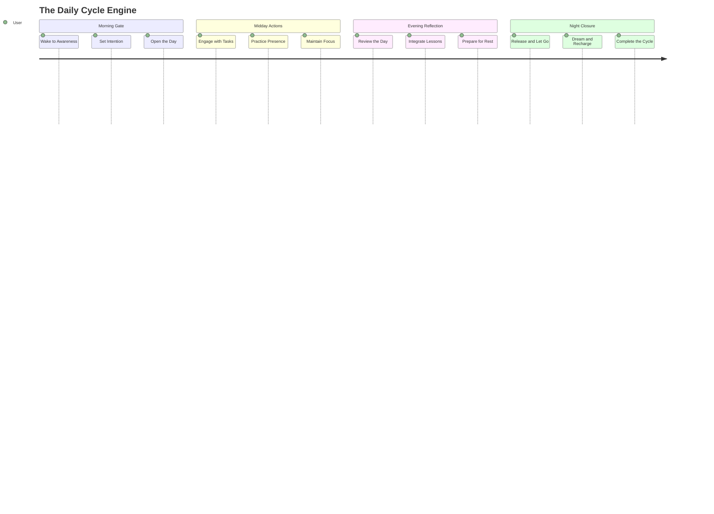

# Part 8: The Daily Cycle Engine

## The Rhythm of Conscious Living

The Daily Cycle Engine orchestrates ConsciousOS as a living, breathing system that aligns with the natural rhythms of human consciousness. Like the rising and setting of the sun, each day unfolds through four distinct phases—each acting as a threshold (or "gate") that guides the user from one state of awareness to the next.

This cyclic design ensures that growth isn't random but follows a deliberate, time-based progression that mirrors how consciousness naturally expands and contracts throughout the day.

## 1. Morning Gate: The Threshold of Awakening

The Morning Gate is the portal through which users enter each new day with intention and awareness. Like a spiritual dawn, this phase gently transitions from sleep to conscious engagement.

### How it Works
- **Time Window**: Typically 5am–12pm, though customizable based on user preferences
- **Entry Point**: Triggered by the first app interaction of the day
- **Core Experience**: A personalized Guru conversation that replaces traditional wizards
- **Key Elements**:
  - Warm, context-aware greeting based on user level and streak
  - Mood and energy assessment through natural dialogue
  - Intention setting tied to current curriculum or personal goals
  - Seamless data collection that feeds into task generation

### The Gatekeeper Mechanism
The Morning Gate acts as a guardrail to ensure users don't skip this critical foundation. Until morning practices are complete:
- Users can't access full task chains or premium features
- The Home screen displays a focused Morning Gate interface
- Gentle reminders are sent if the gate remains unopened past the user's preferred time

## 2. Midday Actions: The Rhythm of Engagement

Midday is the phase of active engagement, where intention meets action. This is the "working phase" of the daily cycle, designed to maintain awareness amidst the busyness of life.

### The Presence Card
A constant companion during this phase is the Presence Card—an elegant, unobtrusive interface element that:
- Indicates completion status of morning practices
- Shows if at least one task has been completed
- Displays a reminder of the day's theme or lesson
- Provides quick access to midday reflection prompts

### Level-Based Task Chains
Tasks are strategically distributed based on user level:
- **Levels 1-3 (The Crack)**: 3 tasks/day—building foundational awareness
- **Levels 4-6 (The Witness)**: 4 tasks/day—deepening observation skills
- **Levels 7-9 (The Mirror)**: 5 tasks/day—fostering self-reflection
- **Levels 10-12 (The Gap)**: 6 tasks/day—expanding consciousness
- **Levels 13-15 (The Space)**: 5 tasks/day—embracing awareness
- **Levels 16-18 (Dissolution)**: 4 tasks/day—letting go of attachments
- **Levels 19-20 (Embodiment)**: 3 tasks/day—integrating wisdom
- **Level 21**: 0 tasks/day—no structure needed (conscious living is effortless)

### Domain Distribution
Tasks are carefully assigned to match midday energy levels:
- **Work & Productivity**: Tasks focused on mindful work practices
- **Mental Clarity**: Exercises for focus and concentration
- **Habit Formation**: Activities to strengthen positive routines
- **Social Connection**: Practices for conscious communication

## 3. Evening Reflection: The Sandhya of Integration

The Evening Reflection phase is the "sandhya"—the sacred twilight time when day transitions to night. This is the phase of integration, where the day's experiences are processed and transformed into wisdom.

### Deep Guru Conversation
The centerpiece is a profound Guru interaction that:
- Reviews the entire day with full context from morning, tasks, and journal entries
- Asks level-specific reflective questions to deepen insight
- Updates capacity markers based on daily performance
- Provides feedback on progress toward goals

### Tomorrow Glimpse
To foster continuity, users receive a "tomorrow glimpse":
- Preview of tomorrow's theme or lesson
- Level progress update and next steps
- Suggested night practices for optimal rest

### Integration Practices
During this phase, users engage with reflective domains:
- **Emotional Integration**: Processing feelings from the day
- **Self-Inquiry**: Questioning beliefs and patterns
- **Body Awareness**: Relaxation and release practices
- **Gratitude**: Cultivating appreciation for life's blessings

## 4. Night Closure: The Gateway to Restoration

Night Closure is the final threshold that completes the daily cycle. Like the closing of a temple at night, this phase prepares consciousness for rest and renewal.

### Night Mode Card
A dedicated interface element provides:
- Level-appropriate grounding exercises
- Breathwork and relaxation practices
- Body awareness and release techniques
- Gentle reminders to prepare for sleep

### Dream Journal
Recognizing the importance of dream consciousness:
- Quick capture interface for dream recall
- "Did you dream last night?" prompt (available 5am-9am)
- Dream entries feed into morning context for deeper insights
- Supports pattern recognition across nights

### The Cycle Completion Mechanism
The app ensures the cycle is properly closed through:
- A sense of ritual and completion
- Visual feedback that shows the cycle as "complete"
- Integration of night data into the next morning's context
- Streak protection for consistent cycle completion

## Ensuring Flow Completion

The Daily Cycle Engine employs sophisticated mechanisms to guide users through the complete flow without feeling forced or restrictive.

### Progressive Disclosure
Each phase is revealed only when the previous one is complete, creating a natural progression that feels intuitive rather than demanding.

### Contextual Reminders
Reminders are personalized based on user behavior:
- Sent at optimal times based on usage patterns
- Adapt to time zone and preferences
- Use gentle, encouraging language rather than alarms
- Can be customized or silenced

### Gamification Elements
Streaks, XP, and level progress create positive reinforcement:
- Consistently completing cycles builds longer streaks
- Each phase completion awards XP
- Level advancement requires consistent cycle participation
- Visual progress indicators show daily completion status

### Seamless Experience
The app minimizes friction through:
- Quick, focused interactions that fit into busy schedules
- Intuitive navigation that requires minimal decision-making
- Personalized content that matches user level and preferences
- Integration with external calendars and reminders

## The Cyclic Nature of Growth

The Daily Cycle Engine is more than just a schedule—it's a microcosm of the spiritual journey itself. Each day's cycle mirrors the larger arc of growth:
- **Morning**: Birth of intention (like spiritual awakening)
- **Midday**: Active engagement (like the spiritual path)
- **Evening**: Integration (like spiritual realization)
- **Night**: Rest and renewal (like spiritual dissolution and rebirth)

By aligning with this natural rhythm, ConsciousOS creates an environment where growth becomes effortless—a daily practice that gradually transforms consciousness from within.

The cycle never truly ends; each night's closure seeds the next morning's awakening, creating an infinite loop of conscious evolution.
