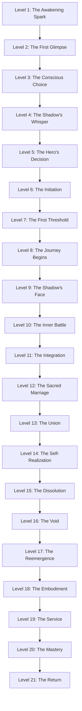

# Part 10: Gamification & Mystical Progression

## A Journey Map to Consciousness Evolution

> *"The journey of a thousand miles begins with a single step—but every step should feel like a revelation."*

---

## Table of Contents

1. [The Gamification Philosophy](#1-the-gamification-philosophy)
2. [The Level System: Stages of Awakening](#2-the-level-system-stages-of-awakening)
3. [Spiritual Currency: Points & XP as Transformation Units](#3-spiritual-currency-points--xp-as-transformation-units)
4. [Unlockable Features: Tools for the Journey](#4-unlockable-features-tools-for-the-journey)
5. [Personal Growth Metrics: The Language of Transformation](#5-personal-growth-metrics-the-language-of-transformation)
6. [The Psychology of Mystical Progression](#6-the-psychology-of-mystical-progression)
7. [Integration with the Consciousness Framework](#7-integration-with-the-consciousness-framework)

---

## 1. The Gamification Philosophy

ConsciousOS approaches gamification not as a tool for addiction or engagement, but as a **journey map for consciousness evolution**. It transforms the abstract and often intangible process of spiritual growth into a visible, measurable path that honors the user's unique trajectory while providing meaningful feedback and motivation.

### Core Principles

- **Not a Game, But a Journey**: The system is designed to feel like a pilgrimage, with each level representing a significant milestone in self-discovery.
- **Intrinsic Motivation First**: Rewards are tied to personal growth rather than external validation.
- **Respect for the Process**: Progress is non-linear and respects the user's unique pace of awakening.
- **Transparency**: The system explains *why* certain actions contribute to growth, fostering understanding rather than blind obedience.

### The Journey Map Metaphor

```
┌─────────────────────────────────────────────────────────────────────┐
│                          THE AWAKENING JOURNEY                        │
├─────────────────────────────────────────────────────────────────────┤
│                                                                      │
│  ┌──────────────┐  ┌──────────────┐  ┌──────────────┐  ┌──────────────┐  │
│  │  INITIATION  │  │  EXPLORATION │  │  TRANSFORMATION│  │  INTEGRATION │  │
│  │  (Level 1-7) │  │ (Level 8-14) │  │ (Level 15-21) │  │ (Level 22-28) │  │
│  └──────────────┘  └──────────────┘  └──────────────┘  └──────────────┘  │
│          │                │                │                │            │
│          ▼                ▼                ▼                ▼            │
│  ┌──────────────┐  ┌──────────────┐  ┌──────────────┐  ┌──────────────┐  │
│  │  SELF-AWARENESS│  │  SELF-MASTERY │  │  SELF-REALIZATION│  │  SELF-TRANSFORMATION│  │
│  └──────────────┘  └──────────────┘  └──────────────┘  └──────────────┘  │
│                                                                      │
└─────────────────────────────────────────────────────────────────────┘
```

---

## 2. The Level System: Stages of Awakening

The ConsciousOS level system is a **mystical progression framework** that maps to the 21 stages of vertical consciousness development (V-Levels) from the core framework. Each level represents a distinct stage of awakening, with its own challenges, lessons, and rewards.

### Level Structure

The system is divided into four primary arcs of development:

#### Arc 1: The Call to Adventure (Levels 1-7)
- **Focus**: Self-discovery and initial awareness
- **Key Challenges**: Breaking free from unconscious patterns, recognizing conditioning, and embracing the journey
- **Milestone Features**: Basic meditation guides, journaling tools, and pattern recognition

#### Arc 2: The Hero's Journey (Levels 8-14)
- **Focus**: Shadow work and psychological integration
- **Key Challenges**: Confronting inner demons, healing past traumas, and integrating conflicting aspects of self
- **Milestone Features**: Advanced shadow work exercises, dream analysis, and emotional intelligence tools

#### Arc 3: The Sacred Marriage (Levels 15-21)
- **Focus**: Unity consciousness and spiritual realization
- **Key Challenges**: Embracing non-duality, transcending ego, and recognizing the interconnectedness of all things
- **Milestone Features**: Advanced meditation techniques, consciousness expansion tools, and spiritual guidance

#### Arc 4: The Return (Levels 22-28)
- **Focus**: Integration and service
- **Key Challenges**: Bringing spiritual realization into daily life, serving others, and embodying awakened consciousness
- **Milestone Features**: Mentorship capabilities, community leadership tools, and wisdom sharing platforms

### Level Progression



---

## 3. Spiritual Currency: Points & XP as Transformation Units

In ConsciousOS, traditional points and XP are reimagined as **spiritual currency**—a measurable representation of the energy and intention invested in personal growth. This currency is not about competition or comparison, but about tracking the quality and consistency of practice.

### Types of Spiritual Currency

#### 1. Awareness Points (AP)
- **What They Measure**: Quality of present-moment awareness
- **How Earned**: Meditation, mindfulness exercises, conscious breathing
- **Significance**: Reflects the depth of conscious presence in daily life

#### 2. Integration Points (IP)
- **What They Measure**: Successful integration of insights into daily life
- **How Earned**: Shadow work, emotional processing, behavior change
- **Significance**: Indicates the degree to which spiritual insights are embodied

#### 3. Wisdom Points (WP)
- **What They Measure**: Deepening understanding and insight
- **How Earned**: Journaling, self-reflection, learning from challenges
- **Significance**: Represents the accumulation of spiritual knowledge and self-understanding

#### 4. Service Points (SP)
- **What They Measure**: Contribution to others' growth
- **How Earned**: Mentorship, community service, compassionate action
- **Significance**: Reflects the expansion of consciousness beyond the self

### The Currency of Transformation

```
┌─────────────────────────────────────────────────────────────────────┐
│                      SPIRITUAL CURRENCY SYSTEM                       │
├─────────────────────────────────────────────────────────────────────┤
│                                                                      │
│  ┌──────────────┐  ┌──────────────┐  ┌──────────────┐  ┌──────────────┐  │
│  │ AWARENESS    │  │ INTEGRATION  │  │ WISDOM       │  │ SERVICE      │  │
│  │ POINTS (AP)  │  │ POINTS (IP)  │  │ POINTS (WP)  │  │ POINTS (SP)  │  │
│  └──────────────┘  └──────────────┘  └──────────────┘  └──────────────┘  │
│          │                │                │                │            │
│          ▼                ▼                ▼                ▼            │
│  ┌───────────────────────────────────────────────────────────────┐    │
│  │                     CONSCIOUSNESS XP                          │    │
│  │  Total XP = (AP × 0.3) + (IP × 0.4) + (WP × 0.2) + (SP × 0.1) │    │
│  └───────────────────────────────────────────────────────────────┘    │
│                                                                      │
└─────────────────────────────────────────────────────────────────────┘
```

---

## 4. Unlockable Features: Tools for the Journey

Each level unlocks new features and capabilities that serve the user's current stage of development. These features are not just "upgrades"—they are **tools for transformation** designed to meet the user where they are on their journey.

### Unlockable Feature Categories

#### 1. Awareness Tools
- **Level 1**: Basic guided meditation
- **Level 3**: Mindfulness reminders
- **Level 6**: Breathwork exercises
- **Level 10**: Body scan meditations
- **Level 15**: Advanced consciousness expansion techniques

#### 2. Integration Tools
- **Level 2**: Journaling prompts
- **Level 5**: Shadow work exercises
- **Level 8**: Dream analysis tools
- **Level 12**: Emotional processing frameworks
- **Level 18**: Trauma healing modalities

#### 3. Wisdom Tools
- **Level 4**: Personal growth articles
- **Level 7**: Spiritual teachings from various traditions
- **Level 11**: Symbolic analysis tools
- **Level 16**: Mystical literature
- **Level 21**: Advanced philosophical explorations

#### 4. Service Tools
- **Level 9**: Community discussion forums
- **Level 13**: Peer mentorship capabilities
- **Level 17**: Group meditation facilitation
- **Level 20**: Wisdom sharing platforms
- **Level 28**: Leadership training for spiritual communities

### The Unlock Tree

```mermaid
graph TD
    A[Level 1: Basic Meditation] --> B[Level 2: Journaling]
    B --> C[Level 3: Mindfulness Reminders]
    C --> D[Level 4: Growth Articles]
    D --> E[Level 5: Shadow Work]
    E --> F[Level 6: Breathwork]
    F --> G[Level 7: Spiritual Teachings]
    G --> H[Level 8: Dream Analysis]
    H --> I[Level 9: Community Forums]
    I --> J[Level 10: Body Scans]
    J --> K[Level 11: Symbolic Analysis]
    K --> L[Level 12: Emotional Processing]
    L --> M[Level 13: Peer Mentorship]
    M --> N[Level 14: ???]
    N --> O[Level 15: Advanced Consciousness]
    O --> P[Level 16: Mystical Literature]
    P --> Q[Level 17: Group Meditation]
    Q --> R[Level 18: Trauma Healing]
    R --> S[Level 19: ???]
    S --> T[Level 20: Wisdom Sharing]
    T --> U[Level 21: Advanced Philosophy]
    U --> V[Level 22: ???]
    V --> W[Level 23: ???]
    W --> X[Level 24: ???]
    X --> Y[Level 25: ???]
    Y --> Z[Level 26: ???]
    Z --> AA[Level 27: ???]
    AA --> AB[Level 28: Leadership Training]
```



---

## 5. Personal Growth Metrics: The Language of Transformation

ConsciousOS measures personal growth through a sophisticated system of **mystical metrics**—quantifiable indicators of spiritual development that go beyond traditional self-help measurements.

### Core Metrics

#### 1. Presence Quotient (PQ)
- **What It Measures**: The percentage of time spent in conscious awareness
- **Calculation**: Based on meditation frequency, mindfulness practice, and real-time awareness indicators
- **Range**: 0-100 (0 = completely unconscious, 100 = fully present)

#### 2. Integration Index (II)
- **What It Measures**: How well insights are integrated into daily life
- **Calculation**: Based on behavior change, emotional regulation, and consistency of practice
- **Range**: 0-100 (0 = no integration, 100 = fully embodied)

#### 3. Wisdom Quotient (WQ)
- **What It Measures**: Depth of spiritual understanding and insight
- **Calculation**: Based on journaling quality, reflection depth, and application of teachings
- **Range**: 0-100 (0 = no wisdom, 100 = profound understanding)

#### 4. Service Index (SI)
- **What It Measures**: Contribution to others' spiritual growth
- **Calculation**: Based on mentorship, community participation, and compassionate action
- **Range**: 0-100 (0 = no service, 100 = selfless service)

### The Growth Dashboard

```
┌─────────────────────────────────────────────────────────────────────┐
│                       PERSONAL GROWTH DASHBOARD                      │
├─────────────────────────────────────────────────────────────────────┤
│                                                                      │
│  ┌──────────────┐  ┌──────────────┐  ┌──────────────┐  ┌──────────────┐  │
│  │ PRESENCE     │  │ INTEGRATION  │  │ WISDOM       │  │ SERVICE      │  │
│  │ QUOTIENT     │  │ INDEX        │  │ QUOTIENT     │  │ INDEX        │  │
│  │ (PQ: 78)     │  │ (II: 65)     │  │ (WQ: 82)     │  │ (SI: 45)     │  │
│  └──────────────┘  └──────────────┘  └──────────────┘  └──────────────┘  │
│          │                │                │                │            │
│          ▼                ▼                ▼                ▼            │
│  ┌───────────────────────────────────────────────────────────────┐    │
│  │                   CONSCIOUSNESS SCORE                         │    │
│  │  Total: 72/100 | Next Level: 85 XP needed                     │    │
│  └───────────────────────────────────────────────────────────────┘    │
│                                                                      │
└─────────────────────────────────────────────────────────────────────┘
```

### Temporal Metrics

ConsciousOS also tracks growth over time, providing users with a **spiritual timeline** of their journey:

- **Daily Progress**: Tracking consistency of practice
- **Weekly Trends**: Identifying patterns and cycles
- **Monthly Milestones**: Recognizing significant breakthroughs
- **Yearly Transformations**: Seeing the big picture of growth

---

## 6. The Psychology of Mystical Progression

The gamification system is rooted in **positive psychology and behavioral economics**, but adapted for spiritual growth. Key principles include:

### 1. The Progress Principle
- **How It Works**: Small, visible wins create motivation and momentum
- **Application**: Daily check-ins, progress bars, and milestone celebrations

### 2. The Goldilocks Principle
- **How It Works**: Challenges should be neither too easy nor too hard
- **Application**: Adaptive difficulty in exercises and personalized challenges

### 3. The Social Proof Principle
- **How It Works**: Seeing others' progress creates motivation
- **Application**: Anonymous community progress tracking and peer support

### 4. The Scarcity Principle
- **How It Works**: Limited-time opportunities create urgency
- **Application**: Seasonal challenges and time-sensitive spiritual practices

### 5. The Endowment Effect
- **How It Works**: People value things more when they've earned them
- **Application**: Unlockable features and personalized rewards

---

## 7. Integration with the Consciousness Framework

The gamification system is deeply integrated with the core consciousness framework, ensuring that every level, point, and unlockable feature aligns with the user's unique journey.

### Multi-Dimensional Progression

Users progress simultaneously across three dimensions:

1. **Vertical Levels (V-Levels)**: Stages of consciousness evolution
2. **Horizontal Capacities (H-Levels)**: Areas of personal development
3. **Life Domains**: Specific life areas (career, relationships, health, etc.)

### The Interconnected Web of Growth

```
┌─────────────────────────────────────────────────────────────────────┐
│                  THE INTERCONNECTED GROWTH WEB                       │
├─────────────────────────────────────────────────────────────────────┤
│                                                                      │
│  ┌──────────────┐  ┌──────────────┐  ┌──────────────┐  ┌──────────────┐  │
│  │ V-LEVELS:    │  │ H-LEVELS:    │  │ DOMAINS:     │  │ GAMIFICATION:│  │
│  │ Consciousness│  │ Capacities   │  │ Life Areas   │  │ Levels & XP  │  │
│  │ Stages       │  │ (12)         │  │ (9)          │  │              │  │
│  └──────────────┘  └──────────────┘  └──────────────┘  └──────────────┘  │
│          │                │                │                │            │
│          └────────────────┼────────────────┼────────────────┘            │
│                           ▼                                               │
│  ┌───────────────────────────────────────────────────────────────┐    │
│  │                     PERSONAL GROWTH MODEL                     │    │
│  │  Each dimension influences and is influenced by the others     │    │
│  └───────────────────────────────────────────────────────────────┘    │
│                                                                      │
└─────────────────────────────────────────────────────────────────────┘
```

### Adaptive Progression

The system adapts to the user's unique pace and style of learning:

- **Personalized Challenges**: Based on individual strengths and weaknesses
- **Dynamic Difficulty**: Adjusts based on user performance
- **Flexible Timelines**: Respects the user's unique rhythm of growth

---

## Conclusion

ConsciousOS's gamification system is more than just a way to track progress—it's a **map to the inner territory of consciousness**. By translating spiritual growth into tangible, visible progress, it makes the journey of awakening more accessible, engaging, and meaningful.

The system honors the ancient wisdom that transformation is a personal, non-linear journey while providing the structure and motivation needed for modern seekers. It is a testament to the platform's core philosophy: **technology serving awakening**.

As users progress through levels, earn spiritual currency, and unlock new features, they are not just playing a game—they are embarking on a profound journey of self-discovery that has the potential to transform every aspect of their lives.

---

> *"The journey inward is the most important journey you will ever take. ConsciousOS is your guide, your map, and your companion on this sacred path."*