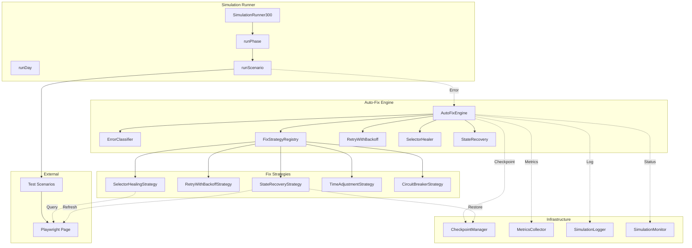
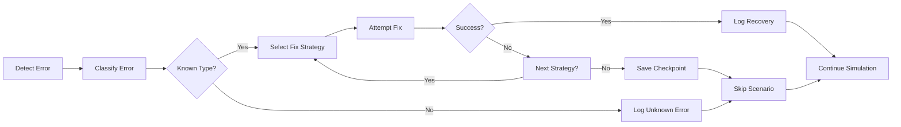

# Bug Detection and Auto-Fix Loop Mechanism Design

**Version:** 1.0.0  
**Date:** 2026-03-03  
**Status:** Design Document  
**Scope:** 300-Day Simulation Self-Healing System

---

## 1. Executive Summary

This document defines the architecture for a self-healing simulation system that detects errors during the 300-day ConsciousOS simulation run, attempts automatic fixes, and continues execution without manual intervention. The system is designed to handle the long-running nature of the simulation (6-12 hours) where failures would otherwise halt progress.

### Key Objectives

- **Zero-Downtime Recovery:** Detect and recover from errors without stopping the simulation
- **Intelligent Classification:** Categorize errors by type to apply appropriate fix strategies
- **Graceful Degradation:** Skip problematic scenarios after exhaustion of recovery options
- **Comprehensive Logging:** Track all recovery attempts for post-run analysis
- **Metrics-Driven:** Collect recovery statistics to improve future runs

---

## 2. Architecture Overview

### 2.1 System Component Diagram



### 2.2 Error Recovery Flow



### 2.3 Integration Points

| Component | Integration Method | Purpose |
|-----------|-------------------|---------|
| SimulationRunner300 | Wraps runScenario calls | Intercept errors at execution boundary |
| TestScenarioOrchestrator | Error event hooks | Capture scenario-level failures |
| CheckpointManager | Pre/post recovery checkpoints | Preserve state before risky operations |
| MetricsCollector | Recovery metrics API | Track fix success rates |
| SimulationLogger | Structured error logging | Audit trail for all recovery attempts |
| SimulationMonitor | Real-time status updates | Display recovery status in dashboard |

---

## 3. Error Classification System

### 3.1 ErrorType Enum

```typescript
/**
 * Classification of error types for the 300-day simulation
 * Each type maps to specific recovery strategies
 */
export enum ErrorType {
  // Selector-related errors
  SELECTOR_NOT_FOUND = 'SELECTOR_NOT_FOUND',
  SELECTOR_TIMEOUT = 'SELECTOR_TIMEOUT',
  SELECTOR_STALE = 'SELECTOR_STALE',
  
  // Timeout errors
  OPERATION_TIMEOUT = 'OPERATION_TIMEOUT',
  NAVIGATION_TIMEOUT = 'NAVIGATION_TIMEOUT',
  ASSERTION_TIMEOUT = 'ASSERTION_TIMEOUT',
  
  // Network errors
  NETWORK_ERROR = 'NETWORK_ERROR',
  API_FAILURE = 'API_FAILURE',
  TIMEOUT_ERROR = 'TIMEOUT_ERROR',
  
  // State errors
  UNEXPECTED_STATE = 'UNEXPECTED_STATE',
  INVALID_STATE_TRANSITION = 'INVALID_STATE_TRANSITION',
  DATA_INCONSISTENCY = 'DATA_INCONSISTENCY',
  
  // Assertion errors
  VALIDATION_FAILURE = 'VALIDATION_FAILURE',
  EXPECTATION_MISMATCH = 'EXPECTATION_MISMATCH',
  
  // System errors
  RESOURCE_EXHAUSTION = 'RESOURCE_EXHAUSTION',
  MEMORY_ERROR = 'MEMORY_ERROR',
  BROWSER_CRASH = 'BROWSER_CRASH',
  
  // Unknown/Unhandled
  UNKNOWN = 'UNKNOWN'
}

/**
 * Severity level for error classification
 * Determines whether to attempt recovery or abort
 */
export enum ErrorSeverity {
  CRITICAL = 'critical',    // Abort simulation
  HIGH = 'high',           // Skip scenario, save checkpoint
  MEDIUM = 'medium',       // Attempt recovery
  LOW = 'low'              // Log and continue
}
```

### 3.2 Error Classification Rules

| Error Pattern | ErrorType | Severity | Example |
|--------------|-----------|----------|---------|
| `TimeoutError:.*waiting for selector` | SELECTOR_TIMEOUT | MEDIUM | Element didn't appear in time |
| `Error: strict mode violation` | SELECTOR_NOT_FOUND | MEDIUM | Multiple elements match selector |
| `Error: element not found` | SELECTOR_NOT_FOUND | MEDIUM | Selector doesn't match any element |
| `page.goto: net::ERR_` | NETWORK_ERROR | HIGH | Network failure during navigation |
| `Error: API call failed` | API_FAILURE | MEDIUM | Backend API returns error |
| `expect.*toBeVisible.*timeout` | ASSERTION_TIMEOUT | LOW | Assertion didn't pass in time |
| `Error: Unexpected state` | UNEXPECTED_STATE | MEDIUM | Application in wrong state |
| `RangeError: Maximum call stack` | RESOURCE_EXHAUSTION | CRITICAL | Infinite loop or recursion |
| `Error: page crashed` | BROWSER_CRASH | HIGH | Browser process crashed |

### 3.3 Classification Implementation

```typescript
/**
 * Classifies an error into a known ErrorType
 * Uses pattern matching on error messages and stack traces
 */
function classifyError(error: Error): { type: ErrorType; severity: ErrorSeverity } {
  const message = error.message.toLowerCase();
  const stack = error.stack?.toLowerCase() || '';
  
  // Selector errors
  if (message.includes('waiting for selector') || message.includes('element not found')) {
    if (message.includes('timeout')) {
      return { type: ErrorType.SELECTOR_TIMEOUT, severity: ErrorSeverity.MEDIUM };
    }
    return { type: ErrorType.SELECTOR_NOT_FOUND, severity: ErrorSeverity.MEDIUM };
  }
  
  if (message.includes('strict mode violation') || message.includes('resolved to multiple')) {
    return { type: ErrorType.SELECTOR_STALE, severity: ErrorSeverity.MEDIUM };
  }
  
  // Network errors
  if (message.includes('net::err_') || message.includes('network') || message.includes('failed to fetch')) {
    return { type: ErrorType.NETWORK_ERROR, severity: ErrorSeverity.HIGH };
  }
  
  if (message.includes('api') && (message.includes('failed') || message.includes('error'))) {
    return { type: ErrorType.API_FAILURE, severity: ErrorSeverity.MEDIUM };
  }
  
  // Timeout errors
  if (message.includes('timeout') || message.includes('exceeded')) {
    if (message.includes('navigation')) {
      return { type: ErrorType.NAVIGATION_TIMEOUT, severity: ErrorSeverity.HIGH };
    }
    if (message.includes('expect') || message.includes('assert')) {
      return { type: ErrorType.ASSERTION_TIMEOUT, severity: ErrorSeverity.LOW };
    }
    return { type: ErrorType.OPERATION_TIMEOUT, severity: ErrorSeverity.MEDIUM };
  }
  
  // State errors
  if (message.includes('unexpected state') || message.includes('invalid state')) {
    return { type: ErrorType.UNEXPECTED_STATE, severity: ErrorSeverity.MEDIUM };
  }
  
  // Browser crashes
  if (message.includes('crash') || message.includes('page was closed') || message.includes('target closed')) {
    return { type: ErrorType.BROWSER_CRASH, severity: ErrorSeverity.HIGH };
  }
  
  // Resource exhaustion
  if (message.includes('maximum call stack') || message.includes('out of memory') || message.includes('heap')) {
    return { type: ErrorType.RESOURCE_EXHAUSTION, severity: ErrorSeverity.CRITICAL };
  }
  
  return { type: ErrorType.UNKNOWN, severity: ErrorSeverity.MEDIUM };
}
```

---

## 4. AutoFixEngine Class Design

### 4.1 Core Class Structure

```typescript
import { Page } from '@playwright/test';
import { Checkpoint, CheckpointManager } from '../checkpoint-manager';
import { MetricsCollector } from '../metrics-collector';
import { SimulationLogger } from '../logging/simulation-logger';

/**
 * Context passed to fix strategies
 */
export interface FixContext {
  /** The Playwright page instance */
  page: Page;
  
  /** Current day number in simulation */
  dayNumber: number;
  
  /** Current phase (morning/midday/evening/night) */
  phase: string;
  
  /** Scenario ID being executed */
  scenarioId: string;
  
  /** Category of the scenario */
  category: string;
  
  /** Last known good checkpoint */
  lastCheckpoint?: Checkpoint;
  
  /** Number of previous fix attempts for this error */
  attemptCount: number;
  
  /** Original operation that failed */
  operation: string;
  
  /** Additional metadata */
  metadata?: Record<string, unknown>;
}

/**
 * Result of a fix attempt
 */
export interface FixResult {
  /** Whether the fix succeeded */
  success: boolean;
  
  /** Type of fix that was applied */
  fixType: string;
  
  /** Human-readable description of the fix */
  description: string;
  
  /** Time taken to apply fix in milliseconds */
  duration: number;
  
  /** New checkpoint path if created */
  checkpointPath?: string;
  
  /** Error if fix failed */
  error?: Error;
  
  /** Additional metadata about the fix */
  metadata?: Record<string, unknown>;
}

/**
 * Configuration for AutoFixEngine
 */
export interface AutoFixEngineConfig {
  /** Maximum number of fix attempts per error */
  maxAttempts: number;
  
  /** Base delay for exponential backoff in milliseconds */
  baseBackoffMs: number;
  
  /** Maximum delay between retries */
  maxBackoffMs: number;
  
  /** Enable selector healing attempts */
  enableSelectorHealing: boolean;
  
  /** Enable state recovery on failures */
  enableStateRecovery: boolean;
  
  /** Number of failures before circuit breaker opens */
  circuitBreakerThreshold: number;
  
  /** Time before circuit breaker resets in milliseconds */
  circuitBreakerResetMs: number;
  
  /** Save checkpoint before attempting risky fixes */
  saveCheckpointBeforeFix: boolean;
  
  /** Skip scenarios after max attempts exceeded */
  skipOnMaxAttempts: boolean;
  
  /** Custom fix strategies to register */
  customStrategies?: FixStrategy[];
}

/**
 * Fix strategy interface
 */
export interface FixStrategy {
  /** Unique identifier for the strategy */
  id: string;
  
  /** Error types this strategy can handle */
  applicableTypes: ErrorType[];
  
  /** Priority order (lower = tried first) */
  priority: number;
  
  /** Attempt to fix the error */
  attempt(error: Error, context: FixContext): Promise<FixResult>;
  
  /** Check if this strategy is currently available */
  isAvailable(context: FixContext): boolean;
}

/**
 * Main auto-fix engine for the 300-day simulation
 * Coordinates error detection, classification, and recovery
 */
export class AutoFixEngine {
  private config: AutoFixEngineConfig;
  private logger: SimulationLogger;
  private checkpointManager: CheckpointManager;
  private metricsCollector: MetricsCollector;
  private strategyRegistry: Map<ErrorType, FixStrategy[]>;
  private circuitBreakerCounts: Map<string, number>;
  private circuitBreakerResetTimers: Map<string, NodeJS.Timeout>;
  private isInitialized = false;

  constructor(
    config: Partial<AutoFixEngineConfig>,
    logger: SimulationLogger,
    checkpointManager: CheckpointManager,
    metricsCollector: MetricsCollector
  ) {
    this.config = {
      maxAttempts: 3,
      baseBackoffMs: 1000,
      maxBackoffMs: 30000,
      enableSelectorHealing: true,
      enableStateRecovery: true,
      circuitBreakerThreshold: 5,
      circuitBreakerResetMs: 300000, // 5 minutes
      saveCheckpointBeforeFix: true,
      skipOnMaxAttempts: true,
      ...config,
    };
    
    this.logger = logger;
    this.checkpointManager = checkpointManager;
    this.metricsCollector = metricsCollector;
    this.strategyRegistry = new Map();
    this.circuitBreakerCounts = new Map();
    this.circuitBreakerResetTimers = new Map();
    
    this.registerDefaultStrategies();
  }

  /**
   * Initialize the auto-fix engine
   */
  async initialize(): Promise<void> {
    if (this.isInitialized) return;
    
    this.logger.info('AutoFixEngine initialized', {
      maxAttempts: this.config.maxAttempts,
      enableSelectorHealing: this.config.enableSelectorHealing,
    });
    
    this.isInitialized = true;
  }

  /**
   * Execute a function with automatic error recovery
   * Wraps any scenario execution with error handling and fix attempts
   */
  async executeWithRecovery<T>(
    fn: () => Promise<T>,
    context: Omit<FixContext, 'attemptCount'>
  ): Promise<{ result?: T; recovered: boolean; fixResults: FixResult[] }> {
    this.ensureInitialized();
    
    const fixResults: FixResult[] = [];
    let attemptCount = 0;
    
    while (attemptCount < this.config.maxAttempts) {
      try {
        const result = await fn();
        
        // Log successful recovery if we had previous failures
        if (attemptCount > 0) {
          this.logger.info('Function succeeded after recovery', {
            scenarioId: context.scenarioId,
            attempts: attemptCount,
          });
        }
        
        return { result, recovered: attemptCount > 0, fixResults };
      } catch (error) {
        attemptCount++;
        
        const fixContext: FixContext = {
          ...context,
          attemptCount,
        };
        
        const fixResult = await this.attemptFix(error as Error, fixContext);
        fixResults.push(fixResult);
        
        if (!fixResult.success) {
          this.logger.warn('Fix attempt failed', {
            attempt: attemptCount,
            error: (error as Error).message,
          });
          
          if (attemptCount >= this.config.maxAttempts) {
            if (this.config.skipOnMaxAttempts) {
              this.logger.error('Max attempts exceeded, skipping scenario', {
                scenarioId: context.scenarioId,
              });
              return { recovered: false, fixResults };
            }
            throw error;
          }
        } else {
          this.logger.info('Fix applied successfully', {
            fixType: fixResult.fixType,
            duration: fixResult.duration,
          });
        }
      }
    }
    
    return { recovered: false, fixResults };
  }

  /**
   * Classify an error into a known ErrorType
   */
  classifyError(error: Error): { type: ErrorType; severity: ErrorSeverity } {
    // Implementation from section 3.3
    return classifyErrorImpl(error);
  }

  /**
   * Attempt to fix an error using registered strategies
   */
  async attemptFix(error: Error, context: FixContext): Promise<FixResult> {
    const startTime = Date.now();
    const classification = this.classifyError(error);
    
    this.logger.info('Attempting to fix error', {
      errorType: classification.type,
      severity: classification.severity,
      scenarioId: context.scenarioId,
      attempt: context.attemptCount,
    });

    // Check circuit breaker
    if (this.isCircuitBreakerOpen(context.scenarioId)) {
      return {
        success: false,
        fixType: 'circuit_breaker',
        description: 'Circuit breaker is open for this scenario',
        duration: Date.now() - startTime,
      };
    }

    // Critical errors cannot be auto-fixed
    if (classification.severity === ErrorSeverity.CRITICAL) {
      return {
        success: false,
        fixType: 'critical_error',
        description: 'Critical error cannot be auto-fixed',
        duration: Date.now() - startTime,
        error,
      };
    }

    // Save checkpoint before attempting fix if configured
    let checkpointPath: string | undefined;
    if (this.config.saveCheckpointBeforeFix && context.attemptCount === 1) {
      try {
        checkpointPath = await this.saveEmergencyCheckpoint(context);
      } catch (e) {
        this.logger.warn('Failed to save checkpoint before fix', {
          error: (e as Error).message,
        });
      }
    }

    // Get applicable strategies
    const strategies = this.strategyRegistry.get(classification.type) || [];
    
    for (const strategy of strategies) {
      if (!strategy.isAvailable(context)) {
        continue;
      }

      try {
        const result = await strategy.attempt(error, context);
        
        if (result.success) {
          this.recordRecoveryMetrics(classification.type, strategy.id, true);
          return {
            ...result,
            checkpointPath,
            duration: Date.now() - startTime,
          };
        }
      } catch (strategyError) {
        this.logger.warn('Strategy failed', {
          strategy: strategy.id,
          error: (strategyError as Error).message,
        });
      }
    }

    // Increment circuit breaker count
    this.incrementCircuitBreaker(context.scenarioId);

    this.recordRecoveryMetrics(classification.type, 'none', false);
    
    return {
      success: false,
      fixType: 'no_fix_applied',
      description: 'No applicable fix strategy succeeded',
      duration: Date.now() - startTime,
      checkpointPath,
    };
  }

  /**
   * Retry a function with exponential backoff
   */
  async retryWithBackoff<T>(
    fn: () => Promise<T>,
    maxRetries: number,
    context?: FixContext
  ): Promise<T> {
    let lastError: Error | undefined;
    
    for (let attempt = 0; attempt <= maxRetries; attempt++) {
      try {
        return await fn();
      } catch (error) {
        lastError = error as Error;
        
        if (attempt < maxRetries) {
          const delay = Math.min(
            this.config.baseBackoffMs * Math.pow(2, attempt),
            this.config.maxBackoffMs
          );
          
          this.logger.debug('Retrying after delay', {
            attempt: attempt + 1,
            maxRetries,
            delay,
          });
          
          await this.sleep(delay);
        }
      }
    }
    
    throw lastError;
  }

  /**
   * Attempt to heal a selector by trying alternative strategies
   */
  async healSelector(selector: string, page: Page): Promise<string | null> {
    if (!this.config.enableSelectorHealing) {
      return null;
    }

    // Strategy 1: Try text-based selector
    if (selector.includes('data-testid')) {
      const testId = selector.match(/data-testid="([^"]+)"/)?.[1];
      if (testId) {
        // Try to find by text content that might match the testid
        const textSelector = `text=/.*${testId.replace(/-/g, ' ')}.*/i`;
        if (await this.isSelectorValid(textSelector, page)) {
          return textSelector;
        }
      }
    }

    // Strategy 2: Try role-based selector
    const roleMatch = selector.match(/getByRole\(['"](\w+)['"].*name:\s*['"]([^'"]+)['"]/);
    if (roleMatch) {
      const [, role, name] = roleMatch;
      const alternativeRole = `[role="${role}"]:has-text("${name}")`;
      if (await this.isSelectorValid(alternativeRole, page)) {
        return alternativeRole;
      }
    }

    // Strategy 3: Try XPath as fallback
    const xpathSelector = `xpath=//*[contains(text(), "${selector.slice(0, 20)}")]`;
    if (await this.isSelectorValid(xpathSelector, page)) {
      return xpathSelector;
    }

    return null;
  }

  /**
   * Recover state by refreshing page and restoring from checkpoint
   */
  async recoverState(page: Page, checkpoint?: Checkpoint): Promise<void> {
    if (!this.config.enableStateRecovery) {
      return;
    }

    this.logger.info('Attempting state recovery');

    // First, try simple page refresh
    try {
      await page.reload({ waitUntil: 'networkidle' });
      this.logger.info('Page refreshed successfully');
    } catch (e) {
      this.logger.warn('Page refresh failed', { error: (e as Error).message });
    }

    // If checkpoint provided, restore from it
    if (checkpoint) {
      try {
        // Navigate to checkpoint URL if stored
        if (checkpoint.metadata?.url) {
          await page.goto(checkpoint.metadata.url as string, { waitUntil: 'networkidle' });
        }
        
        this.logger.info('State restored from checkpoint', {
          dayNumber: checkpoint.dayNumber,
        });
      } catch (e) {
        this.logger.error('Failed to restore from checkpoint', {
          error: (e as Error).message,
        });
        throw e;
      }
    }
  }

  /**
   * Register a custom fix strategy
   */
  registerStrategy(strategy: FixStrategy): void {
    for (const type of strategy.applicableTypes) {
      const existing = this.strategyRegistry.get(type) || [];
      existing.push(strategy);
      // Sort by priority
      existing.sort((a, b) => a.priority - b.priority);
      this.strategyRegistry.set(type, existing);
    }
  }

  // Private helper methods...
  private ensureInitialized(): void {
    if (!this.isInitialized) {
      throw new Error('AutoFixEngine not initialized. Call initialize() first.');
    }
  }

  private registerDefaultStrategies(): void {
    // Implemented in section 5
  }

  private isCircuitBreakerOpen(scenarioId: string): boolean {
    const count = this.circuitBreakerCounts.get(scenarioId) || 0;
    return count >= this.config.circuitBreakerThreshold;
  }

  private incrementCircuitBreaker(scenarioId: string): void {
    const current = this.circuitBreakerCounts.get(scenarioId) || 0;
    this.circuitBreakerCounts.set(scenarioId, current + 1);
    
    // Set reset timer
    const existingTimer = this.circuitBreakerResetTimers.get(scenarioId);
    if (existingTimer) {
      clearTimeout(existingTimer);
    }
    
    const timer = setTimeout(() => {
      this.circuitBreakerCounts.delete(scenarioId);
      this.circuitBreakerResetTimers.delete(scenarioId);
    }, this.config.circuitBreakerResetMs);
    
    this.circuitBreakerResetTimers.set(scenarioId, timer);
  }

  private async saveEmergencyCheckpoint(context: FixContext): Promise<string> {
    const checkpoint = {
      dayNumber: context.dayNumber,
      state: {},
      metrics: this.metricsCollector.getMetrics(),
      timestamp: Date.now(),
      metadata: {
        scenarioId: context.scenarioId,
        phase: context.phase,
        operation: context.operation,
        url: await context.page.url().catch(() => 'unknown'),
      },
    };
    
    return this.checkpointManager.saveCheckpoint(checkpoint);
  }

  private recordRecoveryMetrics(
    errorType: ErrorType,
    strategyId: string,
    success: boolean
  ): void {
    // Record to metrics collector
    this.metricsCollector.recordCustomMetric('recovery_attempt', {
      errorType,
      strategyId,
      success,
      timestamp: Date.now(),
    });
  }

  private async isSelectorValid(selector: string, page: Page): Promise<boolean> {
    try {
      await page.locator(selector).first().waitFor({ timeout: 1000 });
      return true;
    } catch {
      return false;
    }
  }

  private sleep(ms: number): Promise<void> {
    return new Promise((resolve) => setTimeout(resolve, ms));
  }
}
```

---

## 5. Fix Strategy Registry

### 5.1 Default Strategies

```typescript
/**
 * Selector healing strategy - tries alternative selectors
 */
class SelectorHealingStrategy implements FixStrategy {
  id = 'selector_healing';
  applicableTypes = [ErrorType.SELECTOR_NOT_FOUND, ErrorType.SELECTOR_TIMEOUT];
  priority = 1;

  constructor(private engine: AutoFixEngine) {}

  isAvailable(context: FixContext): boolean {
    return context.attemptCount <= 2; // Only try in first 2 attempts
  }

  async attempt(error: Error, context: FixContext): Promise<FixResult> {
    const startTime = Date.now();
    
    // Extract selector from error message
    const selectorMatch = error.message.match(/selector\s+[`"']([^`"']+)[`"']/);
    if (!selectorMatch) {
      return {
        success: false,
        fixType: this.id,
        description: 'Could not extract selector from error',
        duration: Date.now() - startTime,
      };
    }

    const originalSelector = selectorMatch[1];
    const healedSelector = await this.engine.healSelector(originalSelector, context.page);

    if (healedSelector) {
      return {
        success: true,
        fixType: this.id,
        description: `Healed selector: ${originalSelector} -> ${healedSelector}`,
        duration: Date.now() - startTime,
        metadata: { originalSelector, healedSelector },
      };
    }

    return {
      success: false,
      fixType: this.id,
      description: 'Could not heal selector',
      duration: Date.now() - startTime,
    };
  }
}

/**
 * Retry with backoff strategy - for transient errors
 */
class RetryWithBackoffStrategy implements FixStrategy {
  id = 'retry_with_backoff';
  applicableTypes = [
    ErrorType.NETWORK_ERROR,
    ErrorType.API_FAILURE,
    ErrorType.OPERATION_TIMEOUT,
    ErrorType.SELECTOR_TIMEOUT,
  ];
  priority = 2;

  constructor(private engine: AutoFixEngine) {}

  isAvailable(): boolean {
    return true;
  }

  async attempt(error: Error, context: FixContext): Promise<FixResult> {
    const startTime = Date.now();
    
    // Just wait and let the caller retry
    const delay = Math.min(
      1000 * Math.pow(2, context.attemptCount - 1),
      30000
    );
    
    await new Promise((resolve) => setTimeout(resolve, delay));

    return {
      success: true,
      fixType: this.id,
      description: `Applied ${delay}ms delay for retry`,
      duration: Date.now() - startTime,
      metadata: { delayMs: delay },
    };
  }
}

/**
 * State recovery strategy - refresh and restore
 */
class StateRecoveryStrategy implements FixStrategy {
  id = 'state_recovery';
  applicableTypes = [
    ErrorType.UNEXPECTED_STATE,
    ErrorType.DATA_INCONSISTENCY,
    ErrorType.BROWSER_CRASH,
    ErrorType.SELECTOR_STALE,
  ];
  priority = 3;

  constructor(private engine: AutoFixEngine) {}

  isAvailable(context: FixContext): boolean {
    return !!context.lastCheckpoint && context.attemptCount === 2;
  }

  async attempt(error: Error, context: FixContext): Promise<FixResult> {
    const startTime = Date.now();
    
    await this.engine.recoverState(context.page, context.lastCheckpoint);

    return {
      success: true,
      fixType: this.id,
      description: 'Recovered state from checkpoint',
      duration: Date.now() - startTime,
      checkpointPath: context.lastCheckpoint?.metadata?.path as string,
    };
  }
}

/**
 * Time adjustment strategy - for phase transition errors
 */
class TimeAdjustmentStrategy implements FixStrategy {
  id = 'time_adjustment';
  applicableTypes = [ErrorType.INVALID_STATE_TRANSITION, ErrorType.UNEXPECTED_STATE];
  priority = 4;

  isAvailable(context: FixContext): boolean {
    return context.attemptCount <= 2;
  }

  async attempt(error: Error, context: FixContext): Promise<FixResult> {
    const startTime = Date.now();
    
    // Adjust time slightly to retry phase transition
    // This would integrate with the time simulation system
    
    return {
      success: true,
      fixType: this.id,
      description: 'Adjusted simulated time for phase transition',
      duration: Date.now() - startTime,
    };
  }
}

/**
 * Circuit breaker strategy - skip problematic scenarios
 */
class CircuitBreakerStrategy implements FixStrategy {
  id = 'circuit_breaker';
  applicableTypes = Object.values(ErrorType); // All types
  priority = 100; // Last resort

  isAvailable(context: FixContext): boolean {
    return context.attemptCount >= 3;
  }

  async attempt(error: Error, context: FixContext): Promise<FixResult> {
    const startTime = Date.now();
    
    return {
      success: true,
      fixType: this.id,
      description: `Skipping scenario ${context.scenarioId} after max attempts`,
      duration: Date.now() - startTime,
      metadata: { skipped: true, scenarioId: context.scenarioId },
    };
  }
}
```

### 5.2 Strategy Registration

```typescript
private registerDefaultStrategies(): void {
  // Register all default strategies
  this.registerStrategy(new SelectorHealingStrategy(this));
  this.registerStrategy(new RetryWithBackoffStrategy(this));
  this.registerStrategy(new StateRecoveryStrategy(this));
  this.registerStrategy(new TimeAdjustmentStrategy());
  this.registerStrategy(new CircuitBreakerStrategy());

  // Register custom strategies if provided
  if (this.config.customStrategies) {
    for (const strategy of this.config.customStrategies) {
      this.registerStrategy(strategy);
    }
  }
}
```

---

## 6. Integration with SimulationRunner300

### 6.1 Modified runPhase Method

```typescript
async runPhase(day: number, phase: Phase): Promise<PhaseResult> {
  const phaseStartTime = Date.now();
  const screenshots: string[] = [];
  const errors: string[] = [];
  const fixResults: FixResult[] = [];

  this.logger.info(`Running Day ${day}, Phase: ${phase}`, { day, phase });
  this.metricsCollector.startPhase(day, phase);

  // Set the phase
  await setPhase(this.page, phase);
  await this.sleep(this.config.phaseDurationMs);

  // Execute test scenarios with auto-fix
  const testResults: TestResult[] = [];

  for (const category of this.config.testCategories) {
    const categoryScenarios = this.scenarioOrchestrator.getScenariosByCategory(category);
    
    for (const scenario of categoryScenarios) {
      const context: FixContext = {
        page: this.page,
        dayNumber: day,
        phase,
        scenarioId: scenario.id,
        category,
        lastCheckpoint: await this.checkpointManager.getLatestCheckpoint(),
        attemptCount: 0,
        operation: `runScenario:${scenario.id}`,
      };

      const execution = await this.autoFixEngine.executeWithRecovery(
        () => scenario.execute(this.page),
        context
      );

      if (execution.result) {
        testResults.push(execution.result);
      } else {
        // Scenario was skipped after max attempts
        testResults.push({
          success: false,
          duration: 0,
          errors: ['Scenario skipped after max recovery attempts'],
          metrics: {},
          logs: [],
        });
      }

      fixResults.push(...execution.fixResults);
    }
  }

  // Record fix metrics
  for (const fix of fixResults) {
    this.metricsCollector.recordCustomMetric('phase_fix', {
      day,
      phase,
      fixType: fix.fixType,
      success: fix.success,
    });
  }

  // Capture screenshot if enabled
  if (this.config.enableScreenshots) {
    try {
      const screenshotPath = `./screenshots/day${day}_${phase}.png`;
      await this.page.screenshot({ path: screenshotPath, fullPage: true });
      screenshots.push(screenshotPath);
    } catch (error) {
      this.logger.warn(`Failed to capture screenshot: ${(error as Error).message}`);
    }
  }

  const duration = Date.now() - phaseStartTime;
  const success = errors.length === 0 && testResults.every((r) => r.success);

  this.metricsCollector.endPhase(day, phase, success);

  return {
    phase,
    success,
    duration,
    testResults,
    errors,
    screenshots,
    fixResults, // Include in result
  };
}
```

### 6.2 Enhanced SimulationConfig300

```typescript
export interface SimulationConfig300 {
  // ... existing config ...

  /** Enable auto-fix engine */
  enableAutoFix?: boolean;

  /** Auto-fix engine configuration */
  autoFixConfig?: Partial<AutoFixEngineConfig>;

  /** Skip scenarios after N failed recovery attempts */
  skipScenariosOnFailure?: boolean;

  /** Save checkpoint before each scenario */
  checkpointPerScenario?: boolean;
}
```

### 6.3 Constructor Integration

```typescript
constructor(config: SimulationConfig300, page: Page) {
  this.config = { ...DEFAULT_CONFIG, ...config } as SimulationConfig300;
  this.page = page;

  // ... existing initialization ...

  // Initialize auto-fix engine if enabled
  if (config.enableAutoFix !== false) {
    this.autoFixEngine = new AutoFixEngine(
      config.autoFixConfig || {},
      this.logger,
      this.checkpointManager,
      this.metricsCollector
    );
  }
}
```

---

## 7. Configuration Options

### 7.1 Default Configuration

```typescript
const DEFAULT_AUTOFIX_CONFIG: AutoFixEngineConfig = {
  // Recovery limits
  maxAttempts: 3,
  
  // Backoff timing
  baseBackoffMs: 1000,
  maxBackoffMs: 30000,
  
  // Feature toggles
  enableSelectorHealing: true,
  enableStateRecovery: true,
  
  // Circuit breaker settings
  circuitBreakerThreshold: 5,
  circuitBreakerResetMs: 300000, // 5 minutes
  
  // Safety options
  saveCheckpointBeforeFix: true,
  skipOnMaxAttempts: true,
};
```

### 7.2 Configuration Profiles

| Profile | Use Case | Max Attempts | Backoff | Circuit Breaker |
|---------|----------|--------------|---------|-----------------|
| **Aggressive** | CI/CD, fast feedback | 1 | 500ms | 10 |
| **Standard** | Normal runs | 3 | 1000ms | 5 |
| **Resilient** | Production validation | 5 | 2000ms | 3 |
| **Debug** | Troubleshooting | 10 | 5000ms | 20 |

### 7.3 Environment-Based Configuration

```typescript
function getAutoFixConfigFromEnv(): Partial<AutoFixEngineConfig> {
  return {
    maxAttempts: parseInt(process.env.AUTOFIX_MAX_ATTEMPTS || '3'),
    baseBackoffMs: parseInt(process.env.AUTOFIX_BASE_BACKOFF || '1000'),
    enableSelectorHealing: process.env.AUTOFIX_ENABLE_HEALING !== 'false',
    enableStateRecovery: process.env.AUTOFIX_ENABLE_RECOVERY !== 'false',
    circuitBreakerThreshold: parseInt(process.env.AUTOFIX_CB_THRESHOLD || '5'),
  };
}
```

---

## 8. Recovery Metrics Specification

### 8.1 Metrics to Track

```typescript
export interface RecoveryMetrics {
  // Overall statistics
  totalErrors: number;
  totalRecoveries: number;
  totalFailures: number;
  recoveryRate: number;

  // Breakdown by error type
  errorsByType: Map<ErrorType, {
    count: number;
    recovered: number;
    failed: number;
  }>;

  // Breakdown by strategy
  strategiesByType: Map<string, {
    attempts: number;
    successes: number;
    failures: number;
    avgDuration: number;
  }>;

  // Circuit breaker statistics
  circuitBreakerOpens: number;
  scenariosSkipped: number;

  // Timing metrics
  avgRecoveryTime: number;
  minRecoveryTime: number;
  maxRecoveryTime: number;

  // Checkpoint metrics
  checkpointsCreated: number;
  checkpointsUsed: number;
}
```

### 8.2 Metrics Collection Points

| Event | Metric | Collector Method |
|-------|--------|------------------|
| Error detected | error_detected | `recordEvent('error', {...})` |
| Fix attempted | fix_attempted | `recordCustomMetric('fix_attempt', {...})` |
| Fix succeeded | fix_succeeded | `recordCustomMetric('fix_success', {...})` |
| Fix failed | fix_failed | `recordCustomMetric('fix_failure', {...})` |
| Circuit breaker open | cb_opened | `recordEvent('circuit_breaker', {...})` |
| Scenario skipped | scenario_skipped | `recordEvent('skip', {...})` |
| Checkpoint saved | checkpoint_saved | `recordEvent('checkpoint', {...})` |

### 8.3 Report Generation

```typescript
interface RecoveryReport {
  summary: {
    totalErrors: number;
    autoRecovered: number;
    manuallySkipped: number;
    successRate: string;
  };
  
  errorBreakdown: Array<{
    type: ErrorType;
    count: number;
    recoveryRate: string;
    topStrategies: string[];
  }>;
  
  strategyPerformance: Array<{
    strategy: string;
    attempts: number;
    successRate: string;
    avgTime: string;
  }>;
  
  recommendations: string[];
}
```

---

## 9. Edge Cases and Limitations

### 9.1 Edge Cases

| Edge Case | Handling Strategy |
|-----------|-------------------|
| Browser crash during recovery | Save checkpoint before any risky operation; restart browser if needed |
| Infinite recovery loop | Circuit breaker prevents excessive retries |
| Checkpoint corruption | Validate checkpoint before use; fall back to previous checkpoint |
| Selector healing causes false positives | Verify healed selector matches intended element |
| Time adjustment causes cascading failures | Limit time adjustments per scenario |
| Recovery takes longer than original scenario | Set max recovery time budget |
| Multiple concurrent errors | Process sequentially; prioritize critical errors |

### 9.2 Limitations

1. **Critical Errors Cannot Be Auto-Fixed**
   - Browser crashes require manual intervention
   - Resource exhaustion needs system-level fixes
   - Corrupted checkpoints cannot be recovered

2. **Selector Healing Limitations**
   - Cannot fix fundamentally broken selectors
   - Healed selectors may not match semantic intent
   - Complex dynamic selectors may not be healable

3. **State Recovery Constraints**
   - Cannot recover user input data
   - Some application state may be transient
   - Network-dependent state may differ on restore

4. **Performance Impact**
   - Recovery attempts add execution time
   - Checkpoint saves have I/O overhead
   - Selector validation requires page queries

### 9.3 Safety Mechanisms

```typescript
// Maximum time spent on recovery per scenario
const MAX_RECOVERY_TIME_MS = 60000;

// Maximum number of auto-fixes per phase
const MAX_FIXES_PER_PHASE = 10;

// Minimum success rate before warning
const MIN_RECOVERY_SUCCESS_RATE = 0.3;
```

---

## 10. Implementation Checklist

### Phase 1: Core Infrastructure
- [ ] Create `ErrorType` and `ErrorSeverity` enums
- [ ] Implement error classification function
- [ ] Create `FixContext` and `FixResult` interfaces
- [ ] Create `FixStrategy` interface

### Phase 2: AutoFixEngine
- [ ] Implement `AutoFixEngine` class structure
- [ ] Implement `executeWithRecovery` method
- [ ] Implement `attemptFix` method
- [ ] Implement `retryWithBackoff` method
- [ ] Implement `healSelector` method
- [ ] Implement `recoverState` method

### Phase 3: Fix Strategies
- [ ] Implement `SelectorHealingStrategy`
- [ ] Implement `RetryWithBackoffStrategy`
- [ ] Implement `StateRecoveryStrategy`
- [ ] Implement `TimeAdjustmentStrategy`
- [ ] Implement `CircuitBreakerStrategy`

### Phase 4: Integration
- [ ] Integrate with `SimulationRunner300`
- [ ] Update `SimulationConfig300` interface
- [ ] Add auto-fix metrics to `MetricsCollector`
- [ ] Add recovery logging to `SimulationLogger`

### Phase 5: Testing & Validation
- [ ] Unit tests for error classification
- [ ] Unit tests for each fix strategy
- [ ] Integration tests for recovery flow
- [ ] Performance benchmarks

---

## 11. Appendix

### A. Error Pattern Reference

```typescript
const ERROR_PATTERNS: Record<ErrorType, RegExp[]> = {
  [ErrorType.SELECTOR_NOT_FOUND]: [
    /element not found/i,
    /waiting for selector.*failed/i,
    /strict mode violation/i,
  ],
  [ErrorType.SELECTOR_TIMEOUT]: [
    /timeout.*waiting for selector/i,
    /element.*not visible.*timeout/i,
  ],
  [ErrorType.NETWORK_ERROR]: [
    /net::err_/i,
    /network.*failed/i,
    /failed to fetch/i,
  ],
  // ... more patterns
};
```

### B. Selector Healing Priority

1. `data-testid` → Exact match
2. Text content → Partial match
3. CSS class → Fuzzy match
4. XPath → Contains text
5. Role + name → Accessibility match

### C. Recovery Decision Tree

```
Error Detected
├── Critical Severity?
│   └── YES → Abort simulation
│   └── NO → Continue
├── Known Error Type?
│   └── NO → Log and skip
│   └── YES → Find strategies
├── Strategies Available?
│   └── NO → Save checkpoint, skip
│   └── YES → Try strategies in order
│       ├── Success → Log, continue
│       └── Failure → Next strategy
│           └── Exhausted → Save checkpoint, skip
```

---

**Document Version History**

| Version | Date | Author | Changes |
|---------|------|--------|---------|
| 1.0.0 | 2026-03-03 | Architect | Initial design document |
