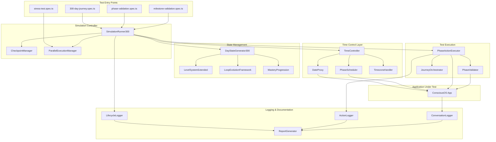
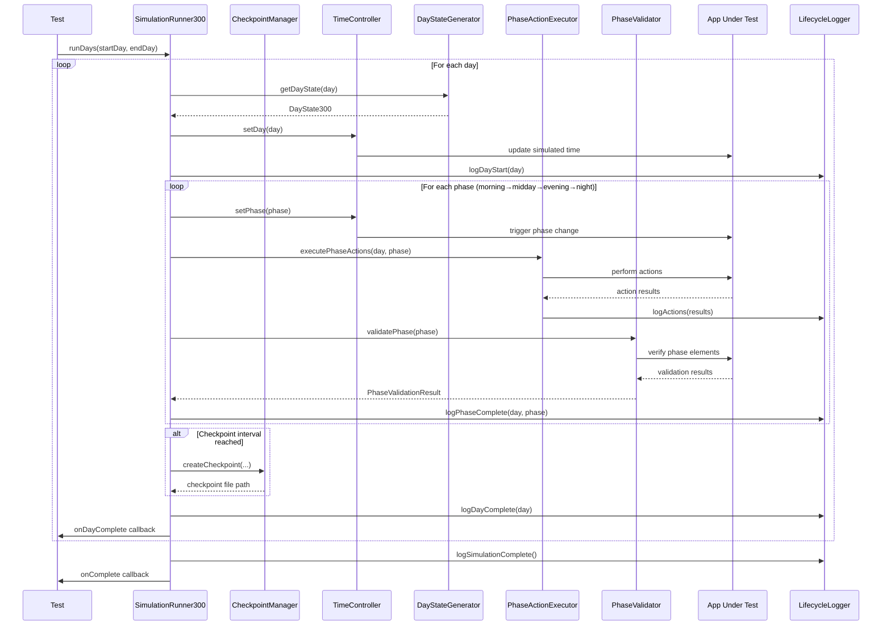
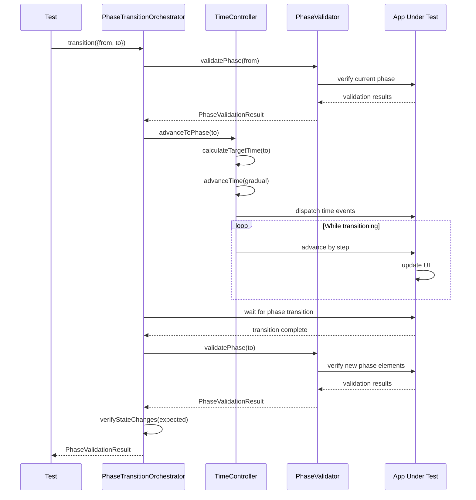

# 300-Day Temporal Simulation Architecture

## Executive Summary

This document outlines the comprehensive architecture for extending the ConsciousOS 100-day simulation framework to a 300-day temporal simulation system. The architecture maintains backward compatibility with existing tests while introducing sophisticated date mocking, extended progression curves, and parallel execution capabilities.

### Key Objectives

1. **Extended Progression**: Support days 1-300 with Levels 1-30 and XP thresholds up to 500,000
2. **Sophisticated Time Control**: Browser-level time interception for true temporal simulation
3. **Phase-Aware Testing**: Comprehensive validation across all four daily phases
4. **Scalable Execution**: Parallel execution strategies for 300-day runs
5. **Comprehensive Logging**: Real-time documentation capturing all user interactions

### Simulation Scale

| Metric | Current (100-day) | Target (300-day) | Improvement |
|--------|------------------|------------------|-------------|
| Days Simulated | 100 | 300 | 3x |
| Level Cap | 10 | 30 | 3x |
| XP Cap | 20,000 | 500,000 | 25x |
| Milestones | 7 | 12 | +5 |
| Execution Time* | ~400 min | ~600 min | 1.5x |
| Parallel Workers | 1 | Up to 10 | 10x |

*With 1 minute per phase, parallel execution reduces total time

---

## System Architecture Diagram



---

## Component Specifications

### 1. Extended Day State Fixtures Architecture

#### 1.1 DayState300 Interface

```typescript
interface DayState300 extends DayState {
    // Extended from base DayState
    dayNumber: number;           // 1-300
    level: number;               // 1-30
    xp: number;                  // Up to 500,000
    
    // New fields for 300-day journey
    masteryTier: MasteryTier;    // Apprentice, Practitioner, Guide, Master, Sage
    masteryProgress: number;     // 0-500 (beyond 100%)
    ascensionLevel: number;      // 0-5 (post-mastery progression)
    
    // Loop evolution
    loopEvolutionStage: LoopStage;  // Initial, Active, Resolving, Transcended
    loopMasteryCount: number;    // Total loops mastered
    
    // Advanced features
    unlockedFeatures: Feature[]; // Features unlocked by day
    wisdomScore: number;         // 0-1000 cumulative wisdom
    insightDepth: InsightDepth;  // Surface, Cognitive, Emotional, Somatic, Transcendent
    
    // Seasonal context
    season: Season;              // Spring, Summer, Autumn, Winter
    seasonalTheme: string;       // Theme for current season
}

type MasteryTier = 'apprentice' | 'practitioner' | 'guide' | 'master' | 'sage';
type LoopStage = 'initial' | 'active' | 'resolving' | 'transcended';
type InsightDepth = 'surface' | 'cognitive' | 'emotional' | 'somatic' | 'transcendent';
type Season = 'spring' | 'summer' | 'autumn' | 'winter';
type Feature = 'basic-practices' | 'loop-work' | 'deep-inquiry' | 'mentorship' | 'teaching' | 'wisdom-transmission';
```

#### 1.2 Milestone States (Days 101-300)

```typescript
export const EXTENDED_MILESTONES: DayState300[] = [
    // Month 4: Consolidation (Day 120)
    {
        dayNumber: 120,
        level: 10,
        xp: 25000,
        streak: 120,
        masteryTier: 'practitioner',
        masteryProgress: 100,
        ascensionLevel: 0,
        loopEvolutionStage: 'resolving',
        loopMasteryCount: 8,
        unlockedFeatures: ['basic-practices', 'loop-work', 'deep-inquiry', 'mentorship'],
        wisdomScore: 400,
        insightDepth: 'emotional',
        season: 'spring',
        seasonalTheme: 'Growth & Expansion',
        // ... other fields
    },
    
    // Month 5: Deepening (Day 150)
    {
        dayNumber: 150,
        level: 14,
        xp: 45000,
        streak: 150,
        masteryTier: 'practitioner',
        masteryProgress: 150,
        ascensionLevel: 1,
        loopEvolutionStage: 'transcended',
        loopMasteryCount: 12,
        unlockedFeatures: ['basic-practices', 'loop-work', 'deep-inquiry', 'mentorship', 'teaching'],
        wisdomScore: 600,
        insightDepth: 'somatic',
        season: 'spring',
        seasonalTheme: 'Flowering & Expression',
        // ... other fields
    },
    
    // Month 6: Integration (Day 180)
    {
        dayNumber: 180,
        level: 18,
        xp: 70000,
        streak: 180,
        masteryTier: 'guide',
        masteryProgress: 200,
        ascensionLevel: 2,
        loopEvolutionStage: 'transcended',
        loopMasteryCount: 15,
        unlockedFeatures: ['basic-practices', 'loop-work', 'deep-inquiry', 'mentorship', 'teaching'],
        wisdomScore: 800,
        insightDepth: 'somatic',
        season: 'summer',
        seasonalTheme: 'Fullness & Radiance',
        // ... other fields
    },
    
    // Month 9: Transcendence (Day 270)
    {
        dayNumber: 270,
        level: 25,
        xp: 280000,
        streak: 270,
        masteryTier: 'master',
        masteryProgress: 350,
        ascensionLevel: 4,
        loopEvolutionStage: 'transcended',
        loopMasteryCount: 25,
        unlockedFeatures: ['basic-practices', 'loop-work', 'deep-inquiry', 'mentorship', 'teaching', 'wisdom-transmission'],
        wisdomScore: 1200,
        insightDepth: 'transcendent',
        season: 'autumn',
        seasonalTheme: 'Harvest & Refinement',
        // ... other fields
    },
    
    // Month 10: Completion (Day 300)
    {
        dayNumber: 300,
        level: 30,
        xp: 500000,
        streak: 300,
        masteryTier: 'sage',
        masteryProgress: 500,
        ascensionLevel: 5,
        loopEvolutionStage: 'transcended',
        loopMasteryCount: 30,
        unlockedFeatures: ['basic-practices', 'loop-work', 'deep-inquiry', 'mentorship', 'teaching', 'wisdom-transmission'],
        wisdomScore: 1500,
        insightDepth: 'transcendent',
        season: 'autumn',
        seasonalTheme: 'Completion & Renewal',
        // ... other fields
    },
];
```

#### 1.3 Extended Level Thresholds (Levels 11-30)

```typescript
const EXTENDED_LEVEL_THRESHOLDS: number[] = [
    // Original levels 1-10
    0, 500, 1200, 2500, 4000, 6000, 8500, 11500, 15000, 20000,
    
    // Extended levels 11-20 (Practitioner Phase)
    25000,   // Level 11
    32000,   // Level 12
    40000,   // Level 13
    50000,   // Level 14
    62000,   // Level 15
    76000,   // Level 16
    92000,   // Level 17
    110000,  // Level 18
    130000,  // Level 19
    152000,  // Level 20
    
    // Extended levels 21-30 (Master Phase)
    180000,  // Level 21
    210000,  // Level 22
    245000,  // Level 23
    285000,  // Level 24
    330000,  // Level 25
    380000,  // Level 26
    435000,  // Level 27
    495000,  // Level 28
    560000,  // Level 29
    650000,  // Level 30 (Sage)
];
```

#### 1.4 XP Progression Curves

```typescript
interface XPProgressionConfig {
    baseDailyXP: number;         // Base XP per day
    streakMultiplier: number;    // Multiplier based on streak
    phaseBonus: Record<Phase, number>;  // Bonus per phase
    levelMultiplier: number;     // XP scaling with level
    masteryBonus: number;        // Bonus in mastery phase (>100%)
}

const XP_PROGRESSION_300: XPProgressionConfig = {
    baseDailyXP: 75,  // Increased from 50 for 100-day
    streakMultiplier: 1.5,
    phaseBonus: {
        morning: 10,
        midday: 5,
        evening: 15,
        night: 10,
    },
    levelMultiplier: 1.02,  // 2% increase per level
    masteryBonus: 2.0,  // Double XP during mastery phase
};

function calculateXPForDay(day: number, config: XPProgressionConfig): number {
    const base = config.baseDailyXP;
    const streakBonus = Math.floor(day / 7) * 50;  // Weekly bonus
    const phaseBonus = Object.values(config.phaseBonus).reduce((a, b) => a + b, 0);
    const levelMultiplier = Math.pow(config.levelMultiplier, Math.floor(day / 30));
    
    // Mastery phase kicks in after day 100
    const masteryMultiplier = day > 100 ? config.masteryBonus : 1;
    
    return Math.floor((base + streakBonus + phaseBonus) * levelMultiplier * masteryMultiplier);
}
```

#### 1.5 Loop Evolution Patterns

```typescript
interface LoopEvolutionPattern {
    dayRange: [number, number];
    stage: LoopStage;
    maxActiveLoops: number;
    resolutionRate: number;  // Loops resolved per 30 days
    newLoopIntroductionRate: number;  // New loops per 30 days
}

const LOOP_EVOLUTION_PATTERNS: LoopEvolutionPattern[] = [
    // Days 1-30: Initial awareness
    {
        dayRange: [1, 30],
        stage: 'initial',
        maxActiveLoops: 3,
        resolutionRate: 0.1,
        newLoopIntroductionRate: 1.0,
    },
    // Days 31-90: Active work
    {
        dayRange: [31, 90],
        stage: 'active',
        maxActiveLoops: 5,
        resolutionRate: 0.3,
        newLoopIntroductionRate: 0.8,
    },
    // Days 91-180: Deep resolution
    {
        dayRange: [91, 180],
        stage: 'resolving',
        maxActiveLoops: 4,
        resolutionRate: 0.6,
        newLoopIntroductionRate: 0.3,
    },
    // Days 181-300: Transcendence
    {
        dayRange: [181, 300],
        stage: 'transcended',
        maxActiveLoops: 2,
        resolutionRate: 0.9,
        newLoopIntroductionRate: 0.1,
    },
];
```

---

### 2. Sophisticated Date Mocking & Proxy Mechanisms

#### 2.1 Browser-Level Time Interception

```typescript
interface DateProxyConfig {
    startDate: Date;
    timeAcceleration: number;  // 1 = real-time, 60 = 1 minute = 1 hour
    timezone: string;
    enableDST: boolean;
}

class DateProxyController {
    private page: Page;
    private config: DateProxyConfig;
    private currentSimulatedTime: Date;
    
    async installDateProxy(config: DateProxyConfig): Promise<void> {
        this.config = config;
        this.currentSimulatedTime = new Date(config.startDate);
        
        // Route all date-related requests through proxy
        await this.page.route('**/*', async (route) => {
            // Inject time proxy script before any page scripts
            if (route.request().resourceType() === 'document') {
                const response = await route.fetch();
                const body = await response.text();
                const modifiedBody = this.injectTimeProxyScript(body);
                await route.fulfill({
                    response,
                    body: modifiedBody,
                });
            } else {
                await route.continue();
            }
        });
        
        // Add initialization script
        await this.page.addInitScript((proxyConfig) => {
            // Override Date constructor
            const OriginalDate = window.Date;
            const simulatedTime = new OriginalDate(proxyConfig.startDate);
            let acceleration = proxyConfig.timeAcceleration;
            let lastRealTime = OriginalDate.now();
            
            class SimulatedDate extends OriginalDate {
                constructor(...args: any[]) {
                    if (args.length === 0) {
                        // Return simulated time
                        const elapsed = (OriginalDate.now() - lastRealTime) * acceleration;
                        return new OriginalDate(simulatedTime.getTime() + elapsed);
                    }
                    return new OriginalDate(...args);
                }
                
                static now(): number {
                    const elapsed = (OriginalDate.now() - lastRealTime) * acceleration;
                    return simulatedTime.getTime() + elapsed;
                }
                
                static UTC = OriginalDate.UTC;
                static parse = OriginalDate.parse;
            }
            
            // Override global Date
            window.Date = SimulatedDate as any;
            
            // Override performance.now() for consistency
            const originalPerformanceNow = performance.now.bind(performance);
            performance.now = () => {
                return SimulatedDate.now() - simulatedTime.getTime();
            };
            
            // Store original for potential restoration
            (window as any).__originalDate = OriginalDate;
            (window as any).__simulatedDateConfig = proxyConfig;
        }, config);
    }
    
    async advanceTime(milliseconds: number): Promise<void> {
        await this.page.evaluate((ms) => {
            const config = (window as any).__simulatedDateConfig;
            const originalStart = new ((window as any).__originalDate)(config.startDate);
            config.startDate = new Date(originalStart.getTime() + ms).toISOString();
            
            // Dispatch time change event
            window.dispatchEvent(new CustomEvent('consciousos:time-advanced', {
                detail: { advancedBy: ms, newTime: config.startDate },
            }));
        }, milliseconds);
        
        this.currentSimulatedTime = new Date(this.currentSimulatedTime.getTime() + milliseconds);
    }
    
    async setTime(targetDate: Date): Promise<void> {
        await this.page.evaluate((isoString) => {
            const config = (window as any).__simulatedDateConfig;
            config.startDate = isoString;
            
            window.dispatchEvent(new CustomEvent('consciousos:time-set', {
                detail: { newTime: isoString },
            }));
        }, targetDate.toISOString());
        
        this.currentSimulatedTime = targetDate;
    }
    
    async getSimulatedTime(): Promise<Date> {
        const timestamp = await this.page.evaluate(() => {
            return Date.now();
        });
        return new Date(timestamp);
    }
    
    private injectTimeProxyScript(html: string): string {
        const proxyScript = `
            <script>
                // Time proxy will be installed by addInitScript
                window.__timeProxyInstalled = true;
            </script>
        `;
        return html.replace('<head>', `<head>${proxyScript}`);
    }
}
```

#### 2.2 Time Advancement Strategies

```typescript
interface TimeAdvancementStrategy {
    name: string;
    advance: (controller: DateProxyController, from: Date, to: Date) => Promise<void>;
}

const TIME_ADVANCEMENT_STRATEGIES: Record<string, TimeAdvancementStrategy> = {
    // Instant: Jump directly to target time
    instant: {
        name: 'instant',
        async advance(controller, from, to) {
            await controller.setTime(to);
        },
    },
    
    // Gradual: Advance in steps with phase transitions
    gradual: {
        name: 'gradual',
        async advance(controller, from, to) {
            const stepMs = 1000 * 60 * 60; // 1 hour steps
            let current = from.getTime();
            const target = to.getTime();
            
            while (current < target) {
                const nextStep = Math.min(current + stepMs, target);
                await controller.advanceTime(nextStep - current);
                
                // Allow UI to update between steps
                await controller['page'].waitForTimeout(100);
                
                current = nextStep;
            }
        },
    },
    
    // Phase-respecting: Advance one phase at a time
    phaseRespecting: {
        name: 'phase-respecting',
        async advance(controller, from, to) {
            const phases = ['morning', 'midday', 'evening', 'night'];
            const phaseHours = { morning: 7, midday: 6, evening: 4, night: 7 };
            
            let current = new Date(from);
            
            while (current < to) {
                const currentPhase = getPhaseForTime(current);
                const hoursToAdvance = phaseHours[currentPhase];
                const nextTime = new Date(current.getTime() + hoursToAdvance * 60 * 60 * 1000);
                
                await controller.advanceTime(hoursToAdvance * 60 * 60 * 1000);
                
                // Trigger phase transition validation
                await controller['page'].evaluate((phase) => {
                    window.dispatchEvent(new CustomEvent('consciousos:phase-transition', {
                        detail: { phase, time: Date.now() },
                    }));
                }, currentPhase);
                
                current = nextTime;
            }
        },
    },
};
```

#### 2.3 Timezone and DST Handling

```typescript
interface TimezoneConfig {
    baseTimezone: string;  // e.g., 'America/New_York'
    simulateDST: boolean;
    dstTransitions: Date[];  // Known DST transition dates
}

class TimezoneHandler {
    private config: TimezoneConfig;
    
    constructor(config: TimezoneConfig) {
        this.config = config;
    }
    
    // Get offset for a specific date considering DST
    getOffsetForDate(date: Date): number {
        if (!this.config.simulateDST) {
            return this.getStandardOffset();
        }
        
        const isDST = this.isDateInDST(date);
        return isDST ? this.getDSTOffset() : this.getStandardOffset();
    }
    
    // Check if date falls in DST period
    isDateInDST(date: Date): boolean {
        // Simplified DST detection - in production, use a library like moment-timezone
        for (let i = 0; i < this.config.dstTransitions.length; i += 2) {
            const start = this.config.dstTransitions[i];
            const end = this.config.dstTransitions[i + 1];
            if (date >= start && date < end) {
                return true;
            }
        }
        return false;
    }
    
    // Calculate seasonal variation for practices
    getSeasonalContext(date: Date): SeasonalContext {
        const month = date.getMonth();
        const dayOfYear = this.getDayOfYear(date);
        
        return {
            season: this.getSeason(month),
            dayLength: this.calculateDayLength(date),
            seasonalTheme: this.getSeasonalTheme(month),
            recommendedPractices: this.getSeasonalPractices(month),
        };
    }
    
    private getSeason(month: number): Season {
        if (month >= 2 && month <= 4) return 'spring';
        if (month >= 5 && month <= 7) return 'summer';
        if (month >= 8 && month <= 10) return 'autumn';
        return 'winter';
    }
    
    private getDayOfYear(date: Date): number {
        const start = new Date(date.getFullYear(), 0, 0);
        const diff = date.getTime() - start.getTime();
        return Math.floor(diff / (1000 * 60 * 60 * 24));
    }
    
    private calculateDayLength(date: Date): number {
        // Simplified calculation - in production, use astronomical algorithms
        const dayOfYear = this.getDayOfYear(date);
        const latitude = 40.7; // Default to NYC latitude
        
        // Approximate day length variation
        const variation = Math.cos((dayOfYear - 172) * 2 * Math.PI / 365) * 4;
        return 12 + variation; // Hours of daylight
    }
}

interface SeasonalContext {
    season: Season;
    dayLength: number;
    seasonalTheme: string;
    recommendedPractices: string[];
}
```

---

### 3. Four Daily Phases Testing Framework

#### 3.1 Phase Configuration Matrix

```typescript
interface PhaseConfig {
    name: Phase;
    timeRange: { start: number; end: number };  // Hours (24h format)
    greeting: string;
    primaryActions: PhaseAction[];
    secondaryActions: PhaseAction[];
    aiContext: string;
    uiTheme: string;
}

interface PhaseAction {
    id: string;
    name: string;
    type: 'checkin' | 'practice' | 'journal' | 'reflection' | 'ai-chat';
    duration: number;  // Expected duration in minutes
    xpReward: number;
    required: boolean;
}

const PHASE_CONFIGS: Record<Phase, PhaseConfig> = {
    morning: {
        name: 'morning',
        timeRange: { start: 5, end: 12 },
        greeting: 'Good Morning',
        primaryActions: [
            { id: 'morning-checkin', name: 'Morning Check-in', type: 'checkin', duration: 3, xpReward: 15, required: true },
            { id: 'intention-setting', name: 'Set Daily Intention', type: 'reflection', duration: 5, xpReward: 20, required: true },
            { id: 'morning-practice', name: 'Morning Practice', type: 'practice', duration: 15, xpReward: 30, required: false },
        ],
        secondaryActions: [
            { id: 'dream-journal', name: 'Dream Journal', type: 'journal', duration: 10, xpReward: 25, required: false },
            { id: 'gratitude', name: 'Gratitude Practice', type: 'reflection', duration: 5, xpReward: 15, required: false },
        ],
        aiContext: 'morning_coach',
        uiTheme: 'dawn',
    },
    
    midday: {
        name: 'midday',
        timeRange: { start: 12, end: 18 },
        greeting: 'Good Afternoon',
        primaryActions: [
            { id: 'midday-checkin', name: 'Midday Reset', type: 'checkin', duration: 2, xpReward: 10, required: true },
            { id: 'presence-practice', name: 'Presence Practice', type: 'practice', duration: 5, xpReward: 15, required: false },
            { id: 'loop-inquiry', name: 'Loop Inquiry', type: 'reflection', duration: 10, xpReward: 25, required: false },
        ],
        secondaryActions: [
            { id: 'knowledge-session', name: 'Knowledge Session', type: 'ai-chat', duration: 10, xpReward: 20, required: false },
            { id: 'quick-journal', name: 'Quick Journal', type: 'journal', duration: 5, xpReward: 10, required: false },
        ],
        aiContext: 'midday_guide',
        uiTheme: 'daylight',
    },
    
    evening: {
        name: 'evening',
        timeRange: { start: 18, end: 22 },
        greeting: 'Good Evening',
        primaryActions: [
            { id: 'evening-reflection', name: 'Evening Reflection', type: 'reflection', duration: 10, xpReward: 25, required: true },
            { id: 'ai-master-chat', name: 'AI Master Chat', type: 'ai-chat', duration: 15, xpReward: 35, required: true },
            { id: 'day-review', name: 'Day Review', type: 'reflection', duration: 5, xpReward: 15, required: true },
        ],
        secondaryActions: [
            { id: 'gratitude-evening', name: 'Evening Gratitude', type: 'reflection', duration: 5, xpReward: 15, required: false },
            { id: 'tomorrow-preview', name: 'Tomorrow Preview', type: 'reflection', duration: 3, xpReward: 10, required: false },
        ],
        aiContext: 'evening_master',
        uiTheme: 'sunset',
    },
    
    night: {
        name: 'night',
        timeRange: { start: 22, end: 5 },
        greeting: 'Good Night',
        primaryActions: [
            { id: 'night-mode', name: 'Enter Night Mode', type: 'checkin', duration: 1, xpReward: 5, required: true },
            { id: 'grounding-exercise', name: 'Grounding Exercise', type: 'practice', duration: 10, xpReward: 20, required: false },
            { id: 'sleep-prep', name: 'Sleep Preparation', type: 'reflection', duration: 5, xpReward: 15, required: false },
        ],
        secondaryActions: [
            { id: 'dream-prep', name: 'Dream Preparation', type: 'reflection', duration: 5, xpReward: 10, required: false },
            { id: 'night-journal', name: 'Night Journal', type: 'journal', duration: 8, xpReward: 15, required: false },
        ],
        aiContext: 'night_companion',
        uiTheme: 'night',
    },
};
```

#### 3.2 Phase Validation Framework

```typescript
interface PhaseValidationResult {
    phase: Phase;
    passed: boolean;
    checks: PhaseCheckResult[];
    errors: string[];
    warnings: string[];
}

interface PhaseCheckResult {
    check: string;
    passed: boolean;
    message: string;
}

class PhaseValidator {
    private page: Page;
    
    constructor(page: Page) {
        this.page = page;
    }
    
    async validatePhase(phase: Phase): Promise<PhaseValidationResult> {
        const config = PHASE_CONFIGS[phase];
        const checks: PhaseCheckResult[] = [];
        const errors: string[] = [];
        const warnings: string[] = [];
        
        // Check 1: Correct greeting
        const greetingCheck = await this.validateGreeting(config.greeting);
        checks.push(greetingCheck);
        if (!greetingCheck.passed) errors.push(greetingCheck.message);
        
        // Check 2: Phase-appropriate UI theme
        const themeCheck = await this.validateTheme(config.uiTheme);
        checks.push(themeCheck);
        if (!themeCheck.passed) errors.push(themeCheck.message);
        
        // Check 3: Primary actions available
        for (const action of config.primaryActions) {
            const actionCheck = await this.validateActionAvailable(action);
            checks.push(actionCheck);
            if (!actionCheck.passed && action.required) {
                errors.push(`Required action missing: ${action.name}`);
            } else if (!actionCheck.passed) {
                warnings.push(`Optional action missing: ${action.name}`);
            }
        }
        
        // Check 4: AI context appropriate
        const aiCheck = await this.validateAIContext(config.aiContext);
        checks.push(aiCheck);
        if (!aiCheck.passed) warnings.push(aiCheck.message);
        
        // Check 5: Time-appropriate content
        const timeCheck = await this.validateTimeAppropriateContent(phase);
        checks.push(timeCheck);
        if (!timeCheck.passed) errors.push(timeCheck.message);
        
        return {
            phase,
            passed: errors.length === 0,
            checks,
            errors,
            warnings,
        };
    }
    
    private async validateGreeting(expected: string): Promise<PhaseCheckResult> {
        const greeting = await this.page.locator('h1, h2, [data-testid="greeting"]').first().textContent();
        const passed = greeting?.toLowerCase().includes(expected.toLowerCase()) ?? false;
        
        return {
            check: 'phase-greeting',
            passed,
            message: passed 
                ? `Correct greeting: "${greeting}"` 
                : `Expected greeting containing "${expected}", got "${greeting}"`,
        };
    }
    
    private async validateTheme(expectedTheme: string): Promise<PhaseCheckResult> {
        const body = this.page.locator('body');
        const themeClass = await body.getAttribute('data-theme');
        const passed = themeClass === expectedTheme;
        
        return {
            check: 'ui-theme',
            passed,
            message: passed 
                ? `Theme is "${expectedTheme}"` 
                : `Expected theme "${expectedTheme}", got "${themeClass}"`,
        };
    }
    
    private async validateActionAvailable(action: PhaseAction): Promise<PhaseCheckResult> {
        const actionLocator = this.page.getByTestId(action.id)
            .or(this.page.getByRole('button', { name: new RegExp(action.name, 'i') }));
        
        const visible = await actionLocator.isVisible().catch(() => false);
        
        return {
            check: `action-${action.id}`,
            passed: visible,
            message: visible 
                ? `Action "${action.name}" is available` 
                : `Action "${action.name}" not found`,
        };
    }
    
    private async validateAIContext(expectedContext: string): Promise<PhaseCheckResult> {
        // Check AI context via data attribute or API call
        const context = await this.page.evaluate(() => {
            return (window as any).__consciousOS?.aiContext;
        });
        
        const passed = context === expectedContext;
        
        return {
            check: 'ai-context',
            passed,
            message: passed 
                ? `AI context is "${expectedContext}"` 
                : `Expected AI context "${expectedContext}", got "${context}"`,
        };
    }
    
    private async validateTimeAppropriateContent(phase: Phase): Promise<PhaseCheckResult> {
        // Check for phase-specific content elements
        const phaseSelectors: Record<Phase, string[]> = {
            morning: ['[data-testid="morning-practices"]', '[data-testid="intention-setting"]'],
            midday: ['[data-testid="midday-reset"]', '[data-testid="presence-check"]'],
            evening: ['[data-testid="evening-reflection"]', '[data-testid="ai-master-chat"]'],
            night: ['[data-testid="night-mode"]', '[data-testid="sleep-prep"]'],
        };
        
        const selectors = phaseSelectors[phase];
        let foundCount = 0;
        
        for (const selector of selectors) {
            const visible = await this.page.locator(selector).first().isVisible().catch(() => false);
            if (visible) foundCount++;
        }
        
        const passed = foundCount >= selectors.length / 2;
        
        return {
            check: 'time-appropriate-content',
            passed,
            message: passed 
                ? `Found ${foundCount}/${selectors.length} phase-specific elements` 
                : `Only found ${foundCount}/${selectors.length} phase-specific elements`,
        };
    }
}
```

#### 3.3 Phase Transition Orchestrator

```typescript
interface PhaseTransitionConfig {
    from: Phase;
    to: Phase;
    transitionTime: number;  // Duration in milliseconds
    validateState: boolean;
    expectedStateChanges: string[];
}

class PhaseTransitionOrchestrator {
    private page: Page;
    private validator: PhaseValidator;
    
    constructor(page: Page) {
        this.page = page;
        this.validator = new PhaseValidator(page);
    }
    
    async transition(config: PhaseTransitionConfig): Promise<PhaseValidationResult> {
        const { from, to, transitionTime, validateState } = config;
        
        console.log(`🔄 Transitioning from ${from} to ${to}...`);
        
        // 1. Validate current phase
        if (validateState) {
            const currentValidation = await this.validator.validatePhase(from);
            if (!currentValidation.passed) {
                console.warn(`⚠️ Current phase validation failed before transition`);
            }
        }
        
        // 2. Calculate target time for new phase
        const targetTime = this.calculateTargetTime(to);
        
        // 3. Advance time gradually
        await this.advanceToPhase(to, transitionTime);
        
        // 4. Wait for phase transition to complete
        await this.waitForPhaseTransition(from, to);
        
        // 5. Validate new phase
        const validation = await this.validator.validatePhase(to);
        
        // 6. Verify state changes
        if (validateState) {
            await this.verifyStateChanges(config.expectedStateChanges);
        }
        
        console.log(`✅ Transition to ${to} complete. Passed: ${validation.passed}`);
        
        return validation;
    }
    
    private calculateTargetTime(phase: Phase): Date {
        const config = PHASE_CONFIGS[phase];
        const now = new Date();
        const targetHour = config.timeRange.start;
        
        const target = new Date(now);
        target.setHours(targetHour, 0, 0, 0);
        
        // If target time has passed today, move to tomorrow
        if (target <= now) {
            target.setDate(target.getDate() + 1);
        }
        
        return target;
    }
    
    private async advanceToPhase(phase: Phase, transitionTime: number): Promise<void> {
        // Use time simulation to advance to target phase
        const timeController = new DateProxyController(this.page);
        
        // Advance by phase duration
        await timeController.advanceTime(transitionTime);
        
        // Dispatch phase change event
        await this.page.evaluate((newPhase) => {
            window.dispatchEvent(new CustomEvent('consciousos:phase-change', {
                detail: { phase: newPhase, timestamp: Date.now() },
            }));
        }, phase);
    }
    
    private async waitForPhaseTransition(from: Phase, to: Phase): Promise<void> {
        // Wait for phase transition animation
        await this.page.waitForTimeout(500);
        
        // Wait for phase-specific content to appear
        const phaseSelectors: Record<Phase, string> = {
            morning: '[data-testid="morning-content"]',
            midday: '[data-testid="midday-content"]',
            evening: '[data-testid="evening-content"]',
            night: '[data-testid="night-content"]',
        };
        
        await this.page.waitForSelector(phaseSelectors[to], { timeout: 10000 });
    }
    
    private async verifyStateChanges(expectedChanges: string[]): Promise<void> {
        for (const change of expectedChanges) {
            // Verify each expected state change occurred
            const verified = await this.page.evaluate((expected) => {
                const state = (window as any).__consciousOS?.state;
                return state?.recentChanges?.includes(expected);
            }, change);
            
            if (!verified) {
                console.warn(`⚠️ Expected state change not verified: ${change}`);
            }
        }
    }
}
```

---

### 4. Comprehensive Test Scenario Architecture

#### 4.1 Test Scenario Types

```typescript
interface TestScenario {
    id: string;
    name: string;
    description: string;
    category: TestCategory;
    dayRange: [number, number];
    phases: Phase[];
    duration: number;  // Estimated duration in minutes
    priority: 'critical' | 'high' | 'medium' | 'low';
}

type TestCategory = 
    | 'interactive-guide'
    | 'journaling'
    | 'ai-chat'
    | 'core-functionality'
    | 'stress-test'
    | 'edge-case'
    | 'journey-orchestration';

const TEST_SCENARIOS: TestScenario[] = [
    // Interactive Guide Tests
    {
        id: 'IG-001',
        name: 'All Guide Modes Availability',
        description: 'Verify all interactive guide modes are accessible and functional',
        category: 'interactive-guide',
        dayRange: [1, 300],
        phases: ['morning', 'midday', 'evening'],
        duration: 15,
        priority: 'critical',
    },
    {
        id: 'IG-002',
        name: 'Guide Mode Context Adaptation',
        description: 'Verify guide adapts responses based on phase and day',
        category: 'interactive-guide',
        dayRange: [30, 300],
        phases: ['morning', 'midday', 'evening', 'night'],
        duration: 20,
        priority: 'high',
    },
    
    // Journaling Tests
    {
        id: 'JR-001',
        name: 'Morning Journal Flow',
        description: 'Test morning journal entry with intention setting',
        category: 'journaling',
        dayRange: [1, 300],
        phases: ['morning'],
        duration: 10,
        priority: 'critical',
    },
    {
        id: 'JR-002',
        name: 'Midday Quick Journal',
        description: 'Test midday quick journal entry',
        category: 'journaling',
        dayRange: [7, 300],
        phases: ['midday'],
        duration: 5,
        priority: 'medium',
    },
    {
        id: 'JR-003',
        name: 'Evening AI Master Reflection',
        description: 'Test evening reflection with AI Master chat',
        category: 'journaling',
        dayRange: [1, 300],
        phases: ['evening'],
        duration: 15,
        priority: 'critical',
    },
    {
        id: 'JR-004',
        name: 'Dream Journal Entry',
        description: 'Test dream journal entry in night phase',
        category: 'journaling',
        dayRange: [14, 300],
        phases: ['night'],
        duration: 10,
        priority: 'medium',
    },
    
    // AI Chat Tests
    {
        id: 'AI-001',
        name: 'Guru Conversation Flow',
        description: 'Test complete Guru conversation with insight generation',
        category: 'ai-chat',
        dayRange: [1, 300],
        phases: ['morning', 'midday', 'evening'],
        duration: 20,
        priority: 'critical',
    },
    {
        id: 'AI-002',
        name: 'Multi-Turn Conversation',
        description: 'Test multi-turn conversation with context retention',
        category: 'ai-chat',
        dayRange: [30, 300],
        phases: ['morning', 'midday', 'evening', 'night'],
        duration: 25,
        priority: 'high',
    },
    {
        id: 'AI-003',
        name: 'Insight Generation and Storage',
        description: 'Test AI-generated insights are properly stored and displayed',
        category: 'ai-chat',
        dayRange: [7, 300],
        phases: ['evening'],
        duration: 15,
        priority: 'high',
    },
    
    // Core Functionality Tests
    {
        id: 'CF-001',
        name: 'Complete Check-in Flow',
        description: 'Test complete check-in flow with mood and energy tracking',
        category: 'core-functionality',
        dayRange: [1, 300],
        phases: ['morning', 'midday', 'evening'],
        duration: 10,
        priority: 'critical',
    },
    {
        id: 'CF-002',
        name: 'Practice Session Completion',
        description: 'Test practice session start, progress, and completion',
        category: 'core-functionality',
        dayRange: [1, 300],
        phases: ['morning', 'midday', 'evening', 'night'],
        duration: 20,
        priority: 'critical',
    },
    {
        id: 'CF-003',
        name: 'Loop Work Session',
        description: 'Test loop identification, work session, and dissolution',
        category: 'core-functionality',
        dayRange: [5, 300],
        phases: ['midday', 'evening'],
        duration: 30,
        priority: 'high',
    },
    {
        id: 'CF-004',
        name: 'XP and Level Progression',
        description: 'Test XP accumulation and level-up mechanics',
        category: 'core-functionality',
        dayRange: [1, 300],
        phases: ['morning', 'midday', 'evening', 'night'],
        duration: 60,
        priority: 'critical',
    },
    
    // Stress Tests
    {
        id: 'ST-001',
        name: 'Rapid Day Advancement',
        description: 'Test system stability with rapid day advancement (1 day per second)',
        category: 'stress-test',
        dayRange: [1, 300],
        phases: ['morning', 'midday', 'evening', 'night'],
        duration: 30,
        priority: 'high',
    },
    {
        id: 'ST-002',
        name: 'Concurrent Action Simulation',
        description: 'Test handling of multiple simultaneous actions',
        category: 'stress-test',
        dayRange: [50, 300],
        phases: ['morning', 'midday', 'evening', 'night'],
        duration: 20,
        priority: 'medium',
    },
    {
        id: 'ST-003',
        name: 'Memory Leak Detection',
        description: 'Monitor for memory leaks during extended simulation',
        category: 'stress-test',
        dayRange: [1, 100],
        phases: ['morning', 'midday', 'evening', 'night'],
        duration: 120,
        priority: 'high',
    },
    
    // Edge Cases
    {
        id: 'EC-001',
        name: 'Daylight Saving Time Transition',
        description: 'Test behavior during DST transition',
        category: 'edge-case',
        dayRange: [1, 300],
        phases: ['morning', 'midday', 'evening', 'night'],
        duration: 15,
        priority: 'medium',
    },
    {
        id: 'EC-002',
        name: 'Leap Year Handling',
        description: 'Test February 29th handling in leap years',
        category: 'edge-case',
        dayRange: [1, 300],
        phases: ['morning', 'midday', 'evening', 'night'],
        duration: 10,
        priority: 'low',
    },
    {
        id: 'EC-003',
        name: 'Timezone Change Simulation',
        description: 'Test behavior when timezone changes during simulation',
        category: 'edge-case',
        dayRange: [1, 300],
        phases: ['morning', 'midday', 'evening', 'night'],
        duration: 15,
        priority: 'medium',
    },
    {
        id: 'EC-004',
        name: 'Streak Freeze and Recovery',
        description: 'Test streak freeze mechanism and recovery',
        category: 'edge-case',
        dayRange: [1, 300],
        phases: ['morning', 'midday', 'evening', 'night'],
        duration: 20,
        priority: 'high',
    },
    
    // Journey Orchestration
    {
        id: 'JO-001',
        name: 'Complete 300-Day Journey',
        description: 'Full 300-day simulation with all phases and activities',
        category: 'journey-orchestration',
        dayRange: [1, 300],
        phases: ['morning', 'midday', 'evening', 'night'],
        duration: 600,
        priority: 'critical',
    },
    {
        id: 'JO-002',
        name: 'Milestone Validation Journey',
        description: 'Jump to each milestone and validate state',
        category: 'journey-orchestration',
        dayRange: [1, 300],
        phases: ['morning', 'midday', 'evening', 'night'],
        duration: 90,
        priority: 'high',
    },
    {
        id: 'JO-003',
        name: 'Parallel User Simulation',
        description: 'Simulate multiple users at different day states',
        category: 'journey-orchestration',
        dayRange: [1, 300],
        phases: ['morning', 'midday', 'evening', 'night'],
        duration: 45,
        priority: 'medium',
    },
];
```

#### 4.2 Scenario Orchestrator

```typescript
class TestScenarioOrchestrator {
    private scenarios: Map<string, TestScenario>;
    private page: Page;
    
    constructor(page: Page) {
        this.page = page;
        this.scenarios = new Map(TEST_SCENARIOS.map(s => [s.id, s]));
    }
    
    async executeScenario(scenarioId: string, config: ScenarioConfig): Promise<ScenarioResult> {
        const scenario = this.scenarios.get(scenarioId);
        if (!scenario) {
            throw new Error(`Unknown scenario: ${scenarioId}`);
        }
        
        console.log(`🎬 Executing scenario: ${scenario.name}`);
        
        const startTime = Date.now();
        const steps: ScenarioStep[] = [];
        
        try {
            // Setup
            await this.setupScenario(scenario, config);
            
            // Execute scenario steps
            switch (scenario.category) {
                case 'interactive-guide':
                    await this.executeInteractiveGuideScenario(scenario, steps);
                    break;
                case 'journaling':
                    await this.executeJournalingScenario(scenario, steps);
                    break;
                case 'ai-chat':
                    await this.executeAIChatScenario(scenario, steps);
                    break;
                case 'core-functionality':
                    await this.executeCoreFunctionalityScenario(scenario, steps);
                    break;
                case 'stress-test':
                    await this.executeStressTestScenario(scenario, steps);
                    break;
                case 'edge-case':
                    await this.executeEdgeCaseScenario(scenario, steps);
                    break;
                case 'journey-orchestration':
                    await this.executeJourneyOrchestrationScenario(scenario, steps);
                    break;
            }
            
            // Teardown
            await this.teardownScenario(scenario);
            
            return {
                scenarioId,
                passed: true,
                duration: Date.now() - startTime,
                steps,
            };
            
        } catch (error) {
            return {
                scenarioId,
                passed: false,
                duration: Date.now() - startTime,
                steps,
                error: error instanceof Error ? error.message : String(error),
            };
        }
    }
    
    private async executeJournalingScenario(scenario: TestScenario, steps: ScenarioStep[]): Promise<void> {
        const journalPage = new JournalPage(this.page);
        
        // Navigate to journal
        await journalPage.goto();
        steps.push({ action: 'navigate', target: 'journal', status: 'completed' });
        
        // Execute based on scenario type
        if (scenario.id === 'JR-001') {
            // Morning journal with intention
            await journalPage.createEntry('Morning Intention', 'Today I intend to...');
            steps.push({ action: 'create-entry', target: 'morning-intention', status: 'completed' });
            
            // Verify entry created
            await journalPage.expectEntryExists('Morning Intention');
            steps.push({ action: 'verify', target: 'entry-exists', status: 'completed' });
            
        } else if (scenario.id === 'JR-003') {
            // Evening AI Master reflection
            await journalPage.createEntry('Evening Reflection', 'Today I learned...');
            steps.push({ action: 'create-entry', target: 'evening-reflection', status: 'completed' });
        }
    }
    
    private async executeCoreFunctionalityScenario(scenario: TestScenario, steps: ScenarioStep[]): Promise<void> {
        if (scenario.id === 'CF-004') {
            // XP and level progression test
            const analyticsPage = new AnalyticsPage(this.page);
            
            // Get initial XP
            await analyticsPage.goto();
            const initialXP = await analyticsPage.getCurrentXP() ?? 0;
            const initialLevel = await analyticsPage.getCurrentLevel() ?? 1;
            steps.push({ action: 'capture', target: 'initial-state', status: 'completed', data: { xp: initialXP, level: initialLevel } });
            
            // Complete activities to earn XP
            const dashboardPage = new DashboardPage(this.page);
            await dashboardPage.goto();
            await dashboardPage.startPractice();
            steps.push({ action: 'complete', target: 'practice', status: 'completed' });
            
            // Verify XP increase
            await analyticsPage.goto();
            const finalXP = await analyticsPage.getCurrentXP() ?? 0;
            steps.push({ action: 'capture', target: 'final-state', status: 'completed', data: { xp: finalXP } });
            
            // Assert XP increased
            if (finalXP <= initialXP) {
                throw new Error('XP did not increase after activity');
            }
        }
    }
    
    // Additional scenario execution methods...
    private async setupScenario(scenario: TestScenario, config: ScenarioConfig): Promise<void> {
        // Set up time simulation
        const timeController = new DateProxyController(this.page);
        await timeController.installDateProxy({
            startDate: config.startDate,
            timeAcceleration: config.timeAcceleration,
            timezone: config.timezone,
            enableDST: config.enableDST,
        });
        
        // Seed day state if specified
        if (config.dayState) {
            await seedCompleteDayState(this.page, config.dayState);
        }
        
        // Navigate to starting page
        await this.page.goto(config.startUrl ?? '/app');
    }
    
    private async teardownScenario(scenario: TestScenario): Promise<void> {
        // Clean up any test data
        await clearUserProgress(this.page);
    }
}

interface ScenarioConfig {
    startDate: Date;
    timeAcceleration: number;
    timezone: string;
    enableDST: boolean;
    dayState?: DayState300;
    startUrl?: string;
}

interface ScenarioResult {
    scenarioId: string;
    passed: boolean;
    duration: number;
    steps: ScenarioStep[];
    error?: string;
}

interface ScenarioStep {
    action: string;
    target: string;
    status: 'pending' | 'in-progress' | 'completed' | 'failed';
    data?: Record<string, unknown>;
}
```

---

### 5. Real-Time Documentation & Logging System

#### 5.1 Logging Architecture

```typescript
interface LogEntry {
    timestamp: number;
    level: 'debug' | 'info' | 'warn' | 'error';
    category: LogCategory;
    source: string;
    message: string;
    data?: Record<string, unknown>;
    correlationId?: string;
}

type LogCategory =
    | 'frontend-interaction'
    | 'ai-conversation'
    | 'journal-entry'
    | 'system-state'
    | 'backend-engine'
    | 'database-mutation'
    | 'performance';

interface LogAggregatorConfig {
    bufferSize: number;
    flushInterval: number;
    outputFormat: 'json' | 'structured';
    outputDestination: 'console' | 'file' | 'api';
}

class SimulationLogger {
    private buffer: LogEntry[] = [];
    private config: LogAggregatorConfig;
    private correlationId: string;
    
    constructor(config: LogAggregatorConfig) {
        this.config = config;
        this.correlationId = this.generateCorrelationId();
        
        // Set up periodic flush
        setInterval(() => this.flush(), config.flushInterval);
    }
    
    log(entry: Omit<LogEntry, 'timestamp' | 'correlationId'>): void {
        const fullEntry: LogEntry = {
            ...entry,
            timestamp: Date.now(),
            correlationId: this.correlationId,
        };
        
        this.buffer.push(fullEntry);
        
        if (this.buffer.length >= this.config.bufferSize) {
            this.flush();
        }
    }
    
    private flush(): void {
        if (this.buffer.length === 0) return;
        
        const entries = [...this.buffer];
        this.buffer = [];
        
        switch (this.config.outputDestination) {
            case 'console':
                this.outputToConsole(entries);
                break;
            case 'file':
                this.outputToFile(entries);
                break;
            case 'api':
                this.outputToAPI(entries);
                break;
        }
    }
    
    private outputToConsole(entries: LogEntry[]): void {
        for (const entry of entries) {
            const formatted = this.formatEntry(entry);
            
            switch (entry.level) {
                case 'debug':
                    console.debug(formatted);
                    break;
                case 'info':
                    console.info(formatted);
                    break;
                case 'warn':
                    console.warn(formatted);
                    break;
                case 'error':
                    console.error(formatted);
                    break;
            }
        }
    }
    
    private outputToFile(entries: LogEntry[]): void {
        const logData = entries.map(e => JSON.stringify(e)).join('\n');
        // In Node.js environment, append to file
        // This would be implemented in the actual test runner
    }
    
    private outputToAPI(entries: LogEntry[]): void {
        // Send to logging API
        // Implementation depends on your logging infrastructure
    }
    
    private formatEntry(entry: LogEntry): string {
        if (this.config.outputFormat === 'json') {
            return JSON.stringify(entry);
        }
        
        // Structured format
        const timestamp = new Date(entry.timestamp).toISOString();
        const data = entry.data ? ` | Data: ${JSON.stringify(entry.data)}` : '';
        return `[${timestamp}] [${entry.level.toUpperCase()}] [${entry.category}] ${entry.source}: ${entry.message}${data}`;
    }
    
    private generateCorrelationId(): string {
        return `sim-${Date.now()}-${Math.random().toString(36).substr(2, 9)}`;
    }
}
```

#### 5.2 Frontend Interaction Logger

```typescript
class FrontendInteractionLogger {
    private logger: SimulationLogger;
    private page: Page;
    
    constructor(page: Page, logger: SimulationLogger) {
        this.page = page;
        this.logger = logger;
    }
    
    async install(): Promise<void> {
        // Log all clicks
        await this.page.evaluate(() => {
            document.addEventListener('click', (e) => {
                const target = e.target as HTMLElement;
                const logData = {
                    tag: target.tagName,
                    id: target.id,
                    class: target.className,
                    text: target.textContent?.substring(0, 100),
                    timestamp: Date.now(),
                };
                
                (window as any).__logInteraction?.('click', logData);
            }, true);
            
            // Log all inputs
            document.addEventListener('input', (e) => {
                const target = e.target as HTMLInputElement;
                if (target.type === 'password') return; // Don't log passwords
                
                const logData = {
                    tag: target.tagName,
                    id: target.id,
                    type: target.type,
                    timestamp: Date.now(),
                };
                
                (window as any).__logInteraction?.('input', logData);
            }, true);
            
            // Log navigation
            window.addEventListener('popstate', () => {
                (window as any).__logInteraction?.('navigation', {
                    url: window.location.href,
                    timestamp: Date.now(),
                });
            });
        });
        
        // Set up handler for logged interactions
        await this.page.exposeFunction('__logInteraction', (type: string, data: unknown) => {
            this.logger.log({
                level: 'info',
                category: 'frontend-interaction',
                source: 'browser',
                message: `User ${type}`,
                data: { type, ...data },
            });
        });
    }
    
    async logNavigation(from: string, to: string): Promise<void> {
        this.logger.log({
            level: 'info',
            category: 'frontend-interaction',
            source: 'test',
            message: 'Page navigation',
            data: { from, to },
        });
    }
    
    async logAction(action: string, details: Record<string, unknown>): Promise<void> {
        this.logger.log({
            level: 'info',
            category: 'frontend-interaction',
            source: 'test',
            message: `Action: ${action}`,
            data: details,
        });
    }
}
```

#### 5.3 AI Conversation Logger

```typescript
interface AIConversationEntry {
    timestamp: number;
    role: 'user' | 'assistant' | 'system';
    content: string;
    metadata?: {
        model?: string;
        tokens?: number;
        latency?: number;
        context?: string;
    };
}

class AIConversationLogger {
    private logger: SimulationLogger;
    private conversations: Map<string, AIConversationEntry[]> = new Map();
    
    constructor(logger: SimulationLogger) {
        this.logger = logger;
    }
    
    startConversation(conversationId: string, context: string): void {
        this.conversations.set(conversationId, []);
        
        this.logger.log({
            level: 'info',
            category: 'ai-conversation',
            source: 'ai-system',
            message: 'Conversation started',
            data: { conversationId, context },
        });
    }
    
    logMessage(conversationId: string, entry: AIConversationEntry): void {
        const conversation = this.conversations.get(conversationId);
        if (conversation) {
            conversation.push(entry);
        }
        
        this.logger.log({
            level: 'info',
            category: 'ai-conversation',
            source: `ai-${entry.role}`,
            message: `AI ${entry.role} message`,
            data: {
                conversationId,
                content: entry.content.substring(0, 500), // Truncate long messages
                metadata: entry.metadata,
            },
        });
    }
    
    endConversation(conversationId: string, summary?: string): void {
        const conversation = this.conversations.get(conversationId);
        
        this.logger.log({
            level: 'info',
            category: 'ai-conversation',
            source: 'ai-system',
            message: 'Conversation ended',
            data: {
                conversationId,
                messageCount: conversation?.length ?? 0,
                summary,
            },
        });
        
        this.conversations.delete(conversationId);
    }
    
    async installInterceptor(page: Page): Promise<void> {
        // Intercept AI API calls
        await page.route('**/api/ai/**', async (route) => {
            const request = route.request();
            const conversationId = request.headers()['x-conversation-id'] || 'default';
            
            // Log request
            const requestBody = request.postData();
            if (requestBody) {
                try {
                    const data = JSON.parse(requestBody);
                    this.logMessage(conversationId, {
                        timestamp: Date.now(),
                        role: 'user',
                        content: data.message || data.prompt || '',
                    });
                } catch {
                    // Ignore parse errors
                }
            }
            
            // Continue and log response
            const response = await route.fetch();
            const responseBody = await response.text();
            
            try {
                const data = JSON.parse(responseBody);
                this.logMessage(conversationId, {
                    timestamp: Date.now(),
                    role: 'assistant',
                    content: data.message || data.response || '',
                    metadata: {
                        model: data.model,
                        tokens: data.tokens,
                        latency: data.latency,
                    },
                });
            } catch {
                // Ignore parse errors
            }
            
            await route.fulfill({ response });
        });
    }
    
    exportConversation(conversationId: string): AIConversationEntry[] | null {
        return this.conversations.get(conversationId) ?? null;
    }
}
```

#### 5.4 Performance Metrics Logger

```typescript
interface PerformanceMetrics {
    timestamp: number;
    url: string;
    loadTime: number;
    domContentLoaded: number;
    firstPaint: number;
    firstContentfulPaint: number;
    largestContentfulPaint: number;
    timeToInteractive: number;
    memoryUsage?: {
        usedJSHeapSize: number;
        totalJSHeapSize: number;
        jsHeapSizeLimit: number;
    };
    fps?: number;
}

class PerformanceMetricsLogger {
    private logger: SimulationLogger;
    private page: Page;
    private metricsHistory: PerformanceMetrics[] = [];
    
    constructor(page: Page, logger: SimulationLogger) {
        this.page = page;
        this.logger = logger;
    }
    
    async startMonitoring(): Promise<void> {
        // Monitor navigation timing
        await this.page.evaluate(() => {
            const observer = new PerformanceObserver((list) => {
                for (const entry of list.getEntries()) {
                    (window as any).__logPerformance?.(entry.toJSON());
                }
            });
            
            observer.observe({ entryTypes: ['navigation', 'paint', 'largest-contentful-paint'] });
        });
        
        // Monitor FPS
        await this.page.evaluate(() => {
            let frameCount = 0;
            let lastTime = performance.now();
            
            const countFrames = () => {
                frameCount++;
                const now = performance.now();
                
                if (now - lastTime >= 1000) {
                    (window as any).__logFPS?.(frameCount);
                    frameCount = 0;
                    lastTime = now;
                }
                
                requestAnimationFrame(countFrames);
            };
            
            requestAnimationFrame(countFrames);
        });
        
        // Expose logging functions
        await this.page.exposeFunction('__logPerformance', (entry: Record<string, unknown>) => {
            this.logger.log({
                level: 'debug',
                category: 'performance',
                source: 'browser',
                message: 'Performance entry',
                data: entry,
            });
        });
        
        await this.page.exposeFunction('__logFPS', (fps: number) => {
            this.logger.log({
                level: 'debug',
                category: 'performance',
                source: 'browser',
                message: 'FPS measurement',
                data: { fps },
            });
        });
    }
    
    async captureMetrics(): Promise<PerformanceMetrics> {
        const metrics = await this.page.evaluate(() => {
            const nav = performance.getEntriesByType('navigation')[0] as PerformanceNavigationTiming;
            const paint = performance.getEntriesByType('paint');
            const lcp = performance.getEntriesByType('largest-contentful-paint')[0];
            const memory = (performance as any).memory;
            
            return {
                timestamp: Date.now(),
                url: window.location.href,
                loadTime: nav?.loadEventEnd - nav?.startTime,
                domContentLoaded: nav?.domContentLoadedEventEnd - nav?.startTime,
                firstPaint: paint.find((p: PerformanceEntry) => p.name === 'first-paint')?.startTime,
                firstContentfulPaint: paint.find((p: PerformanceEntry) => p.name === 'first-contentful-paint')?.startTime,
                largestContentfulPaint: lcp?.startTime,
                timeToInteractive: nav?.domInteractive - nav?.startTime,
                memoryUsage: memory ? {
                    usedJSHeapSize: memory.usedJSHeapSize,
                    totalJSHeapSize: memory.totalJSHeapSize,
                    jsHeapSizeLimit: memory.jsHeapSizeLimit,
                } : undefined,
            };
        });
        
        this.metricsHistory.push(metrics);
        
        this.logger.log({
            level: 'info',
            category: 'performance',
            source: 'test',
            message: 'Performance metrics captured',
            data: metrics,
        });
        
        return metrics;
    }
    
    detectMemoryLeak(): { detected: boolean; growthRate: number } {
        if (this.metricsHistory.length < 10) {
            return { detected: false, growthRate: 0 };
        }
        
        const recent = this.metricsHistory.slice(-10);
        const memoryValues = recent
            .map(m => m.memoryUsage?.usedJSHeapSize)
            .filter((v): v is number => v !== undefined);
        
        if (memoryValues.length < 5) {
            return { detected: false, growthRate: 0 };
        }
        
        // Simple linear regression to detect trend
        const n = memoryValues.length;
        const sumX = memoryValues.reduce((sum, _, i) => sum + i, 0);
        const sumY = memoryValues.reduce((sum, v) => sum + v, 0);
        const sumXY = memoryValues.reduce((sum, v, i) => sum + i * v, 0);
        const sumX2 = memoryValues.reduce((sum, _, i) => sum + i * i, 0);
        
        const slope = (n * sumXY - sumX * sumY) / (n * sumX2 - sumX * sumX);
        
        // If slope is positive and significant, potential leak
        const detected = slope > 1000000; // 1MB per sample threshold
        
        return {
            detected,
            growthRate: slope,
        };
    }
}
```

#### 5.5 Report Generator

```typescript
interface SimulationReport {
    summary: ReportSummary;
    timeline: TimelineEntry[];
    metrics: AggregatedMetrics;
    errors: ErrorEntry[];
    performance: PerformanceReport;
    conversations: ConversationReport[];
}

interface ReportSummary {
    simulationId: string;
    startTime: number;
    endTime: number;
    totalDays: number;
    phasesCompleted: number;
    status: 'completed' | 'failed' | 'partial';
}

class ReportGenerator {
    private logger: SimulationLogger;
    private logs: LogEntry[] = [];
    
    constructor(logger: SimulationLogger) {
        this.logger = logger;
    }
    
    async generateReport(simulationId: string): Promise<SimulationReport> {
        // Collect all logs for this simulation
        const simulationLogs = this.logs.filter(l => l.correlationId === simulationId);
        
        return {
            summary: this.generateSummary(simulationId, simulationLogs),
            timeline: this.generateTimeline(simulationLogs),
            metrics: this.aggregateMetrics(simulationLogs),
            errors: this.extractErrors(simulationLogs),
            performance: this.generatePerformanceReport(simulationLogs),
            conversations: this.generateConversationReport(simulationLogs),
        };
    }
    
    private generateSummary(simulationId: string, logs: LogEntry[]): ReportSummary {
        const startTime = Math.min(...logs.map(l => l.timestamp));
        const endTime = Math.max(...logs.map(l => l.timestamp));
        const errorCount = logs.filter(l => l.level === 'error').length;
        
        return {
            simulationId,
            startTime,
            endTime,
            totalDays: this.countUniqueDays(logs),
            phasesCompleted: this.countPhasesCompleted(logs),
            status: errorCount > 10 ? 'failed' : errorCount > 0 ? 'partial' : 'completed',
        };
    }
    
    private generateTimeline(logs: LogEntry[]): TimelineEntry[] {
        return logs
            .filter(l => l.category === 'system-state')
            .map(l => ({
                timestamp: l.timestamp,
                event: l.message,
                data: l.data,
            }));
    }
    
    private aggregateMetrics(logs: LogEntry[]): AggregatedMetrics {
        const interactionLogs = logs.filter(l => l.category === 'frontend-interaction');
        const aiLogs = logs.filter(l => l.category === 'ai-conversation');
        
        return {
            totalInteractions: interactionLogs.length,
            totalAiMessages: aiLogs.length,
            actionsByType: this.groupBy(interactionLogs, l => l.data?.type),
            averageResponseTime: this.calculateAverageResponseTime(aiLogs),
        };
    }
    
    private extractErrors(logs: LogEntry[]): ErrorEntry[] {
        return logs
            .filter(l => l.level === 'error')
            .map(l => ({
                timestamp: l.timestamp,
                message: l.message,
                source: l.source,
                data: l.data,
            }));
    }
    
    private generatePerformanceReport(logs: LogEntry[]): PerformanceReport {
        const perfLogs = logs.filter(l => l.category === 'performance');
        
        const loadTimes = perfLogs
            .filter(l => l.data?.loadTime)
            .map(l => l.data!.loadTime as number);
        
        return {
            averageLoadTime: this.average(loadTimes),
            maxLoadTime: Math.max(...loadTimes),
            minLoadTime: Math.min(...loadTimes),
            memorySnapshots: this.extractMemorySnapshots(perfLogs),
        };
    }
    
    private generateConversationReport(logs: LogEntry[]): ConversationReport[] {
        const conversationLogs = logs.filter(l => l.category === 'ai-conversation');
        const conversations = this.groupByConversation(conversationLogs);
        
        return Object.entries(conversations).map(([id, entries]) => ({
            conversationId: id,
            messageCount: entries.length,
            startTime: Math.min(...entries.map(e => e.timestamp)),
            endTime: Math.max(...entries.map(e => e.timestamp)),
            topics: this.extractTopics(entries),
        }));
    }
    
    async exportToFile(report: SimulationReport, filepath: string): Promise<void> {
        const json = JSON.stringify(report, null, 2);
        // Write to file using Node.js fs module
    }
    
    // Helper methods
    private countUniqueDays(logs: LogEntry[]): number {
        const days = new Set(logs.map(l => new Date(l.timestamp).toDateString()));
        return days.size;
    }
    
    private countPhasesCompleted(logs: LogEntry[]): number {
        return logs.filter(l => l.message.includes('phase completed')).length;
    }
    
    private groupBy<T>(items: T[], keyFn: (item: T) => string): Record<string, number> {
        const groups: Record<string, number> = {};
        for (const item of items) {
            const key = keyFn(item);
            groups[key] = (groups[key] ?? 0) + 1;
        }
        return groups;
    }
    
    private average(values: number[]): number {
        if (values.length === 0) return 0;
        return values.reduce((a, b) => a + b, 0) / values.length;
    }
}
```

---

### 6. Simulation Execution Architecture

#### 6.1 Parallel Execution Manager

```typescript
interface ParallelExecutionConfig {
    workerCount: number;
    daysPerWorker: number;
    overlapDays: number;  // Days to overlap for continuity
    checkpointInterval: number;  // Days between checkpoints
}

interface WorkerAssignment {
    workerId: number;
    startDay: number;
    endDay: number;
    checkpointFile?: string;
}

class ParallelExecutionManager {
    private config: ParallelExecutionConfig;
    private workers: Worker[] = [];
    
    constructor(config: ParallelExecutionConfig) {
        this.config = config;
    }
    
    async executeParallel(totalDays: number, workerFn: (assignment: WorkerAssignment) => Promise<void>): Promise<void> {
        const assignments = this.createWorkerAssignments(totalDays);
        
        console.log(`🚀 Starting parallel execution with ${assignments.length} workers`);
        
        // Execute workers in parallel
        const workerPromises = assignments.map(async (assignment) => {
            console.log(`👷 Worker ${assignment.workerId}: Days ${assignment.startDay}-${assignment.endDay}`);
            
            try {
                await workerFn(assignment);
                console.log(`✅ Worker ${assignment.workerId} completed`);
            } catch (error) {
                console.error(`❌ Worker ${assignment.workerId} failed:`, error);
                throw error;
            }
        });
        
        await Promise.all(workerPromises);
        
        console.log('✅ All workers completed successfully');
    }
    
    private createWorkerAssignments(totalDays: number): WorkerAssignment[] {
        const assignments: WorkerAssignment[] = [];
        const { workerCount, daysPerWorker, overlapDays } = this.config;
        
        let currentDay = 1;
        let workerId = 0;
        
        while (currentDay <= totalDays && workerId < workerCount) {
            const startDay = Math.max(1, currentDay - overlapDays);
            const endDay = Math.min(totalDays, currentDay + daysPerWorker - 1);
            
            assignments.push({
                workerId,
                startDay,
                endDay,
                checkpointFile: `checkpoint-worker-${workerId}.json`,
            });
            
            currentDay = endDay + 1;
            workerId++;
        }
        
        // If we have fewer workers than needed, adjust assignments
        if (currentDay <= totalDays) {
            // Redistribute remaining days across workers
            const remainingDays = totalDays - currentDay + 1;
            const daysPerRemainingWorker = Math.ceil(remainingDays / assignments.length);
            
            for (let i = 0; i < assignments.length && currentDay <= totalDays; i++) {
                const extraEndDay = Math.min(totalDays, currentDay + daysPerRemainingWorker - 1);
                assignments[i].endDay = extraEndDay;
                currentDay = extraEndDay + 1;
            }
        }
        
        return assignments;
    }
    
    async mergeResults(assignments: WorkerAssignment[]): Promise<SimulationMetrics> {
        const mergedMetrics: SimulationMetrics = {
            totalDays: 0,
            totalPhases: 0,
            totalTimeMs: 0,
            journalEntriesCreated: 0,
            practicesCompleted: 0,
            checkinsCompleted: 0,
            guidedSessionsCompleted: 0,
            xpEarned: 0,
            levelUps: [],
            loopsResolved: [],
            insightsUnlocked: [],
        };
        
        for (const assignment of assignments) {
            // Load checkpoint data
            const checkpoint = await this.loadCheckpoint(assignment.checkpointFile!);
            
            // Merge metrics
            mergedMetrics.totalDays += checkpoint.metrics.totalDays;
            mergedMetrics.totalPhases += checkpoint.metrics.totalPhases;
            mergedMetrics.totalTimeMs += checkpoint.metrics.totalTimeMs;
            mergedMetrics.journalEntriesCreated += checkpoint.metrics.journalEntriesCreated;
            mergedMetrics.practicesCompleted += checkpoint.metrics.practicesCompleted;
            mergedMetrics.checkinsCompleted += checkpoint.metrics.checkinsCompleted;
            mergedMetrics.guidedSessionsCompleted += checkpoint.metrics.guidedSessionsCompleted;
            mergedMetrics.xpEarned += checkpoint.metrics.xpEarned;
            mergedMetrics.levelUps.push(...checkpoint.metrics.levelUps);
            mergedMetrics.loopsResolved.push(...checkpoint.metrics.loopsResolved);
            mergedMetrics.insightsUnlocked.push(...checkpoint.metrics.insightsUnlocked);
        }
        
        // Sort and deduplicate arrays
        mergedMetrics.levelUps = [...new Set(mergedMetrics.levelUps)].sort((a, b) => a - b);
        mergedMetrics.loopsResolved = [...new Set(mergedMetrics.loopsResolved)];
        mergedMetrics.insightsUnlocked = [...new Set(mergedMetrics.insightsUnlocked)];
        
        return mergedMetrics;
    }
    
    private async loadCheckpoint(filepath: string): Promise<Checkpoint> {
        // Load checkpoint from file
        const fs = await import('fs');
        const data = fs.readFileSync(filepath, 'utf-8');
        return JSON.parse(data);
    }
}

interface Checkpoint {
    workerId: number;
    day: number;
    phase: Phase;
    state: DayState300;
    metrics: SimulationMetrics;
    timestamp: number;
}
```

#### 6.2 Checkpoint Manager

```typescript
class CheckpointManager {
    private checkpointDir: string;
    private checkpointInterval: number;
    
    constructor(checkpointDir: string = './checkpoints', checkpointInterval: number = 10) {
        this.checkpointDir = checkpointDir;
        this.checkpointInterval = checkpointInterval;
    }
    
    async createCheckpoint(workerId: number, day: number, phase: Phase, state: DayState300, metrics: SimulationMetrics): Promise<string> {
        const checkpoint: Checkpoint = {
            workerId,
            day,
            phase,
            state,
            metrics: { ...metrics },
            timestamp: Date.now(),
        };
        
        const filename = `${this.checkpointDir}/checkpoint-worker-${workerId}-day-${day}.json`;
        
        // Ensure directory exists
        const fs = await import('fs');
        const path = await import('path');
        
        if (!fs.existsSync(this.checkpointDir)) {
            fs.mkdirSync(this.checkpointDir, { recursive: true });
        }
        
        // Write checkpoint
        fs.writeFileSync(filename, JSON.stringify(checkpoint, null, 2));
        
        console.log(`💾 Checkpoint saved: ${filename}`);
        
        return filename;
    }
    
    async loadLatestCheckpoint(workerId: number): Promise<Checkpoint | null> {
        const fs = await import('fs');
        const path = await import('path');
        
        if (!fs.existsSync(this.checkpointDir)) {
            return null;
        }
        
        // Find all checkpoints for this worker
        const files = fs.readdirSync(this.checkpointDir)
            .filter(f => f.startsWith(`checkpoint-worker-${workerId}`))
            .sort();
        
        if (files.length === 0) {
            return null;
        }
        
        // Load the latest checkpoint
        const latestFile = files[files.length - 1];
        const data = fs.readFileSync(path.join(this.checkpointDir, latestFile), 'utf-8');
        
        return JSON.parse(data);
    }
    
    async resumeFromCheckpoint(checkpoint: Checkpoint, page: Page): Promise<void> {
        console.log(`🔄 Resuming from checkpoint: Day ${checkpoint.day}, Phase ${checkpoint.phase}`);
        
        // Restore time simulation
        const timeController = new DateProxyController(page);
        const checkpointDate = this.calculateDateForDay(checkpoint.day);
        await timeController.setTime(checkpointDate);
        
        // Restore day state
        await seedCompleteDayState(page, checkpoint.state);
        
        // Set phase
        await setPhase(page, checkpoint.phase);
        
        console.log(`✅ Resumed to Day ${checkpoint.day}, Phase ${checkpoint.phase}`);
    }
    
    async cleanupOldCheckpoints(maxAgeHours: number = 24): Promise<void> {
        const fs = await import('fs');
        const path = await import('path');
        
        if (!fs.existsSync(this.checkpointDir)) {
            return;
        }
        
        const now = Date.now();
        const maxAgeMs = maxAgeHours * 60 * 60 * 1000;
        
        const files = fs.readdirSync(this.checkpointDir);
        
        for (const file of files) {
            const filepath = path.join(this.checkpointDir, file);
            const stats = fs.statSync(filepath);
            
            if (now - stats.mtime.getTime() > maxAgeMs) {
                fs.unlinkSync(filepath);
                console.log(`🗑️ Cleaned up old checkpoint: ${file}`);
            }
        }
    }
    
    private calculateDateForDay(day: number): Date {
        const startDate = new Date('2024-01-01'); // Simulation start date
        return new Date(startDate.getTime() + (day - 1) * 24 * 60 * 60 * 1000);
    }
}
```

#### 6.3 CI/CD Integration

```typescript
interface CIConfig {
    mode: 'full' | 'smoke' | 'milestone-only';
    parallelWorkers: number;
    timeoutMinutes: number;
    reportFormat: 'json' | 'html' | 'junit';
    notifyOnFailure: boolean;
}

class CICDIntegration {
    private config: CIConfig;
    
    constructor(config: CIConfig) {
        this.config = config;
    }
    
    async runInCI(): Promise<void> {
        console.log('🏃 Starting 300-day simulation in CI mode');
        
        const startTime = Date.now();
        const timeoutMs = this.config.timeoutMinutes * 60 * 1000;
        
        try {
            // Set up test environment
            await this.setupTestEnvironment();
            
            // Run simulation based on mode
            switch (this.config.mode) {
                case 'smoke':
                    await this.runSmokeTest();
                    break;
                case 'milestone-only':
                    await this.runMilestoneTests();
                    break;
                case 'full':
                    await this.runFullSimulation();
                    break;
            }
            
            // Generate and export report
            await this.generateReport();
            
            console.log('✅ CI simulation completed successfully');
            
        } catch (error) {
            console.error('❌ CI simulation failed:', error);
            
            if (this.config.notifyOnFailure) {
                await this.sendFailureNotification(error);
            }
            
            process.exit(1);
        }
    }
    
    private async runSmokeTest(): Promise<void> {
        // Quick smoke test: Days 1, 50, 100, 150, 200, 250, 300
        const smokeDays = [1, 50, 100, 150, 200, 250, 300];
        
        for (const day of smokeDays) {
            console.log(`🧪 Smoke testing Day ${day}`);
            // Run abbreviated test for this day
        }
    }
    
    private async runMilestoneTests(): Promise<void> {
        // Test only milestone days
        const milestones = [1, 7, 14, 30, 60, 90, 100, 120, 150, 180, 270, 300];
        
        const parallelManager = new ParallelExecutionManager({
            workerCount: Math.min(this.config.parallelWorkers, milestones.length),
            daysPerWorker: 1,
            overlapDays: 0,
            checkpointInterval: 1,
        });
        
        await parallelManager.executeParallel(milestones.length, async (assignment) => {
            const milestoneDay = milestones[assignment.workerId];
            console.log(`🎯 Testing Milestone Day ${milestoneDay}`);
            // Run milestone validation
        });
    }
    
    private async runFullSimulation(): Promise<void> {
        const parallelManager = new ParallelExecutionManager({
            workerCount: this.config.parallelWorkers,
            daysPerWorker: Math.ceil(300 / this.config.parallelWorkers),
            overlapDays: 1,
            checkpointInterval: 10,
        });
        
        await parallelManager.executeParallel(300, async (assignment) => {
            // Run simulation for assigned days
            const runner = new SimulationRunner300();
            await runner.runDays(assignment.startDay, assignment.endDay);
        });
        
        // Merge results from all workers
        const assignments = parallelManager['createWorkerAssignments'](300);
        const mergedMetrics = await parallelManager.mergeResults(assignments);
        
        console.log('📊 Final merged metrics:', mergedMetrics);
    }
    
    private async setupTestEnvironment(): Promise<void> {
        // Install browsers if needed
        // Set up test database
        // Configure environment variables
    }
    
    private async generateReport(): Promise<void> {
        // Generate report in specified format
        // Upload artifacts
    }
    
    private async sendFailureNotification(error: unknown): Promise<void> {
        // Send notification via Slack, email, etc.
        const message = `300-day simulation failed: ${error instanceof Error ? error.message : String(error)}`;
        console.error(message);
        // Implement actual notification logic
    }
}
```

---

## Data Models

### Extended DayState Interface

```typescript
// File: e2e/types/simulation300.ts

export interface DayState300 {
    // Core progression
    dayNumber: number;
    level: number;
    xp: number;
    streak: number;
    
    // Mastery system
    masteryTier: MasteryTier;
    masteryProgress: number;  // 0-500 (can exceed 100%)
    ascensionLevel: number;   // 0-5 (post-mastery progression)
    
    // Activity tracking
    completedBlocks: string[];
    activeLoops: string[];
    journalEntries: number;
    practicesCompleted: number;
    checkinsCompleted: number;
    guidedSessionsCompleted: number;
    loopsResolved: number;
    insightsUnlocked: string[];
    
    // Phase context
    expectedPhase: Phase;
    
    // Loop evolution
    loopEvolutionStage: LoopStage;
    loopMasteryCount: number;
    
    // Advanced features
    unlockedFeatures: Feature[];
    wisdomScore: number;
    insightDepth: InsightDepth;
    
    // Seasonal context
    season: Season;
    seasonalTheme: string;
}

export type MasteryTier = 'apprentice' | 'practitioner' | 'guide' | 'master' | 'sage';
export type LoopStage = 'initial' | 'active' | 'resolving' | 'transcended';
export type InsightDepth = 'surface' | 'cognitive' | 'emotional' | 'somatic' | 'transcendent';
export type Season = 'spring' | 'summer' | 'autumn' | 'winter';
export type Feature = 'basic-practices' | 'loop-work' | 'deep-inquiry' | 'mentorship' | 'teaching' | 'wisdom-transmission';
export type Phase = 'morning' | 'midday' | 'evening' | 'night';
```

### Simulation Configuration Interface

```typescript
export interface Simulation300Config {
    // Time control
    startDay: number;
    endDay: number;
    phaseDurationMs: number;
    timeAcceleration: number;
    timezone: string;
    enableDST: boolean;
    
    // Feature toggles
    enableJournal: boolean;
    enableGuidedSessions: boolean;
    enableCheckins: boolean;
    enablePractices: boolean;
    enableAIChat: boolean;
    enableLoopWork: boolean;
    
    // Execution
    parallelWorkers: number;
    checkpointInterval: number;
    resumeFromCheckpoint: boolean;
    
    // Logging
    logLevel: 'debug' | 'info' | 'warn' | 'error';
    logDestination: 'console' | 'file' | 'api';
    captureScreenshots: boolean;
    captureVideos: boolean;
    
    // Callbacks
    onDayComplete?: (day: number, state: DayState300) => Promise<void> | void;
    onPhaseComplete?: (day: number, phase: Phase) => Promise<void> | void;
    onCheckpoint?: (checkpoint: Checkpoint) => Promise<void> | void;
    onComplete?: (finalState: DayState300, metrics: SimulationMetrics300) => Promise<void> | void;
    onError?: (error: Error, day: number, phase: Phase) => Promise<void> | void;
}

export interface SimulationMetrics300 {
    totalDays: number;
    totalPhases: number;
    totalTimeMs: number;
    journalEntriesCreated: number;
    practicesCompleted: number;
    checkinsCompleted: number;
    guidedSessionsCompleted: number;
    aiConversationsCompleted: number;
    loopWorkSessionsCompleted: number;
    xpEarned: number;
    levelUps: number[];
    masteryTierProgressions: { day: number; from: MasteryTier; to: MasteryTier }[];
    loopsResolved: string[];
    insightsUnlocked: string[];
    wisdomScore: number;
}
```

---

## Sequence Diagrams

### Day Advancement Workflow



### Phase Transition Workflow



---

## File Structure

```
e2e/
├── simulation300/                  # NEW: 300-day simulation tests
│   ├── 300-day-journey.spec.ts
│   ├── milestone-validation.spec.ts
│   ├── phase-advanced.spec.ts
│   ├── stress-test.spec.ts
│   └── parallel-execution.spec.ts
│
├── fixtures/
│   ├── day-states.ts               # EXISTING: 100-day fixtures
│   └── day-states-300.ts           # NEW: 300-day extended fixtures
│
├── utils/
│   ├── simulation-runner.ts        # EXISTING: 100-day runner
│   ├── simulation-runner-300.ts    # NEW: 300-day runner
│   ├── time-simulation.ts          # EXISTING: Basic time control
│   ├── time-controller.ts          # NEW: Advanced date proxy
│   ├── phase-validator.ts          # NEW: Phase validation
│   ├── seed-data.ts                # EXISTING: Data seeding
│   ├── seed-data-300.ts            # NEW: Extended seeding
│   ├── parallel-executor.ts        # NEW: Parallel execution
│   ├── checkpoint-manager.ts       # NEW: Checkpoint/resume
│   └── test-helpers.ts             # EXISTING: Test utilities
│
├── logging/                        # NEW: Logging infrastructure
│   ├── simulation-logger.ts
│   ├── frontend-logger.ts
│   ├── ai-conversation-logger.ts
│   ├── performance-logger.ts
│   └── report-generator.ts
│
├── types/                          # NEW: Shared types
│   └── simulation300.ts
│
├── pages/                          # EXISTING: Page objects
│   ├── DashboardPage.ts
│   ├── JournalPage.ts
│   ├── PracticePage.ts
│   ├── CheckinPage.ts
│   ├── LoopPage.ts
│   ├── AnalyticsPage.ts
│   └── index.ts
│
└── README.md                       # EXISTING: Documentation
```

---

## Implementation Phases

### Phase 1: Foundation (Week 1-2)

**Priority: Critical**

1. **Extend DayState fixtures**
   - Create [`DayState300`](e2e/types/simulation300.ts:8) interface
   - Define extended milestones (Days 120, 150, 180, 270, 300)
   - Implement level thresholds 11-30
   - Create XP progression curve for 300 days

2. **Backward Compatibility Layer**
   - Ensure existing 100-day tests continue working
   - Create adapter functions for DayState → DayState300
   - Maintain existing API signatures

### Phase 2: Time Control (Week 2-3)

**Priority: Critical**

1. **Date Proxy Implementation**
   - Implement [`DateProxyController`](e2e/utils/time-controller.ts:15)
   - Add browser-level Date constructor override
   - Support time acceleration factors
   - Handle timezone and DST transitions

2. **Phase Transition Framework**
   - Create [`PhaseValidator`](e2e/utils/phase-validator.ts:1)
   - Implement [`PhaseTransitionOrchestrator`](e2e/utils/phase-transition.ts:30)
   - Add phase-specific validation rules

### Phase 3: Test Scenarios (Week 3-4)

**Priority: High**

1. **Scenario Architecture**
   - Define all test scenario types
   - Create [`TestScenarioOrchestrator`](e2e/utils/scenario-orchestrator.ts:1)
   - Implement scenario execution engine

2. **Core Test Scenarios**
   - Morning phase tests
   - Midday phase tests
   - Evening AI Master tests
   - Night phase tests

### Phase 4: Logging System (Week 4-5)

**Priority: High**

1. **Logging Infrastructure**
   - Implement [`SimulationLogger`](e2e/logging/simulation-logger.ts:30)
   - Create frontend interaction logger
   - Add AI conversation logger
   - Implement performance metrics logger

2. **Report Generation**
   - Create [`ReportGenerator`](e2e/logging/report-generator.ts:1)
   - Define report formats (JSON, HTML)
   - Add CI artifact generation

### Phase 5: Execution Engine (Week 5-6)

**Priority: High**

1. **Parallel Execution**
   - Implement [`ParallelExecutionManager`](e2e/utils/parallel-executor.ts:25)
   - Create worker assignment algorithm
   - Add result merging logic

2. **Checkpoint System**
   - Create [`CheckpointManager`](e2e/utils/checkpoint-manager.ts:1)
   - Implement save/resume functionality
   - Add cleanup logic

### Phase 6: Integration & Testing (Week 6-7)

**Priority: Medium**

1. **CI/CD Integration**
   - Add CI configuration
   - Implement smoke test mode
   - Create milestone-only mode
   - Add notification system

2. **End-to-End Testing**
   - Run full 300-day simulation
   - Validate all milestones
   - Performance benchmarking
   - Memory leak detection

### Phase 7: Documentation & Optimization (Week 7-8)

**Priority: Medium**

1. **Documentation**
   - Complete architecture documentation
   - Add usage examples
   - Create troubleshooting guide
   - Document CI/CD integration

2. **Optimization**
   - Performance tuning
   - Memory optimization
   - Parallel execution tuning
   - Resource usage optimization

---

## Risk Analysis

| Risk | Likelihood | Impact | Mitigation |
|------|-----------|--------|------------|
| **Backward compatibility breakage** | Medium | High | Maintain adapter layer, run both 100-day and 300-day tests in parallel |
| **Memory leaks during long simulation** | Medium | High | Implement performance monitoring, add memory leak detection, enable checkpoint/resume |
| **Time proxy conflicts with app** | Medium | High | Thorough testing, graceful fallback, configurable proxy injection |
| **Parallel execution race conditions** | Low | High | Worker isolation, no shared state, deterministic test data |
| **CI timeout on full 300-day run** | High | Medium | Implement milestone-only mode, parallel workers, checkpoint resume |
| **DST/timezone edge cases** | Low | Medium | Comprehensive edge case tests, timezone library integration |
| **AI API rate limiting** | Medium | Medium | Mock AI responses for most tests, limit real API calls |
| **Browser crashes during long runs** | Low | High | Frequent checkpoints, automatic restart logic, worker isolation |

---

## Performance Considerations

### Resource Usage Estimates

| Metric | 100-Day (Current) | 300-Day (Target) | Optimization |
|--------|------------------|------------------|--------------|
| **Execution Time** | ~400 min | ~600 min | Parallel workers (10x faster) |
| **Memory per Worker** | ~500 MB | ~800 MB | Cleanup between phases |
| **Disk (logs)** | ~100 MB | ~500 MB | Log rotation, compression |
| **Disk (checkpoints)** | N/A | ~50 MB | Automatic cleanup |
| **Network (AI calls)** | ~200 calls | ~600 calls | Mocking, caching |

### Optimization Strategies

1. **Parallel Execution**
   - Split 300 days across 10 workers
   - Each worker handles ~30 days
   - Reduces total execution time by ~80%

2. **Selective Logging**
   - Debug level: Full logging
   - Info level: Essential events only
   - Error level: Failures only

3. **Checkpoint Frequency**
   - Every 10 days in normal mode
   - Every day in CI mode
   - Automatic cleanup of old checkpoints

4. **Browser Resource Management**
   - Restart browser every 50 days
   - Clear localStorage between phases
   - Disable unnecessary browser features

5. **Time Acceleration**
   - Use accelerated time (60x) for most tests
   - Real-time only for timing-sensitive tests
   - Configurable per scenario

---

## Conclusion

This architecture provides a comprehensive foundation for extending the ConsciousOS 100-day simulation to 300 days. Key architectural decisions include:

1. **Backward Compatibility**: Maintain existing 100-day infrastructure while extending capabilities
2. **Modular Design**: Separate concerns (time control, validation, logging, execution)
3. **Parallel Execution**: Enable scalable execution through worker distribution
4. **Robust Logging**: Comprehensive capture of all simulation events
5. **Checkpoint/Resume**: Enable long-running simulations to survive interruptions

The implementation should proceed in phases, with Phase 1 (Foundation) and Phase 2 (Time Control) being the highest priority as they unblock subsequent work.

---

*Document Version: 1.0*
*Last Updated: March 2026*
