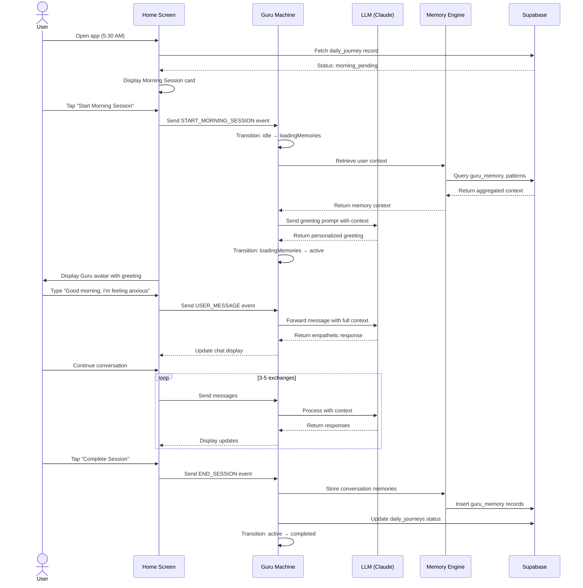
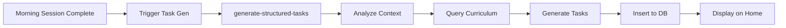

# Daily Flow Phase Scenarios

## Overview

This document defines comprehensive test scenarios for all 4 daily phases in the ConsciousOS system. Each scenario includes user actions, system responses, and the six-layer technical documentation requirements.

## Phase Timeline

```
┌─────────────────────────────────────────────────────────────────────────┐
│                         24-HOUR DAILY FLOW                               │
├─────────────────────────────────────────────────────────────────────────┤
│                                                                         │
│  5:00 AM ┌─────────────────────────────────────────────────┐            │
│          │        MORNING PHASE (5:00 AM - 11:59 AM)        │            │
│          │  • Guru morning greeting                         │            │
│          │  • Intention setting                             │            │
│          │  • Morning practice (breathing/meditation)       │            │
│          │  • Task generation                               │            │
│  12:00 PM└─────────────────────────────────────────────────┘            │
│                                                                         │
│          ┌─────────────────────────────────────────────────┐            │
│          │        MIDDAY PHASE (12:00 PM - 5:59 PM)         │            │
│          │  • Midday presence check-in                      │            │
│          │  • Loop inquiry prompts                          │            │
│          │  • Practice recommendations                      │            │
│          │  • Quick reset exercises                         │            │
│   6:00 PM└─────────────────────────────────────────────────┘            │
│                                                                         │
│          ┌─────────────────────────────────────────────────┐            │
│          │       EVENING PHASE (6:00 PM - 9:59 PM)          │            │
│          │  • Day review with Guru                          │            │
│          │  • Evening reflection                            │            │
│          │  • Journal entry                                 │            │
│          │  • Tomorrow preview                              │            │
│  10:00 PM└─────────────────────────────────────────────────┘            │
│                                                                         │
│          ┌─────────────────────────────────────────────────┐            │
│          │         NIGHT PHASE (10:00 PM - 4:59 AM)         │            │
│          │  • Sleep preparation                             │            │
│          │  • Night grounding practices                     │            │
│          │  • Dream journaling (5:00 AM - 9:00 AM window)   │            │
│          │  • Gratitude practice                            │            │
│   5:00 AM└─────────────────────────────────────────────────┘            │
│                                                                         │
└─────────────────────────────────────────────────────────────────────────┘
```

---

## Morning Phase (5:00 AM - 11:59 AM)

### Scenario MOR-001: Complete Morning Session with Guru

**Priority**: P0 (Critical)  
**Duration**: ~10 minutes simulated  
**Six-Layer Documentation**: All layers enabled

#### User Journey



#### Six-Layer Documentation

**User Layer**:
- Initial screen state with Morning Session card visible
- Tap coordinates on "Start Morning Session" button
- Chat interface rendering with message bubbles
- Text input field interaction
- Session completion button interaction

**AI Layer**:
- System prompt: "You are the ConsciousOS Guru..."
- Context window: Previous day summary, active loops, user patterns
- User message: "Good morning, I'm feeling anxious about work today"
- LLM response with empathy and inquiry
- Token usage: ~350 input, ~180 output tokens
- Response latency: ~1200ms

**State Layer**:
- guruMachine transitions:
  - `idle` → `loadingMemories` on START_MORNING_SESSION
  - `loadingMemories` → `active` on MEMORIES_LOADED
  - `active` → `processing` on USER_MESSAGE
  - `processing` → `active` on RESPONSE_RECEIVED
  - `active` → `completing` on END_SESSION
  - `completing` → `completed` on SESSION_SAVED

**Memory Layer**:
- Retrieve: `guru_memory` where user_id = X, last 7 days
- Retrieve: `user_loops` active patterns
- Store: New conversation memory with tags ["morning", "anxiety", "work"]
- Context aggregation: Merge yesterday + patterns + current mood

**Engine Layer**:
- `morning-context-aggregator` runs
  - Input: user_id, day_number, previous_day_data
  - Output: Context object for Guru prompt
- `extract-morning-data` runs
  - Parses conversation for mood, energy, intention
  - Updates daily_journeys record

**Database Layer**:
```sql
-- Fetch daily journey
SELECT * FROM daily_journeys 
WHERE user_id = 'uuid' AND date = CURRENT_DATE;

-- Fetch memories
SELECT * FROM guru_memory 
WHERE user_id = 'uuid' 
AND created_at > NOW() - INTERVAL '7 days';

-- Insert new memory
INSERT INTO guru_memory (user_id, content, tags, importance)
VALUES ('uuid', 'User expressed work anxiety...', ['anxiety', 'work'], 8);

-- Update journey status
UPDATE daily_journeys 
SET status = 'tasks_active', morning_session_id = 'sess_id'
WHERE id = 'journey_id';
```

---

### Scenario MOR-002: Set Daily Intention

**Priority**: P0 (Critical)  
**Duration**: ~3 minutes  
**Prerequisites**: MOR-001 completed

#### User Journey

1. User completes Guru conversation
2. System prompts: "What is your intention for today?"
3. User types intention (or selects from suggestions)
4. System confirms and stores intention
5. Intention displayed on Home screen

#### Six-Layer Documentation

**User Layer**:
- Intention input modal/dialog appears
- Text field with placeholder: "Today I intend to..."
- Suggestion chips below input
- Save/Confirm button state changes
- Intention card appears on Home

**AI Layer**:
- Prompt: "Based on the conversation, suggest 3 intentions..."
- Suggestions generated: ["Stay present during meetings", "Practice self-compassion", "Take mindful breaks"]
- Token usage: ~200 tokens

**State Layer**:
- `intentionMachine` state transitions
- Context: `{ intention: string | null, suggested: string[] }`

**Memory Layer**:
- Store intention in daily_journeys.analysis
- Link to morning session context

**Engine Layer**:
- `intention-suggestion-engine` generates options
- Input: Conversation transcript, user patterns
- Output: 3 contextual intention suggestions

**Database Layer**:
```sql
UPDATE daily_journeys 
SET analysis = jsonb_set(analysis, '{intention}', '"Stay present..."')
WHERE user_id = 'uuid' AND date = CURRENT_DATE;
```

---

### Scenario MOR-003: Morning Breathing Practice

**Priority**: P1 (High)  
**Duration**: ~5 minutes

#### User Journey

1. User selects "Start Practice" from morning tasks
2. Practice screen loads with breathing animation
3. Audio guidance begins (if enabled)
4. User completes 5-minute breathing exercise
5. XP awarded, completion recorded

#### Six-Layer Documentation

**User Layer**:
- Practice card click
- Practice screen with animated breath circle
- Play/pause controls
- Timer display (5:00 → 0:00)
- Completion celebration animation

**AI Layer**:
- Optional: AI-generated personalized guidance text
- Text-to-speech for audio guidance

**State Layer**:
- `practiceMachine` states:
  - `idle` → `loading` → `ready` → `playing` → `paused` / `playing` → `completed`
- Timer actor spawned

**Memory Layer**:
- Record practice completion
- Update capacity scores (Presence, Body Awareness)

**Engine Layer**:
- `practice-timer-engine` manages countdown
- `xp-calculation-engine` awards XP
- `capacity-growth-engine` updates H-Levels

**Database Layer**:
```sql
INSERT INTO practice_history (user_id, practice_type, duration, completed_at)
VALUES ('uuid', 'breathwork', 300, NOW());

UPDATE profiles 
SET xp = xp + 25 
WHERE user_id = 'uuid';
```

---

### Scenario MOR-004: Task Generation

**Priority**: P0 (Critical)  
**Duration**: ~2 minutes (background)

#### User Journey

1. After morning session, system generates tasks
2. Tasks appear on Home screen
3. User reviews task list
4. Tasks organized by time segment

#### Technical Flow



#### Six-Layer Documentation

**User Layer**:
- Loading indicator: "Generating your tasks..."
- Task cards appear on Home
- Task count badge updates
- Task domain icons display

**AI Layer**:
- Prompt includes: Level, lesson, morning context, active loops
- Response: JSON array of tasks with titles, descriptions, durations

**State Layer**:
- `taskMachine` transitions to `generating`
- Spawn `taskGenerationActor`
- On completion: transition to `ready`

**Memory Layer**:
- Retrieve current level, lesson progress
- Retrieve active loops for task alignment
- Store generated tasks

**Engine Layer**:
- `generate-structured-tasks` Supabase Edge Function
  - Input: user_id, level, morning_data
  - Process: Query curriculum, apply level rules, align with loops
  - Output: 3-6 tasks with domains, durations, XP rewards

**Database Layer**:
```sql
-- Get user level and lesson
SELECT level, current_lesson_id FROM profiles WHERE user_id = 'uuid';

-- Get lesson content
SELECT * FROM curriculum_lessons WHERE id = 'lesson_id';

-- Insert generated tasks
INSERT INTO tasks (journey_id, domain_id, title, description, duration_minutes, xp_reward, time_segment)
VALUES 
  ('journey_id', 'domain_uuid', 'Morning reflection', 'Journal about...', 10, 15, 'morning'),
  ('journey_id', 'domain_uuid', 'Breathing practice', 'Complete box breathing', 5, 10, 'morning');
```

---

## Midday Phase (12:00 PM - 5:59 PM)

### Scenario MID-001: Midday Presence Check-in

**Priority**: P1 (High)

#### User Journey

1. User opens app during midday window
2. "Midday Presence" card appears (if conditions met)
3. User taps card
4. Presence overlay appears with 3-4 prompts
5. User selects a prompt or types own
6. Brief journal entry or quick response
7. XP awarded

#### Visibility Conditions
- Time is 12pm-6pm
- Morning session completed
- At least 1 task completed
- User hasn't done midday presence today

#### Six-Layer Documentation

**User Layer**:
- Presence card visibility on Home
- Card tap interaction
- Overlay modal with prompts
- Prompt selection or custom input
- Submit action

**AI Layer**:
- `structured-presence-prompts` edge function
- Generates 3-4 level-appropriate prompts
- Input: user level, current lesson, morning context

**State Layer**:
- `middayPresenceMachine` manages overlay state
- Transitions: `closed` → `opening` → `open` → `responding` → `submitted` → `closed`

**Memory Layer**:
- Store presence response in journal_entries
- Tag as "midday_presence"
- Update capacity: Presence, Observation

**Engine Layer**:
- `presence-prompt-engine` generates contextual prompts
- Level-based prompt complexity scaling

**Database Layer**:
```sql
-- Check visibility conditions
SELECT COUNT(*) FROM tasks 
WHERE journey_id = 'journey_id' AND status = 'completed';

-- Insert presence response as journal entry
INSERT INTO journal_entries (user_id, content, tags, entry_type)
VALUES ('uuid', 'I noticed tension in my shoulders...', ['midday_presence'], 'quick');
```

---

### Scenario MID-002: Loop Inquiry Prompt

**Priority**: P0 (Critical)

#### User Journey

1. System detects active loop pattern
2. Notification or card: "Time for loop inquiry"
3. User engages with inquiry prompt
4. Guided self-inquiry questions
5. Insights captured

#### Six-Layer Documentation

**User Layer**:
- Loop inquiry card/badge
- Inquiry question display
- Response input (text or voice)
- Progress indicator for inquiry depth

**AI Layer**:
- Contextual inquiry based on loop type
- Follow-up questions based on responses
- Pattern recognition in user answers

**State Layer**:
- `loopInquiryMachine` states
- Integration with `loopMachine`

**Memory Layer**:
- Retrieve active loop details
- Store inquiry responses
- Track loop dissolution progress

**Engine Layer**:
- `loop-inquiry-engine` generates questions
- `loop-progress-calculator` updates dissolution %

**Database Layer**:
```sql
-- Get active loops
SELECT * FROM user_loops 
WHERE user_id = 'uuid' AND status = 'active';

-- Update loop progress
UPDATE user_loops 
SET dissolution_progress = dissolution_progress + 5
WHERE id = 'loop_id';
```

---

## Evening Phase (6:00 PM - 9:59 PM)

### Scenario EVE-001: Evening Sandhya Session

**Priority**: P0 (Critical)

#### User Journey

1. User opens app in evening window
2. "Evening Sandhya" card displayed
3. Tap to start evening session
4. Guru reviews the day with user
5. Day summary shown
6. Reflection prompts
7. XP and progress updates

#### Six-Layer Documentation

**User Layer**:
- Evening Sandhya card state
- Session start interaction
- Chat interface with day review
- Summary statistics display
- Completion flow

**AI Layer**:
- Full day context provided to LLM
- Personalized day review
- Level-specific reflection questions

**State Layer**:
- `eveningSessionMachine` manages flow
- Integration with `guruMachine`

**Memory Layer**:
- Aggregate day data for context
- Store evening conversation
- Update capacity markers

**Engine Layer**:
- `evening-sandhya-context` aggregates:
  - Morning data (mood, intention)
  - Tasks completed/skipped
  - Midday presence responses
  - Journal entries
  - Practice completions

**Database Layer**:
```sql
-- Aggregate day data
SELECT 
  d.mood, d.intention, d.status,
  COUNT(t.id) FILTER (WHERE t.status = 'completed') as tasks_completed,
  COUNT(t.id) FILTER (WHERE t.status = 'skipped') as tasks_skipped
FROM daily_journeys d
LEFT JOIN tasks t ON t.journey_id = d.id
WHERE d.user_id = 'uuid' AND d.date = CURRENT_DATE
GROUP BY d.id;
```

---

### Scenario EVE-002: Day Review Journal Entry

**Priority**: P0 (Critical)

#### User Journey

1. After evening conversation, journal prompt appears
2. User writes evening reflection
3. System suggests tags based on content
4. Entry saved with XP award
5. Entry feeds into memory system

#### Six-Layer Documentation

**User Layer**:
- Journal prompt screen
- Rich text editor
- Tag suggestions
- Save/submit flow
- Confirmation toast

**AI Layer**:
- Optional: AI suggests reflection prompts
- Content analysis for auto-tagging

**State Layer**:
- `journalMachine` manages entry flow
- Auto-save actor spawned

**Memory Layer**:
- Store journal entry
- Extract keywords for tags
- Link to daily journey
- Update long-term patterns

**Engine Layer**:
- `journal-analysis-engine` extracts themes
- `tag-suggestion-engine` recommends tags

**Database Layer**:
```sql
INSERT INTO journal_entries (
  user_id, journey_id, content, mood, tags, word_count, entry_type
) VALUES (
  'uuid', 'journey_id', 'Today I noticed...', 'reflective', 
  ['evening', 'gratitude'], 150, 'evening_reflection'
);
```

---

## Night Phase (10:00 PM - 4:59 AM)

### Scenario NGT-001: Sleep Preparation Practice

**Priority**: P1 (High)

#### User Journey

1. User opens app after 10 PM
2. Night mode card displayed
3. Sleep preparation practice offered
4. User completes grounding exercise
5. Sleep well wishes displayed

#### Six-Layer Documentation

**User Layer**:
- Night mode UI (darker theme)
- Sleep prep card
- Practice player interface
- Completion screen

**State Layer**:
- `nightModeMachine` manages night UI
- `practiceMachine` for exercise

**Engine Layer**:
- `sleep-prep-engine` selects appropriate exercise
- Based on: day stress level, user preferences, level

**Database Layer**:
```sql
UPDATE daily_journeys 
SET practice_completed = true, 
    practice_type = 'sleep_preparation'
WHERE user_id = 'uuid' AND date = CURRENT_DATE;
```

---

### Scenario NGT-002: Dream Journal Entry

**Priority**: P0 (Critical)  
**Time Window**: 5:00 AM - 9:00 AM (next day)

#### User Journey

1. User opens app in morning (5-9 AM)
2. "Did you dream last night?" prompt appears
3. User can tap to record dream
4. Quick capture interface
5. Dream stored, feeds into morning context

#### Six-Layer Documentation

**User Layer**:
- Dream prompt card
- Quick capture modal
- Text or voice input
- Confirmation

**AI Layer**:
- Optional: Dream symbol analysis
- Integration with morning context

**Memory Layer**:
- Store dream entry
- Tag with "dream_journal"
- Available for morning Guru context

**Database Layer**:
```sql
INSERT INTO journal_entries (
  user_id, content, tags, entry_type, recorded_at
) VALUES (
  'uuid', 'I was flying over a forest...', 
  ['dream', 'night'], 'dream_journal', NOW()
);
```

---

## Scenario Execution Matrix

| Day Range | Morning | Midday | Evening | Night |
|-----------|---------|--------|---------|-------|
| Day 1-7   | MOR-001, 002, 004 | MID-001 | EVE-001, 002 | NGT-001 |
| Day 8-30  | All MOR | All MID | All EVE | All NGT |
| Day 31-90 | All MOR | All MID + MID-002 | All EVE | All NGT |
| Day 91-150| All MOR | All MID + MID-002 | All EVE + advanced | All NGT |

## Validation Criteria

Each scenario must validate:

1. **User Layer**: All UI elements visible, interactions succeed
2. **AI Layer**: LLM responses received within 3 seconds, parse correctly
3. **State Layer**: All XState transitions valid, no impossible states
4. **Memory Layer**: All memory operations complete, data retrievable
5. **Engine Layer**: All engines execute, return valid output
6. **Database Layer**: All queries succeed, RLS policies pass, realtime events fire
