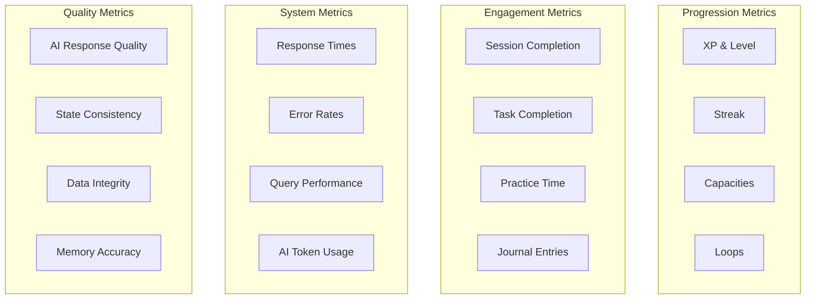

# Metrics and Data Capture Specification

## Overview

This document defines all metrics and data captured during the 100-150 day E2E simulation. These metrics validate system behavior, track user progression, and provide insights into the ConsciousOS platform.

## Metric Categories



## 1. Progression Metrics

### 1.1 XP and Level Tracking

**Captured Data**:
```typescript
interface XPMetrics {
  // Daily
  dayNumber: number;
  startingXP: number;
  xpEarned: number;
  xpBySource: Record<string, number>; // { task_complete: 50, practice: 25, ... }
  endingXP: number;
  
  // Level progression
  startingLevel: number;
  levelUps: Array<{
    fromLevel: number;
    toLevel: number;
    timestamp: string;
  }>;
  endingLevel: number;
  
  // Projections
  projectedLevelAtDay150: number;
  xpProgressToNextLevel: number; // percentage
}
```

**Expected Progression**:

| Day | Expected XP | Expected Level | XP to Next |
|-----|-------------|----------------|------------|
| 1 | 0-100 | 1 | 400-500 |
| 7 | 350-500 | 1 | 0-150 |
| 14 | 750-900 | 2 | 300-450 |
| 30 | 1800-2200 | 3 | 300-700 |
| 60 | 4200-5000 | 5 | 1000-1800 |
| 90 | 7200-8500 | 7 | 1500-2800 |
| 120 | 10000-12000 | 10 | 0-2000 |
| 150 | 13000-16000 | 13 | 2000-5000 |

### 1.2 Streak Metrics

```typescript
interface StreakMetrics {
  currentStreak: number;
  longestStreak: number;
  streakFreezesUsed: number;
  streakFreezesRemaining: number;
  
  // Daily streak status
  dailyStatus: Array<{
    day: number;
    completed: boolean;
    streakMaintained: boolean;
    freezeUsed: boolean;
  }>;
  
  // Milestones
  milestonesReached: number[]; // [7, 14, 30, 60, 90, 100, ...]
}
```

### 1.3 Capacity Growth (H-Levels)

```typescript
interface CapacityMetrics {
  capacities: Record<string, {
    name: string;
    startValue: number;
    currentValue: number;
    growth: number;
    milestones: Array<{
      value: number;
      day: number;
    }>;
  }>;
  
  dominantCapacity: string;
  weakestCapacity: string;
  averageCapacity: number;
  
  // Growth rate
  dailyGrowthRate: number;
  projectedCompletion: number; // Day when all reach 10
}

**12 Capacities Tracked**:
1. Attention
2. Observation
3. Presence
4. Body Awareness
5. Emotional Mastery
6. Pattern Recognition
7. Self Inquiry
8. Disidentification
9. Shadow Integration
10. Equanimity
11. Surrender
12. Unification
```

### 1.4 Loop Progression

```typescript
interface LoopMetrics {
  totalLoopsDetected: number;
  activeLoops: number;
  resolvingLoops: number;
  dissolvedLoops: number;
  
  loopDetails: Array<{
    loopId: string;
    patternName: string;
    detectedDay: number;
    currentStage: 'detected' | 'active' | 'resolving' | 'dissolved';
    dissolutionProgress: number;
    inquiriesCompleted: number;
    insightsGained: number;
  }>;
  
  // Dissolution velocity
  averageDissolutionRate: number; // % per week
  projectedDissolutionTimeline: Record<string, number>; // loop -> estimated day
}
```

## 2. Engagement Metrics

### 2.1 Session Completion

```typescript
interface SessionMetrics {
  // By phase
  morningSessions: {
    attempted: number;
    completed: number;
    completionRate: number;
    averageDuration: number; // seconds
  };
  middayPresence: {
    attempted: number;
    completed: number;
    completionRate: number;
  };
  eveningSessions: {
    attempted: number;
    completed: number;
    completionRate: number;
    averageDuration: number;
  };
  nightSessions: {
    attempted: number;
    completed: number;
    completionRate: number;
  };
  
  // Overall
  totalSessionsCompleted: number;
  totalSessionsPossible: number;
  overallCompletionRate: number;
}
```

### 2.2 Task Completion

```typescript
interface TaskMetrics {
  // Daily stats
  tasksGeneratedPerDay: {
    min: number;
    max: number;
    average: number;
  };
  
  // Completion by status
  completed: number;
  skipped: number;
  pending: number;
  inProgress: number;
  
  // By time segment
  bySegment: Record<TimeSegment, {
    generated: number;
    completed: number;
    completionRate: number;
  }>;
  
  // XP earned from tasks
  totalTaskXP: number;
  averageXPPerTask: number;
  
  // Trends
  completionTrend: 'improving' | 'stable' | 'declining';
  weeklyCompletionRates: number[];
}
```

### 2.3 Practice Metrics

```typescript
interface PracticeMetrics {
  // Count
  totalPractices: number;
  byType: Record<PracticeType, number>;
  
  // Duration
  totalPracticeTime: number; // seconds
  averagePracticeDuration: number;
  longestPractice: number;
  shortestPractice: number;
  
  // Consistency
  dailyPracticeStreak: number;
  daysWithPractice: number;
  daysWithoutPractice: number;
  
  // Time of day
  byTimeOfDay: Record<TimeSegment, {
    count: number;
    totalDuration: number;
  }>;
}
```

### 2.4 Journal Metrics

```typescript
interface JournalMetrics {
  totalEntries: number;
  byType: Record<EntryType, number>;
  
  // Content
  totalWordsWritten: number;
  averageWordsPerEntry: number;
  longestEntry: number;
  shortestEntry: number;
  
  // Consistency
  entriesPerWeek: number[];
  currentStreak: number;
  longestStreak: number;
  
  // Themes (extracted via AI)
  commonThemes: string[];
  emotionalToneTrend: Array<{
    day: number;
    tone: string;
    confidence: number;
  }>;
}
```

## 3. System Performance Metrics

### 3.1 Response Times

```typescript
interface PerformanceMetrics {
  // Page load
  averagePageLoadTime: number;
  maxPageLoadTime: number;
  minPageLoadTime: number;
  
  // API responses
  apiResponseTimes: Record<string, {
    average: number;
    p50: number;
    p95: number;
    p99: number;
  }>;
  
  // AI response
  aiResponseTime: {
    average: number;
    p50: number;
    p95: number;
    max: number;
  };
  
  // Database queries
  dbQueryTime: {
    average: number;
    slowQueries: number; // > 100ms
  };
}
```

**Target Thresholds**:

| Metric | Target | Warning | Critical |
|--------|--------|---------|----------|
| Page Load | < 2s | 2-4s | > 4s |
| API Response | < 200ms | 200-500ms | > 500ms |
| AI Response | < 2s | 2-5s | > 5s |
| DB Query | < 50ms | 50-100ms | > 100ms |

### 3.2 Error Rates

```typescript
interface ErrorMetrics {
  totalErrors: number;
  errorRate: number; // percentage
  
  byCategory: {
    api: number;
    ai: number;
    database: number;
    state: number;
    ui: number;
  };
  
  bySeverity: {
    critical: number;
    error: number;
    warning: number;
  };
  
  autoFixed: number;
  manuallyResolved: number;
  unresolved: number;
}
```

### 3.3 AI Token Usage

```typescript
interface TokenMetrics {
  totalInputTokens: number;
  totalOutputTokens: number;
  totalTokens: number;
  
  // By model
  byModel: Record<string, {
    input: number;
    output: number;
  }>;
  
  // By session type
  bySessionType: Record<string, {
    tokens: number;
    sessions: number;
    averagePerSession: number;
  }>;
  
  // Costs (if applicable)
  estimatedCost: number;
  costPerDay: number;
}
```

## 4. Quality Metrics

### 4.1 State Consistency

```typescript
interface StateConsistencyMetrics {
  // XState validation
  invalidTransitions: number;
  impossibleStates: number;
  guardFailures: number;
  
  // Data consistency
  orphanedRecords: number;
  referentialIntegrityErrors: number;
  
  // Sync status
  serverClientMismatches: number;
  realtimeSyncFailures: number;
}
```

### 4.2 Data Integrity

```typescript
interface DataIntegrityMetrics {
  // Completeness
  requiredFieldsMissing: number;
  nullViolations: number;
  
  // Validity
  constraintViolations: number;
  typeMismatches: number;
  
  // Uniqueness
  duplicateRecords: number;
  
  // Timeliness
  staleData: number; // Records not updated when expected
}
```

### 4.3 Memory Accuracy

```typescript
interface MemoryAccuracyMetrics {
  // Retrieval accuracy
  relevantMemoriesRetrieved: number;
  irrelevantMemoriesRetrieved: number;
  relevantMemoriesMissed: number;
  
  precision: number; // relevant / total retrieved
  recall: number; // relevant retrieved / total relevant
  f1Score: number;
  
  // Pattern detection accuracy
  truePatterns: number;
  falsePatterns: number;
  missedPatterns: number;
}
```

## 5. Daily Metrics Report

Each day generates a metrics report:

```typescript
interface DailyMetricsReport {
  dayNumber: number;
  date: string;
  
  summary: {
    totalInteractions: number;
    totalXP: number;
    level: number;
    streak: number;
  };
  
  phases: Record<TimePhase, PhaseMetrics>;
  
  system: {
    avgResponseTime: number;
    errors: number;
    warnings: number;
  };
  
  // Comparisons
  vsYesterday: DailyComparison;
  vsLastWeek: DailyComparison;
  vsProjection: ProjectionComparison;
}
```

## 6. Aggregation and Reporting

### 6.1 Weekly Aggregation

```typescript
interface WeeklyMetrics {
  weekNumber: number;
  startDay: number;
  endDay: number;
  
  // Summaries
  totalXP: number;
  sessionsCompleted: number;
  tasksCompleted: number;
  practicesCompleted: number;
  journalEntries: number;
  
  // Trends
  trendDirection: 'up' | 'down' | 'stable';
  trendPercentage: number;
  
  // Anomalies
  anomalies: string[];
  issues: string[];
}
```

### 6.2 Milestone Reports

Generated at key milestones: Day 7, 14, 30, 60, 90, 100, 120, 150

```typescript
interface MilestoneReport {
  dayNumber: number;
  
  // Achievement
  levelAchieved: number;
  xpTotal: number;
  streakLength: number;
  
  // Progress
  completionRate: number;
  capacityGrowth: Record<string, number>;
  loopsProgress: number;
  
  // Insights
  keyInsights: string[];
  patternsIdentified: string[];
  challengesFaced: string[];
  
  // Comparison to projection
  onTrack: boolean;
  variance: number;
}
```

## 7. Data Capture Implementation

### 7.1 Capture Points

Metrics are captured at:

1. **User Actions**: Every click, type, navigation
2. **State Transitions**: Every XState transition
3. **API Calls**: Request/response for all Supabase calls
4. **AI Interactions**: Prompt, response, tokens, latency
5. **Database Operations**: Query, result, execution time
6. **Phase Completion**: Summary of each phase
7. **Day Completion**: Daily aggregation

### 7.2 Storage Format

```json
{
  "simulationId": "sim-001",
  "dayNumber": 1,
  "timestamp": "2026-03-05T08:30:00Z",
  "metrics": {
    "progression": { ... },
    "engagement": { ... },
    "system": { ... },
    "quality": { ... }
  },
  "rawData": {
    "interactions": [],
    "stateTransitions": [],
    "apiCalls": [],
    "aiExchanges": [],
    "dbQueries": []
  }
}
```

### 7.3 Export Formats

- **JSON**: Machine-readable for analysis
- **CSV**: Spreadsheet-compatible for manual review
- **Markdown**: Human-readable daily reports
- **HTML**: Interactive dashboards

## 8. Validation Criteria

### 8.1 Passing Thresholds

| Metric | Minimum | Target | Excellent |
|--------|---------|--------|-----------|
| Task Completion Rate | 60% | 80% | 90% |
| Session Completion Rate | 70% | 85% | 95% |
| XP Progression | 80% of projection | 100% | 120% |
| Response Time | < 5s | < 2s | < 1s |
| Error Rate | < 5% | < 1% | < 0.1% |
| State Consistency | 95% | 99% | 100% |

### 8.2 Alert Conditions

Generate alerts when:
- Error rate exceeds 5%
- Response time exceeds 5 seconds
- Task completion drops below 50%
- Data integrity violations detected
- Memory accuracy drops below 80%
