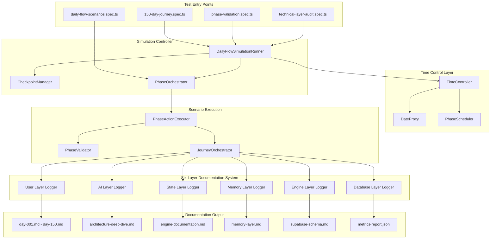

# ConsciousOS 100-150 Day E2E Testing & Documentation Framework

## Overview

This comprehensive testing framework simulates 100-150 days of user journeys through the ConsciousOS daily flow system, providing deep technical documentation of every interaction across all system layers.

## Purpose

- **Validate** complete user journeys across all 4 daily phases
- **Document** every user interaction, AI response, and system operation
- **Analyze** technical under-the-hood behavior across 6 layers
- **Capture** metrics for performance, progression, and system health
- **Enable** automated long-term simulation with comprehensive reporting

## System Architecture



## Daily Flow Phases

| Phase | Time Range | Key Activities | Technical Focus |
|-------|------------|----------------|-----------------|
| **Morning** | 5:00 AM - 11:59 AM | Intention setting, Guru chat, morning practice | Morning session engine, task generation |
| **Midday** | 12:00 PM - 5:59 PM | Loop inquiry, check-in prompts, practice recommendations | Presence prompts, midday overlay |
| **Evening** | 6:00 PM - 9:59 PM | Day review, evening reflection, journal entry | Evening sandhya, day aggregation |
| **Night** | 10:00 PM - 4:59 AM | Sleep preparation, dream journaling, night practice | Night mode, dream capture |

## Six-Layer Documentation Model

Every interaction is documented across six technical layers:

### 1. User Layer (UI)
- What user sees on screen
- User inputs (clicks, typing, selections)
- UI component states
- Visual feedback and transitions

### 2. AI Layer (LLM)
- Prompts sent to LLM
- Responses received from LLM
- Context window contents
- Token usage and timing

### 3. State Layer (XState)
- Machine state transitions
- Context changes
- Actor communications
- Event dispatch sequence

### 4. Memory Layer (Context)
- Short-term session memory
- Long-term pattern memory
- Guru memory retrieval/storage
- Context aggregation

### 5. Engine Layer (Processing)
- Which engines execute
- Input/output transformations
- Calculation logic
- Decision algorithms

### 6. Database Layer (Supabase)
- SQL queries executed
- Data inserted/updated
- RLS policy evaluations
- Real-time broadcast events

## File Structure

```
docs/e2e-daily-flow-simulation/
├── README.md                          # This file - framework overview
├── TESTING_FRAMEWORK_DESIGN.md        # Complete testing architecture
├── DAILY_PHASE_SCENARIOS.md           # All 4 phases scenario specifications
├── SIX_LAYER_DOCUMENTATION.md         # Documentation layer specifications
├── METRICS_AND_CAPTURE.md             # What data to capture and how
├── architecture-deep-dive.md          # Technical architecture deep dive
├── engine-documentation.md            # All engines explained
├── memory-layer.md                    # Memory system documentation
├── supabase-schema.md                 # Database operations reference
├── templates/
│   ├── day-template.md                # Template for daily documentation
│   └── scenario-template.md           # Template for scenario documentation
└── days/
    ├── day-001.md                     # Day 1 documentation
    ├── day-002.md                     # Day 2 documentation
    ├── ...
    ├── day-050.md                     # Day 50 milestone
    ├── ...
    └── day-150.md                     # Day 150 completion
```

## Key Capabilities

### Time Simulation
- Browser-level time mocking via `DateProxyController`
- Phase transitions: morning → midday → evening → night
- Day advancement with state persistence
- Checkpoint creation every 10 days

### Scenario Coverage
- **Morning**: Intention setting, Guru conversation, task generation
- **Midday**: Presence prompts, loop inquiry, check-ins
- **Evening**: Day review, reflection, evening sandhya
- **Night**: Sleep prep, dream journaling, night practices

### Metrics Captured
- XP and level progression
- Loop detection and dissolution progress
- Capacity development across 12 H-Levels
- Practice completion rates
- Journal entry patterns
- AI response quality metrics

## Running the Simulation

```bash
# Full 150-day simulation
npx playwright test e2e/simulation/150-day-journey.spec.ts

# Specific phase validation
npx playwright test e2e/simulation/daily-phases.spec.ts --grep "morning"

# Generate documentation
npm run docs:generate:e2e

# Resume from checkpoint
npx playwright test e2e/simulation/150-day-journey.spec.ts --resume
```

## Integration with Existing Systems

This framework extends the existing 300-day simulation infrastructure:
- Reuses `SimulationRunner` and `DayOrchestrator`
- Leverages existing loggers (AI, State, Journal, Performance)
- Integrates with `AutoFixEngine` for error recovery
- Uses established time control mechanisms

## Success Criteria

- All 150 days documented with 6-layer depth
- 100% phase coverage across all 4 time periods
- Complete engine execution traces
- Memory layer operations logged
- Database queries captured and explained
- Metrics validation against expected progression curves
