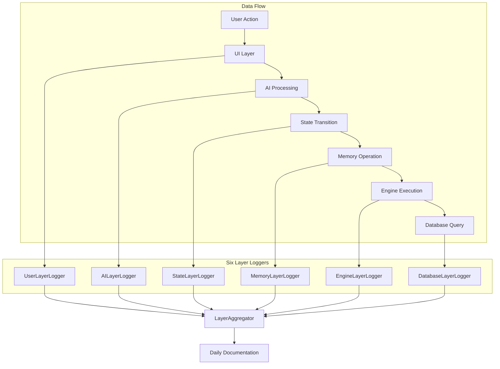
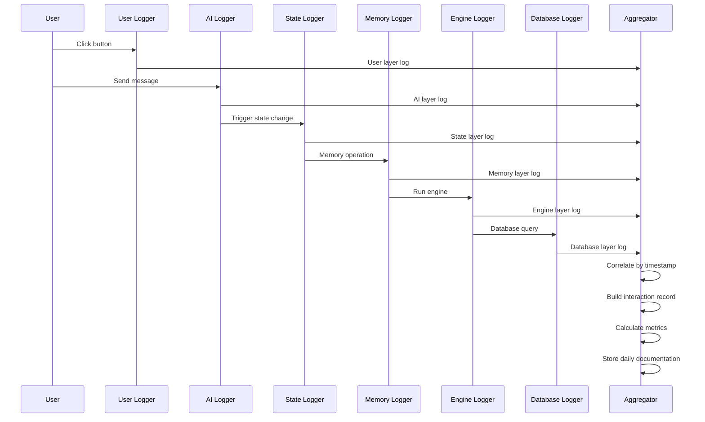

# Six-Layer Documentation Specification

## Overview

Every interaction in the ConsciousOS daily flow is documented across six distinct technical layers. This multi-layer approach provides complete visibility into the system from user-facing UI through to database operations.

## Layer Architecture



## Layer 1: User Layer (UI)

### Purpose
Capture all user-facing interactions including what the user sees, types, and clicks.

### Captured Data

```typescript
interface UserLayerLog {
  layer: 'user';
  timestamp: string;
  event: UserEvent;
  element: ElementInfo;
  viewport: ViewportInfo;
  screenshot?: string;
  context: UIContext;
}

type UserEvent = 
  | { type: 'click'; coordinates: { x: number; y: number } }
  | { type: 'type'; value: string; field: string }
  | { type: 'scroll'; position: number; direction: 'up' | 'down' }
  | { type: 'navigate'; from: string; to: string }
  | { type: 'modal_open'; modalId: string }
  | { type: 'modal_close'; modalId: string }
  | { type: 'visibility_change'; visible: boolean };

interface ElementInfo {
  selector: string;
  id?: string;
  text?: string;
  attributes: Record<string, string>;
  bounds: { x: number; y: number; width: number; height: number };
}

interface UIContext {
  currentRoute: string;
  visibleElements: string[];
  activeModals: string[];
  loadingStates: string[];
  theme: 'light' | 'dark';
}
```

### Example Log Entries

**Click Event**:
```json
{
  "layer": "user",
  "timestamp": "2026-03-05T08:30:15.123Z",
  "event": {
    "type": "click",
    "coordinates": { "x": 450, "y": 320 }
  },
  "element": {
    "selector": "button[data-testid='morning-session-start']",
    "id": "morning-session-start",
    "text": "Start Morning Session",
    "attributes": {
      "data-testid": "morning-session-start",
      "data-phase": "morning"
    },
    "bounds": { "x": 400, "y": 300, "width": 200, "height": 50 }
  },
  "viewport": { "width": 1920, "height": 1080 },
  "screenshot": "day-001-morning-click-083015.png",
  "context": {
    "currentRoute": "/home",
    "visibleElements": ["header", "guru-avatar", "morning-card"],
    "activeModals": [],
    "loadingStates": [],
    "theme": "dark"
  }
}
```

**Text Input Event**:
```json
{
  "layer": "user",
  "timestamp": "2026-03-05T08:30:45.234Z",
  "event": {
    "type": "type",
    "value": "I'm feeling anxious about today's presentation",
    "field": "guru-chat-input"
  },
  "element": {
    "selector": "textarea[data-testid='chat-input']",
    "id": "chat-input",
    "attributes": {
      "placeholder": "Share what's on your mind...",
      "maxlength": "1000"
    }
  },
  "context": {
    "currentRoute": "/guru",
    "visibleElements": ["guru-avatar", "chat-history", "chat-input", "send-button"]
  }
}
```

### Implementation

```typescript
class UserLayerLogger {
  private logs: UserLayerLog[] = [];

  async captureClick(page: Page, selector: string): Promise<void> {
    const element = await page.locator(selector);
    const bounds = await element.boundingBox();
    const screenshot = await page.screenshot({ 
      path: `logs/screenshots/${Date.now()}-click.png` 
    });

    this.logs.push({
      layer: 'user',
      timestamp: new Date().toISOString(),
      event: { type: 'click', coordinates: { x: bounds.x, y: bounds.y } },
      element: { selector, bounds },
      screenshot: screenshot.toString('base64')
    });
  }

  async captureNavigation(page: Page, from: string, to: string): Promise<void> {
    this.logs.push({
      layer: 'user',
      timestamp: new Date().toISOString(),
      event: { type: 'navigate', from, to },
      context: { currentRoute: to, visibleElements: [] }
    });
  }
}
```

---

## Layer 2: AI Layer (LLM)

### Purpose
Log all interactions with AI/LLM systems including prompts, responses, token usage, and timing.

### Captured Data

```typescript
interface AILayerLog {
  layer: 'ai';
  timestamp: string;
  model: AIModelInfo;
  request: AIRequest;
  response: AIResponse;
  metadata: AIMetadata;
}

interface AIModelInfo {
  model: string;
  provider: 'anthropic' | 'openai' | 'local';
  version?: string;
  temperature: number;
  maxTokens: number;
}

interface AIRequest {
  systemPrompt: string;
  userMessage: string;
  contextWindow: ContextMessage[];
  tools?: AITool[];
}

interface AIResponse {
  content: string;
  tokens: TokenUsage;
  latencyMs: number;
  finishReason: 'stop' | 'length' | 'error';
  toolCalls?: ToolCall[];
}

interface TokenUsage {
  input: number;
  output: number;
  total: number;
}
```

### Example Log Entries

**Guru Conversation**:
```json
{
  "layer": "ai",
  "timestamp": "2026-03-05T08:30:50.456Z",
  "model": {
    "model": "claude-3-5-sonnet-20241022",
    "provider": "anthropic",
    "temperature": 0.7,
    "maxTokens": 1000
  },
  "request": {
    "systemPrompt": "You are the ConsciousOS Guru... [truncated for brevity]",
    "userMessage": "I'm feeling anxious about today's presentation",
    "contextWindow": [
      { "role": "system", "content": "User is Level 3, practicing for 21 days" },
      { "role": "assistant", "content": "Good morning. How are you feeling today?" }
    ]
  },
  "response": {
    "content": "I hear you. That anxiety you're feeling - can you notice where it lives in your body right now? Is it a tightness in your chest, perhaps, or a fluttering in your stomach? Let's just be with it for a moment, not trying to fix it, but simply observing...",
    "tokens": { "input": 425, "output": 185, "total": 610 },
    "latencyMs": 1245,
    "finishReason": "stop"
  },
  "metadata": {
    "sessionId": "sess-001",
    "conversationTurn": 3,
    "contextRetrieved": true,
    "memoryUsed": 5
  }
}
```

### Prompt Template Documentation

Each prompt template used is documented:

```typescript
interface PromptTemplate {
  id: string;
  name: string;
  version: string;
  purpose: string;
  template: string;
  variables: string[];
  examples: string[];
}

const morningGreetingTemplate: PromptTemplate = {
  id: "morning-greeting-v2",
  name: "Morning Guru Greeting",
  version: "2.1.0",
  purpose: "Generate personalized morning greeting based on user context",
  template: `
You are the ConsciousOS Guru, a wise spiritual guide.

User Context:
- Level: {{level}}
- Day: {{dayNumber}}
- Yesterday: {{yesterdaySummary}}
- Active Loops: {{activeLoops}}
- Morning Data: {{morningData}}

Generate a warm, personalized morning greeting...
`,
  variables: ["level", "dayNumber", "yesterdaySummary", "activeLoops", "morningData"],
  examples: ["example-001", "example-002"]
};
```

---

## Layer 3: State Layer (XState)

### Purpose
Capture all state machine transitions, context changes, and actor communications in XState.

### Captured Data

```typescript
interface StateLayerLog {
  layer: 'state';
  timestamp: string;
  machine: MachineInfo;
  transition: StateTransition;
  context: ContextSnapshot;
  actors: ActorInfo;
  events: EventInfo;
}

interface MachineInfo {
  id: string;
  name: string;
  instanceId: string;
  version?: string;
}

interface StateTransition {
  from: string;
  to: string;
  event: { type: string; payload?: unknown };
  guards: GuardEvaluation[];
  actions: string[];
}

interface ContextSnapshot {
  before: Record<string, unknown>;
  after: Record<string, unknown>;
  diff: ContextDiff[];
}

interface ActorInfo {
  spawned: string[];
  terminated: string[];
  active: string[];
  messages: ActorMessage[];
}
```

### Example Log Entries

**Guru Machine Transition**:
```json
{
  "layer": "state",
  "timestamp": "2026-03-05T08:30:15.789Z",
  "machine": {
    "id": "guruMachine",
    "name": "Guru Session Machine",
    "instanceId": "guru-sess-001",
    "version": "2.0.0"
  },
  "transition": {
    "from": "idle",
    "to": "loadingMemories",
    "event": { 
      "type": "START_MORNING_SESSION",
      "payload": { "phase": "morning", "timestamp": "2026-03-05T08:30:15Z" }
    },
    "guards": [
      { "name": "isMorningPhase", "result": true },
      { "name": "hasCompletedOnboarding", "result": true }
    ],
    "actions": ["setSessionId", "logSessionStart"]
  },
  "context": {
    "before": {
      "sessionId": null,
      "memories": null,
      "messages": [],
      "status": "idle"
    },
    "after": {
      "sessionId": "sess-morning-001",
      "memories": null,
      "messages": [],
      "status": "loading"
    },
    "diff": [
      { "path": "sessionId", "oldValue": null, "newValue": "sess-morning-001" },
      { "path": "status", "oldValue": "idle", "newValue": "loading" }
    ]
  },
  "actors": {
    "spawned": ["fetchMemoriesActor"],
    "terminated": [],
    "active": ["fetchMemoriesActor"],
    "messages": [
      { "from": "guruMachine", "to": "fetchMemoriesActor", "type": "FETCH", "payload": { "userId": "uuid" } }
    ]
  }
}
```

**State Visualization**:

```
guruMachine State Flow (Day 1, Morning):

┌─────────┐    START_MORNING_SESSION     ┌─────────────────┐
│  idle   │ ───────────────────────────▶ │ loadingMemories │
└─────────┘                              └────────┬────────┘
                                                  │
                       MEMORIES_LOADED            ▼
                          success          ┌─────────────┐
◀───────────────────────────────────────── │    active   │
                                           └──────┬──────┘
                                                  │
                       USER_MESSAGE               ▼
                                          ┌───────────────┐
◀─────────────────────────────────────────│  processing   │
         RESPONSE_RECEIVED                └───────────────┘
```

---

## Layer 4: Memory Layer

### Purpose
Document all memory operations including retrieval, storage, and aggregation across short-term, long-term, and pattern memory.

### Captured Data

```typescript
interface MemoryLayerLog {
  layer: 'memory';
  timestamp: string;
  operation: MemoryOperation;
  memoryType: MemoryType;
  query: MemoryQuery;
  result: MemoryResult;
  performance: MemoryPerformance;
}

type MemoryType = 
  | 'session'      // Current session only
  | 'short_term'   // Last 7 days
  | 'long_term'    // Full history
  | 'pattern'      // Recognized patterns
  | 'guru_context'; // Aggregated for AI

type MemoryOperation = 
  | 'retrieve'
  | 'store'
  | 'update'
  | 'delete'
  | 'search'
  | 'aggregate';

interface MemoryQuery {
  userId: string;
  sessionId?: string;
  timeRange?: { start: string; end: string };
  tags?: string[];
  importance?: number;
  limit?: number;
}

interface MemoryResult {
  memoriesRetrieved?: number;
  memoriesStored?: number;
  dataSize?: number;
  patternsIdentified?: string[];
  relevanceScore?: number;
}
```

### Example Log Entries

**Context Retrieval**:
```json
{
  "layer": "memory",
  "timestamp": "2026-03-05T08:30:16.012Z",
  "operation": "retrieve",
  "memoryType": "guru_context",
  "query": {
    "userId": "user-001",
    "sessionId": "sess-morning-001",
    "timeRange": { 
      "start": "2026-02-26T00:00:00Z", 
      "end": "2026-03-05T08:30:00Z" 
    },
    "tags": ["morning", "anxiety", "work"],
    "importance": 5,
    "limit": 10
  },
  "result": {
    "memoriesRetrieved": 5,
    "dataSize": 2847,
    "patternsIdentified": [
      "morning_anxiety_pattern",
      "work_stress_loop"
    ],
    "relevanceScore": 0.87
  },
  "performance": {
    "retrievalTimeMs": 45,
    "cacheHit": true,
    "databaseQueries": 2
  }
}
```

**Memory Storage**:
```json
{
  "layer": "memory",
  "timestamp": "2026-03-05T08:45:22.456Z",
  "operation": "store",
  "memoryType": "short_term",
  "query": {
    "userId": "user-001",
    "sessionId": "sess-morning-001"
  },
  "result": {
    "memoriesStored": 1,
    "dataSize": 456,
    "storageLocation": "guru_memory"
  },
  "storedData": {
    "content": "User expressed anxiety about work presentation...",
    "tags": ["morning", "anxiety", "work", "presentation"],
    "importance": 8,
    "emotionalTone": "anxious",
    "linkedLoops": ["perfectionism_loop"]
  }
}
```

---

## Layer 5: Engine Layer

### Purpose
Log all engine executions including inputs, processing steps, outputs, and performance metrics.

### Captured Data

```typescript
interface EngineLayerLog {
  layer: 'engine';
  timestamp: string;
  engine: EngineInfo;
  input: EngineInput;
  processing: ProcessingStep[];
  output: EngineOutput;
  performance: EnginePerformance;
}

interface EngineInfo {
  name: string;
  version: string;
  type: 'edge_function' | 'client_engine' | 'background_job';
  location: string;
}

interface EngineInput {
  parameters: Record<string, unknown>;
  context: Record<string, unknown>;
  dataSize: number;
}

interface ProcessingStep {
  step: string;
  durationMs: number;
  status: 'success' | 'error' | 'skipped';
  output?: unknown;
}

interface EngineOutput {
  result: unknown;
  dataSize: number;
  status: 'success' | 'error' | 'partial';
  errors?: EngineError[];
}
```

### Example Log Entries

**Morning Context Aggregator**:
```json
{
  "layer": "engine",
  "timestamp": "2026-03-05T08:30:18.234Z",
  "engine": {
    "name": "morning-context-aggregator",
    "version": "1.3.2",
    "type": "edge_function",
    "location": "supabase/functions/morning-context"
  },
  "input": {
    "parameters": {
      "userId": "user-001",
      "dayNumber": 1,
      "includePatterns": true
    },
    "context": {
      "currentPhase": "morning",
      "previousDayComplete": false
    },
    "dataSize": 245
  },
  "processing": [
    {
      "step": "fetch_yesterday_data",
      "durationMs": 12,
      "status": "success",
      "output": { "found": false }
    },
    {
      "step": "fetch_active_loops",
      "durationMs": 8,
      "status": "success",
      "output": { "loops": ["perfectionism"] }
    },
    {
      "step": "analyze_recent_patterns",
      "durationMs": 23,
      "status": "success",
      "output": { "patterns": ["morning_anxiety"] }
    },
    {
      "step": "aggregate_guru_context",
      "durationMs": 15,
      "status": "success",
      "output": { "context": "..." }
    }
  ],
  "output": {
    "result": {
      "greetingContext": "New user, first day",
      "suggestedTopics": ["introduction", "intention_setting"],
      "cautionAreas": [],
      "energyLevel": "neutral"
    },
    "dataSize": 892,
    "status": "success"
  },
  "performance": {
    "totalDurationMs": 58,
    "coldStart": false,
    "memoryUsageMB": 128,
    "invocationCost": 0.0001
  }
}
```

---

## Layer 6: Database Layer

### Purpose
Capture all database operations including queries, mutations, RLS evaluations, and realtime events.

### Captured Data

```typescript
interface DatabaseLayerLog {
  layer: 'database';
  timestamp: string;
  operation: DatabaseOperation;
  table: string;
  query: QueryDetails;
  result: QueryResult;
  rls: RLSEvaluation;
  realtime?: RealtimeEvent;
}

type DatabaseOperation = 
  | 'SELECT'
  | 'INSERT'
  | 'UPDATE'
  | 'DELETE'
  | 'UPSERT'
  | 'RPC';

interface QueryDetails {
  sql: string;
  parameters: unknown[];
  executionPlan?: string;
}

interface QueryResult {
  rowsAffected?: number;
  rowsReturned?: number;
  executionTimeMs: number;
  dataSize?: number;
}

interface RLSEvaluation {
  policy: string;
  evaluation: 'passed' | 'failed' | 'bypassed';
  userId?: string;
  role?: string;
}

interface RealtimeEvent {
  channel: string;
  event: 'INSERT' | 'UPDATE' | 'DELETE';
  payload: unknown;
}
```

### Example Log Entries

**Daily Journey Insert**:
```json
{
  "layer": "database",
  "timestamp": "2026-03-05T08:30:12.456Z",
  "operation": "INSERT",
  "table": "daily_journeys",
  "query": {
    "sql": "INSERT INTO daily_journeys (user_id, date, status) VALUES ($1, $2, $3) RETURNING *",
    "parameters": [
      "550e8400-e29b-41d4-a716-446655440000",
      "2026-03-05",
      "morning_pending"
    ]
  },
  "result": {
    "rowsAffected": 1,
    "rowsReturned": 1,
    "executionTimeMs": 8,
    "dataSize": 245
  },
  "rls": {
    "policy": "Users can create own journeys",
    "evaluation": "passed",
    "userId": "550e8400-e29b-41d4-a716-446655440000",
    "role": "authenticated"
  },
  "realtime": {
    "channel": "daily_journeys:550e8400-e29b-41d4-a716-446655440000",
    "event": "INSERT",
    "payload": {
      "id": "journey-001",
      "status": "morning_pending"
    }
  }
}
```

---

## Layer Aggregation

All six layers are aggregated into a unified interaction record:

```typescript
interface AggregatedInteraction {
  interactionId: string;
  timestamp: string;
  dayNumber: number;
  phase: TimePhase;
  scenario: string;
  
  layers: {
    user: UserLayerLog;
    ai: AILayerLog;
    state: StateLayerLog;
    memory: MemoryLayerLog;
    engine: EngineLayerLog;
    database: DatabaseLayerLog[];
  };
  
  metrics: {
    totalDurationMs: number;
    userToAIDelayMs: number;
    aiToStateDelayMs: number;
    stateToDatabaseDelayMs: number;
  };
}
```

### Aggregation Flow



## Output Format

The aggregated data is output as both JSON (for programmatic use) and Markdown (for human reading):

### JSON Output
```json
{
  "interactions": [
    {
      "interactionId": "int-001",
      "timestamp": "2026-03-05T08:30:15Z",
      "layers": { ... }
    }
  ]
}
```

### Markdown Output
See `templates/day-template.md` for the daily documentation format.
