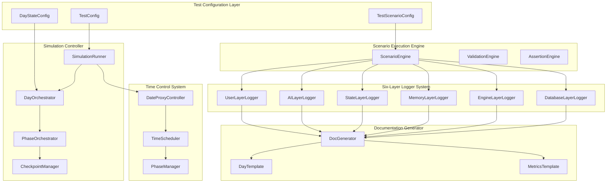
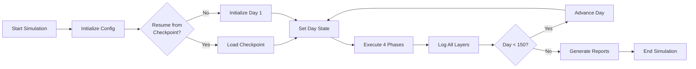
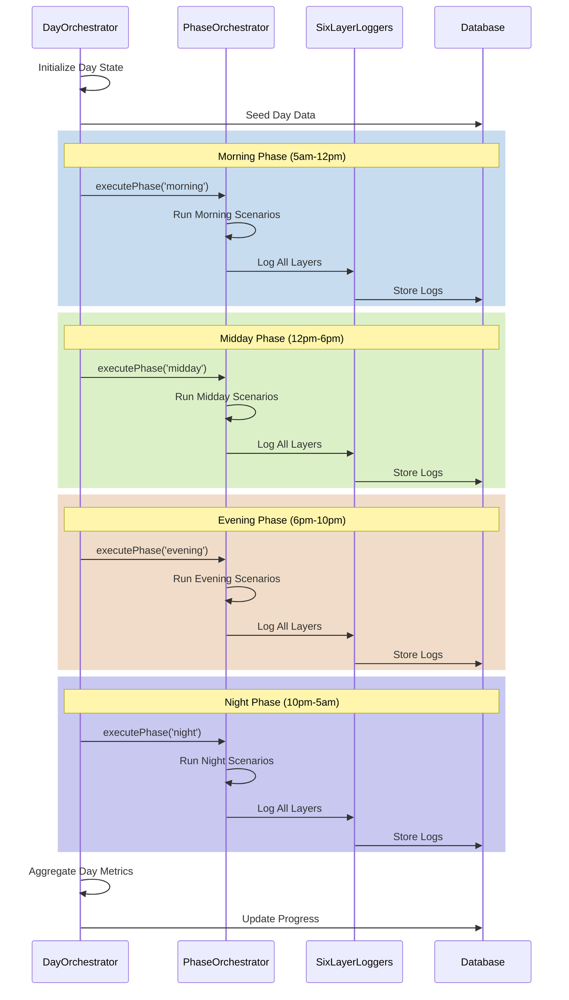
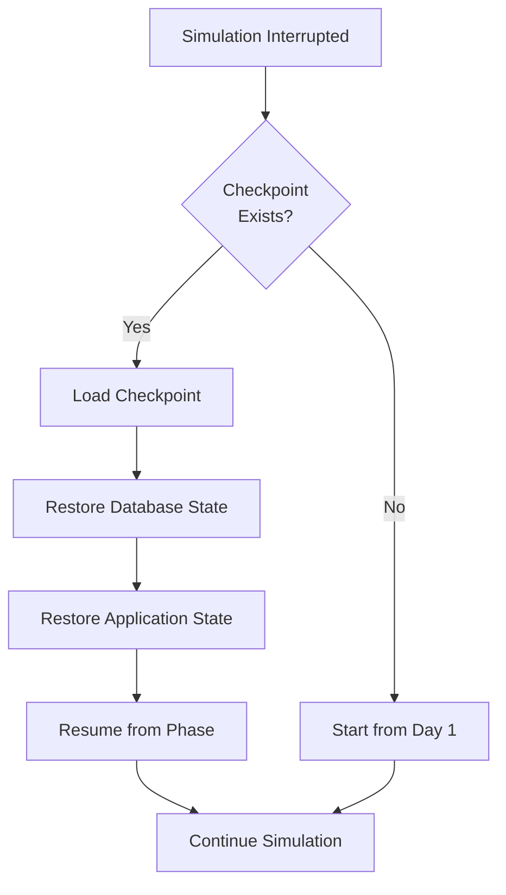
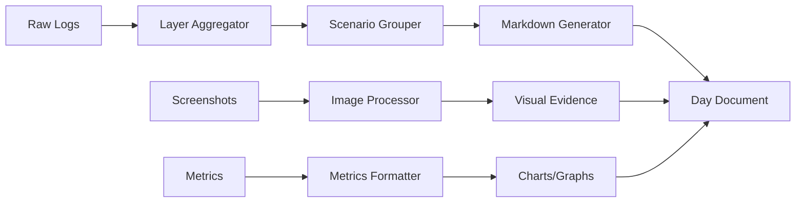

# E2E Testing Framework Design

## Executive Summary

This document defines the complete architecture for the ConsciousOS 100-150 day E2E testing framework. The framework simulates realistic user journeys while capturing comprehensive technical documentation across six system layers.

## 1. Core Architecture

### 1.1 High-Level Component Diagram



### 1.2 Simulation Runner Architecture



## 2. Component Specifications

### 2.1 SimulationRunner

**Purpose**: Main orchestrator for the 150-day simulation

**Configuration Interface**:
```typescript
interface SimulationConfig {
  // Duration
  totalDays: number;              // 150
  startDay: number;               // 1
  
  // Time Control
  timeAcceleration: number;       // 60x = 1 min = 1 hour
  phaseDurationMs: number;        // Time spent in each phase
  
  // Checkpointing
  checkpointInterval: number;     // Every 10 days
  resumeFromCheckpoint: boolean;
  
  // Scenarios
  scenariosPerPhase: {
    min: number;
    max: number;
  };
  
  // Documentation
  outputDir: string;
  generateDailyDocs: boolean;
  generateSummaryDocs: boolean;
  
  // Validation
  validateStateTransitions: boolean;
  validateDatabaseOperations: boolean;
  validateAIResponses: boolean;
}
```

**Core Methods**:
- `initialize(): Promise<void>` - Setup simulation state
- `run(): Promise<SimulationResult>` - Execute full simulation
- `runDay(dayNumber: number): Promise<DayResult>` - Execute single day
- `runPhase(phase: TimePhase): Promise<PhaseResult>` - Execute single phase
- `createCheckpoint(): Promise<Checkpoint>` - Save current state
- `resumeFromCheckpoint(checkpoint: Checkpoint): Promise<void>` - Restore state

### 2.2 DayOrchestrator

**Purpose**: Manages execution of all 4 phases within a single day

**Day Execution Flow**:


**Methods**:
- `executeDay(dayState: DayState): Promise<DayResult>`
- `executePhase(phase: TimePhase, context: PhaseContext): Promise<PhaseResult>`
- `validateDayCompletion(): boolean`
- `calculateDayMetrics(): DayMetrics`

### 2.3 PhaseOrchestrator

**Purpose**: Executes scenarios specific to each daily phase

**Phase-Specific Scenarios**:

| Phase | Scenarios |
|-------|-----------|
| Morning | morningGreeting, intentionSetting, guruChat, taskGeneration, morningPractice |
| Midday | middayPresence, loopInquiry, checkinPrompt, practiceRecommendation |
| Evening | dayReview, eveningReflection, journalEntry, eveningSandhya |
| Night | sleepPreparation, dreamJournal, nightPractice, tomorrowPreview |

**Execution Pattern**:
```typescript
interface PhaseExecution {
  phase: TimePhase;
  startTime: Date;
  scenarios: Scenario[];
  context: PhaseContext;
  
  execute(): Promise<PhaseResult> {
    // 1. Set time to phase start
    // 2. Initialize phase context
    // 3. Execute each scenario
    // 4. Log all 6 layers
    // 5. Validate phase completion
    // 6. Return phase result
  }
}
```

## 3. Six-Layer Logger System

### 3.1 Layer Logger Interface

Each layer logger implements a common interface:

```typescript
interface LayerLogger {
  initialize(config: LoggerConfig): Promise<void>;
  
  // Capture methods
  captureUserInteraction(interaction: UserInteraction): void;
  captureAIExchange(exchange: AIExchange): void;
  captureStateTransition(transition: StateTransition): void;
  captureMemoryOperation(operation: MemoryOperation): void;
  captureEngineExecution(execution: EngineExecution): void;
  captureDatabaseQuery(query: DatabaseQuery): void;
  
  // Persistence
  flush(): Promise<void>;
  export(format: 'json' | 'markdown'): Promise<string>;
}
```

### 3.2 User Layer Logger

**Captures**:
- UI element visibility states
- User click/tap coordinates
- Text input values
- Scroll positions
- Modal/dialog states
- Navigation events
- Loading states

**Example Log Entry**:
```json
{
  "layer": "user",
  "timestamp": "2026-03-05T08:30:00Z",
  "event": "button_click",
  "element": "morning-session-start",
  "coordinates": { "x": 450, "y": 320 },
  "viewport": { "width": 1920, "height": 1080 },
  "screenshot": "day-001-morning-083000.png",
  "context": {
    "visibleElements": ["header", "guru-avatar", "start-button"],
    "currentRoute": "/home",
    "phase": "morning"
  }
}
```

### 3.3 AI Layer Logger

**Captures**:
- LLM prompts (full context)
- LLM responses (raw and parsed)
- Token counts
- Response latency
- Model information
- Temperature/settings
- Error responses

**Example Log Entry**:
```json
{
  "layer": "ai",
  "timestamp": "2026-03-05T08:30:05Z",
  "model": "claude-3-5-sonnet",
  "provider": "anthropic",
  "request": {
    "systemPrompt": "You are the ConsciousOS Guru...",
    "userMessage": "Good morning, I'm feeling anxious about today...",
    "contextWindow": ["previous_message_1", "previous_message_2"],
    "temperature": 0.7,
    "maxTokens": 1000
  },
  "response": {
    "content": "I hear you. Let's explore this anxiety together...",
    "tokens": { "input": 245, "output": 180, "total": 425 },
    "latencyMs": 1245,
    "finishReason": "stop"
  }
}
```

### 3.4 State Layer Logger

**Captures**:
- XState machine state transitions
- Context changes (before/after)
- Event dispatches
- Actor spawn/terminate
- Guard evaluations
- Action executions

**Example Log Entry**:
```json
{
  "layer": "state",
  "timestamp": "2026-03-05T08:30:10Z",
  "machine": "guruMachine",
  "instanceId": "guru-session-001",
  "transition": {
    "from": "idle",
    "to": "loadingMemories",
    "event": { "type": "LOAD_MEMORIES" },
    "context": {
      "before": { "memories": null, "sessionId": null },
      "after": { "memories": null, "sessionId": "sess-001" }
    }
  },
  "actors": {
    "spawned": ["fetchMemoriesActor"],
    "active": ["fetchMemoriesActor"]
  }
}
```

### 3.5 Memory Layer Logger

**Captures**:
- Session memory read/write
- Short-term memory operations
- Long-term memory retrieval
- Pattern memory updates
- Context aggregation queries
- Memory search operations

**Example Log Entry**:
```json
{
  "layer": "memory",
  "timestamp": "2026-03-05T08:30:15Z",
  "operation": "retrieve_context",
  "memoryType": "guru_long_term",
  "query": {
    "userId": "user-001",
    "sessionId": "sess-001",
    "retrievalDepth": "deep",
    "includePatterns": true
  },
  "result": {
    "memoriesRetrieved": 5,
    "patternsIdentified": ["anxiety_morning", "work_stress"],
    "retrievalTimeMs": 45
  }
}
```

### 3.6 Engine Layer Logger

**Captures**:
- Engine name and version
- Input parameters
- Processing steps
- Output results
- Execution time
- Resource usage

**Example Log Entry**:
```json
{
  "layer": "engine",
  "timestamp": "2026-03-05T08:30:20Z",
  "engine": "morning-context-aggregator",
  "version": "1.2.0",
  "input": {
    "userId": "user-001",
    "dayNumber": 1,
    "previousDayData": { ... },
    "activeLoops": ["perfectionism"]
  },
  "processing": [
    { "step": "fetch_yesterday_data", "durationMs": 12 },
    { "step": "analyze_patterns", "durationMs": 23 },
    { "step": "aggregate_context", "durationMs": 8 }
  ],
  "output": {
    "context": { ... },
    "recommendations": ["breathing_practice", "gentle_inquiry"]
  },
  "totalDurationMs": 43
}
```

### 3.7 Database Layer Logger

**Captures**:
- SQL query text
- Query parameters
- Execution time
- Rows affected/returned
- RLS policy evaluation
- Real-time broadcast events
- Error details

**Example Log Entry**:
```json
{
  "layer": "database",
  "timestamp": "2026-03-05T08:30:25Z",
  "table": "daily_journeys",
  "operation": "INSERT",
  "query": "INSERT INTO daily_journeys (user_id, date, status) VALUES ($1, $2, $3)",
  "parameters": ["user-001", "2026-03-05", "morning_pending"],
  "executionTimeMs": 8,
  "rowsAffected": 1,
  "rls": {
    "policy": "Users can create own journeys",
    "evaluation": "passed"
  },
  "realtime": {
    "broadcast": true,
    "channel": "daily_journeys:user-001"
  }
}
```

## 4. Test Scenario Definitions

### 4.1 Scenario Structure

```typescript
interface TestScenario {
  id: string;
  name: string;
  phase: TimePhase;
  prerequisites: Prerequisite[];
  steps: ScenarioStep[];
  validations: Validation[];
  
  // Layer documentation requirements
  captureLayers: {
    user: boolean;
    ai: boolean;
    state: boolean;
    memory: boolean;
    engine: boolean;
    database: boolean;
  };
}

interface ScenarioStep {
  order: number;
  action: 'navigate' | 'click' | 'type' | 'wait' | 'api_call' | 'verify';
  target?: string;
  value?: string;
  timeout?: number;
}
```

### 4.2 Phase Scenario Matrix

| Phase | Scenario ID | Description | Priority |
|-------|-------------|-------------|----------|
| Morning | MOR-001 | Complete morning session with Guru | P0 |
| Morning | MOR-002 | Set daily intention | P0 |
| Morning | MOR-003 | Morning breathing practice | P1 |
| Morning | MOR-004 | Task generation and review | P0 |
| Midday | MID-001 | Midday presence check-in | P1 |
| Midday | MID-002 | Loop inquiry prompt | P0 |
| Midday | MID-003 | Quick practice recommendation | P1 |
| Evening | EVE-001 | Evening sandhya session | P0 |
| Evening | EVE-002 | Day review with Guru | P0 |
| Evening | EVE-003 | Journal entry creation | P0 |
| Evening | EVE-004 | Tomorrow preview | P1 |
| Night | NGT-001 | Sleep preparation practice | P1 |
| Night | NGT-002 | Dream journal entry | P0 |
| Night | NGT-003 | Night grounding exercise | P1 |

## 5. Checkpoint and Recovery System

### 5.1 Checkpoint Structure

```typescript
interface Checkpoint {
  id: string;
  dayNumber: number;
  phase: TimePhase;
  timestamp: string;
  
  // State snapshots
  userState: UserState;
  appState: AppState;
  databaseState: DatabaseState;
  
  // Progress metrics
  metrics: SimulationMetrics;
  
  // File references
  logsPath: string;
  screenshotsPath: string;
  docsPath: string;
}
```

### 5.2 Recovery Process



## 6. Documentation Generation

### 6.1 Daily Documentation Template

Each day generates a markdown file with:
1. Day summary header
2. Phase-by-phase breakdown
3. Six-layer technical details per interaction
4. Screenshots and visual evidence
5. Metrics and progress tracking
6. Anomalies or issues encountered

### 6.2 Documentation Pipeline



## 7. Metrics and Validation

### 7.1 Key Metrics

| Category | Metric | Target |
|----------|--------|--------|
| Coverage | Phase execution rate | 100% |
| Coverage | Scenario completion rate | >95% |
| Performance | Average phase duration | <30s |
| Performance | Documentation generation | <5s/day |
| Accuracy | State transition validation | 100% |
| Accuracy | Database operation success | 100% |

### 7.2 Validation Rules

- All XState transitions must be valid
- Database RLS policies must pass
- AI responses must parse correctly
- Memory operations must complete
- Engine executions must return results
- UI elements must be visible before interaction

## 8. Integration Points

### 8.1 Existing System Integration

The framework integrates with:
- `e2e/runner/simulation-runner.ts` - Core simulation logic
- `e2e/docs/*` - Existing documentation loggers
- `e2e/utils/time-controller.ts` - Time mocking
- `e2e/fixtures/day-state-300.ts` - Day state fixtures

### 8.2 New Components

New components to implement:
- `e2e/docs/six-layer-aggregator.ts` - Combines all 6 layers
- `e2e/docs/markdown-generator.ts` - Generates daily docs
- `e2e/runner/phase-orchestrator.ts` - Phase-specific execution
- `e2e/scenarios/daily-flow/` - Phase-specific scenarios

## 9. Execution Strategy

### 9.1 Full Simulation Mode

Run complete 150-day simulation:
```bash
npx playwright test e2e/simulation/150-day-journey.spec.ts
```

### 9.2 Phase-Focused Mode

Test specific phase across all days:
```bash
npx playwright test e2e/simulation/daily-phases.spec.ts --grep "morning"
```

### 9.3 Day-Range Mode

Test specific day range:
```bash
npx playwright test e2e/simulation/150-day-journey.spec.ts --days="1-30"
```

### 9.4 Resume Mode

Resume from last checkpoint:
```bash
npx playwright test e2e/simulation/150-day-journey.spec.ts --resume
```
