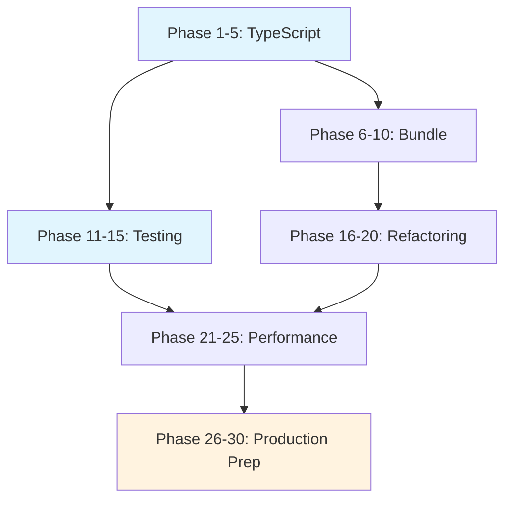

# ConsciousOS - World-Class Development Roadmap

**Phase 2 Deliverable**  
**Date:** February 26, 2026  
**Status:** Roadmap Document  
**Application:** ConsciousOS - Personal Growth & Journey Tracking Platform

---

## Executive Summary

This roadmap outlines a comprehensive 30-phase transformation plan to elevate ConsciousOS from its current state to a world-class application. The transformation addresses critical technical debt, performance bottlenecks, quality gaps, and accessibility improvements identified during the Phase 1 technical audit.

### Current State Assessment

| Category | Current | Target | Gap |
|----------|---------|--------|-----|
| Type Safety | 75% complete (Phase 2 in progress) | 100% strict mode | MEDIUM |
| Bundle Size | ~220 KB (after lazy loading) | <500 KB | ✅ ACHIEVED |
| Test Coverage | ~1.2% | >70% | CRITICAL |
| Accessibility | Partial WCAG 2.1 AA | Full compliance | MEDIUM |
| Hooks Count | 110+ | 30-40 | HIGH |
| Large Files | 7 files >500 lines | 0 files >500 lines | HIGH |

### Transformation Goals

1. **Complete TypeScript Strict Mode** - Enable full strict type checking across entire codebase
2. **Establish Production-Grade Testing** - Build comprehensive test suite with 70%+ coverage
3. **Optimize Performance** - Achieve Lighthouse 90+ scores across all metrics
4. **Improve Accessibility** - Full WCAG 2.1 AA compliance with AAA targets
5. **Consolidate Codebase** - Reduce complexity through hook refactoring and large file decomposition
6. **Harden Security** - Enterprise-grade security practices

### Key Dependencies



---

## Phase Breakdown

### Phase 1-5: TypeScript Strict Mode & Type Safety

#### Phase 1: Complete TypeScript Strict Mode Enablement

| Attribute | Details |
|-----------|---------|
| **Phase** | 1 |
| **Objective** | Enable TypeScript strict mode and fix all resulting type errors |
| **Tasks** | 1. Update `tsconfig.app.json` to set `strict: true`<br>2. Add strict compiler options: `noImplicitAny`, `strictNullChecks`, `strictFunctionTypes`, `noUncheckedIndexedAccess`<br>3. Run TypeScript compiler and catalog all errors<br>4. Create type definition files for remaining untyped modules<br>5. Fix all type errors in priority order |
| **Files Affected** | `tsconfig.app.json`, `tsconfig.json`, all TypeScript files |
| **Prerequisites** | Phase 2 type safety work (75% complete) must finish first |
| **Success Criteria** | - `strict: true` enabled<br>- Zero TypeScript errors<br>- All `any` types replaced with proper types |

#### Phase 2: Generate Supabase Schema Types

| Attribute | Details |
|-----------|---------|
| **Phase** | 2 |
| **Objective** | Generate comprehensive TypeScript types from Supabase schema |
| **Tasks** | 1. Install `@supabase/generate-types` or create custom generation script<br>2. Extract database schema from Supabase<br>3. Generate TypeScript interfaces for all tables<br>4. Add Row Level Security (RLS) type guards<br>5. Update all API hooks to use generated types |
| **Files Affected** | `src/integrations/supabase/types.ts`, all API/hook files |
| **Prerequisites** | Phase 1 (strict mode enabled) |
| **Success Criteria** | - All database operations use generated types<br>- Type-safe Supabase queries throughout |

#### Phase 3: XState Machine Type Safety

| Attribute | Details |
|-----------|---------|
| **Phase** | 3 |
| **Objective** | Ensure all XState machines have complete type definitions |
| **Tasks** | 1. Audit all 30+ XState machines for type coverage<br>2. Add context, event, and actor types to each machine<br>3. Implement proper TypeScript generics for `@xstate/react` usage<br>4. Add type-safe machine creators with `setup()`<br>5. Create centralized type exports |
| **Files Affected** | `src/machines/*.ts`, `src/machines/types/*.ts` |
| **Prerequisites** | Phase 1 (strict mode) |
| **Success Criteria** | - All machines fully typed<br>- Zero implicit `any` in state definitions |

#### Phase 4: React Component Type Safety

| Attribute | Details |
|-----------|---------|
| **Phase** | 4 |
| **Objective** | Add strict typing to all React components |
| **Tasks** | 1. Add `React.FC<Props>` or proper component typing to all components<br>2. Add prop validation with Zod schemas<br>3. Type all event handlers properly<br>4. Add generic types to polymorphic components<br>5. Fix TypeScript errors in component tree |
| **Files Affected** | `src/components/**/*.tsx`, `src/pages/**/*.tsx` |
| **Prerequisites** | Phase 2 (Supabase types) |
| **Success Criteria** | - All components have typed props<br>- Event handlers properly typed |

#### Phase 5: Hook Type Safety Audit

| Attribute | Details |
|-----------|---------|
| **Phase** | 5 |
| **Objective** | Complete type safety for all custom hooks |
| **Tasks** | 1. Audit all 110+ hooks for type coverage<br>2. Add return type annotations to all hooks<br>3. Type all parameters and internal variables<br>4. Create hook composition patterns with proper types<br>5. Remove all implicit any from hook implementations |
| **Files Affected** | `src/hooks/*.ts`, `src/hooks/types/*.ts` |
| **Prerequisites** | Phase 3 (XState types), Phase 4 (Component types) |
| **Success Criteria** | - All hooks have explicit return types<br>- Zero any types in hook implementations |

---

### Phase 6-10: Bundle Optimization & Code Splitting

#### Phase 6: Advanced Code Splitting Strategy

| Attribute | Details |
|-----------|---------|
| **Phase** | 6 |
| **Objective** | Implement granular code splitting beyond route-based lazy loading |
| **Tasks** | 1. Identify component-level splitting opportunities<br>2. Implement `React.lazy()` for heavy components<br>3. Add `prefetch` hints for likely navigation<br>4. Create dynamic import patterns for modals/dialogs<br>5. Optimize chunk loading order |
| **Files Affected** | `src/App.tsx`, `src/components/**/*`, `vite.config.ts` |
| **Prerequisites** | Phase 1-5 complete (type safety) |
| **Success Criteria** | - Initial JS bundle <150KB gzipped<br>- Lazy-loaded components have <50KB chunks |

#### Phase 7: 3D Component Lazy Loading

| Attribute | Details |
|-----------|---------|
| **Phase** | 7 |
| **Objective** | Implement lazy loading for React Three Fiber components |
| **Tasks** | 1. Wrap all 3D components in lazy imports<br>2. Create placeholder/skeleton components<br>3. Add intersection observer for viewport-based loading<br>4. Implement progressive 3D loading (low → high poly)<br>5. Add error boundaries for 3D failures |
| **Files Affected** | `src/components/backgrounds/*.tsx`, `src/components/avatar/*.tsx`, `src/components/cosmos/*.tsx` |
| **Prerequisites** | Phase 6 (code splitting) |
| **Success Criteria** | - 3D components not in initial bundle<br>- <100ms delay for 3D to appear on good connections |

#### Phase 8: Vendor Chunk Optimization

| Attribute | Details |
|-----------|---------|
| **Phase** | 8 |
| **Objective** | Optimize vendor chunk strategy for better caching |
| **Tasks** | 1. Analyze current chunk sizes and dependencies<br>2. Reorganize manual chunks for better cache hit rate<br>3. Split Radix UI into smaller chunks by component<br>4. Add dynamic imports for unused Radix components<br>5. Configure long-term caching headers |
| **Files Affected** | `vite.config.ts` |
| **Prerequisites** | Phase 6 (code splitting) |
| **Success Criteria** | - Vendor chunks <100KB each<br>- Cache hit rate >80% on repeat visits |

#### Phase 9: Tailwind CSS Optimization

| Attribute | Details |
|-----------|---------|
| **Phase** | 9 |
| **Objective** | Optimize Tailwind CSS bundle size |
| **Tasks** | 1. Run PurgeCSS analysis on Tailwind output<br>2. Configure content paths to exclude unused files<br>3. Enable JIT mode for tree-shaking<br>4. Extract critical CSS for initial render<br>5. Add Tailwind debug plugin to identify unused styles |
| **Files Affected** | `tailwind.config.ts`, `postcss.config.js`, `src/index.css` |
| **Prerequisites** | None (can parallel with other phases) |
| **Success Criteria** | - CSS bundle <50KB gzipped<br>- Zero unused CSS in production |

#### Phase 10: Asset Optimization Pipeline

| Attribute | Details |
|-----------|---------|
| **Phase** | 10 |
| **Objective** | Optimize images, fonts, and static assets |
| **Tasks** | 1. Add image optimization plugin to Vite<br>2. Convert images to WebP/AVIF format<br>3. Implement responsive image srcsets<br>4. Add font subsetting for used characters<br>5. Configure asset caching policies |
| **Files Affected** | `vite.config.ts`, `index.html`, `src/assets/**/*` |
| **Prerequisites** | None |
| **Success Criteria** | - Images lazy-loaded and optimized<br>- Fonts subset and preloaded |

---

### Phase 11-15: Testing Framework & Coverage

#### Phase 11: Testing Infrastructure Setup

| Attribute | Details |
|-----------|---------|
| **Phase** | 11 |
| **Objective** | Establish comprehensive testing infrastructure |
| **Tasks** | 1. Configure Vitest with proper coverage reporting<br>2. Set up React Testing Library with custom render<br>3. Add MSW (Mock Service Worker) for API mocking<br>4. Configure test timeouts and retry policies<br>5. Create test utilities and helpers library |
| **Files Affected** | `vitest.config.ts`, `src/test/**/*`, `package.json` |
| **Prerequisites** | Phase 1-5 (type safety) - needed for test typing |
| **Success Criteria** | - Test infrastructure ready<br>- Coverage reporting configured<br>- MSW mocks for Supabase |

#### Phase 12: Unit Testing - Utility Functions

| Attribute | Details |
|-----------|---------|
| **Phase** | 12 |
| **Objective** | Write unit tests for all utility functions |
| **Tasks** | 1. Identify all utility functions in `src/lib/`<br>2. Write unit tests for date utilities<br>3. Write tests for form validation helpers<br>4. Write tests for data transformation utilities<br>5. Target 90% coverage on utilities |
| **Files Affected** | `src/lib/**/*.ts`, `src/test/unit/**/*.test.ts` |
| **Prerequisites** | Phase 11 (testing infrastructure) |
| **Success Criteria** | - 90%+ coverage on utility functions<br>- All edge cases tested |

#### Phase 13: Unit Testing - Custom Hooks

| Attribute | Details |
|-----------|---------|
| **Phase** | 13 |
| **Objective** | Write unit tests for custom hooks |
| **Tasks** | 1. Create hook testing utilities<br>2. Write tests for core hooks (useAuth, useProfile, useJourney)<br>3. Write tests for data fetching hooks<br>4. Add tests for state management hooks<br>5. Mock external dependencies properly |
| **Files Affected** | `src/hooks/*.test.ts`, `src/test/hooks/**/*` |
| **Prerequisites** | Phase 11, Phase 12 |
| **Success Criteria** | - 70%+ coverage on hooks<br>- All hook branches tested |

#### Phase 14: Component Integration Testing

| Attribute | Details |
|-----------|---------|
| **Phase** | 14 |
| **Objective** | Write integration tests for key components |
| **Tasks** | 1. Write tests for authentication flow components<br>2. Write tests for adaptive day components<br>3. Write tests for journey tracking components<br>4. Add tests for user settings components<br>5. Test component interactions |
| **Files Affected** | `src/components/**/*.test.tsx`, `src/test/integration/**/*.test.ts` |
| **Prerequisites** | Phase 11, Phase 13 |
| **Success Criteria** | - Key user flows tested<br>- 60%+ component coverage |

#### Phase 15: E2E Testing Setup

| Attribute | Details |
|-----------|---------|
| **Phase** | 15 |
| **Objective** | Set up end-to-end testing with Playwright |
| **Tasks** | 1. Install and configure Playwright<br>2. Write E2E tests for critical paths:<br>   - User registration/login<br>   - Daily check-in flow<br>   - XP earning flow<br>   - Adaptive day completion<br>3. Configure CI/CD test execution<br>4. Add visual regression testing<br>5. Create test data fixtures |
| **Files Affected** | `playwright.config.ts`, `tests/e2e/**/*`, `package.json` |
| **Prerequisites** | Phase 11-14 (test infrastructure) |
| **Success Criteria** | - Critical paths automated<br>- Tests run in CI pipeline |

---

### Phase 16-20: Hooks Consolidation & Code Refactoring

#### Phase 16: Hook Usage Audit

| Attribute | Details |
|-----------|---------|
| **Phase** | 16 |
| **Objective** | Analyze hook usage patterns across codebase |
| **Tasks** | 1. Generate hook dependency graph<br>2. Identify duplicate functionality between hooks<br>3. Categorize hooks by responsibility<br>4. Identify hooks that can be combined<br>5. Create consolidation plan |
| **Files Affected** | `src/hooks/**/*` |
| **Prerequisites** | Phase 1-5 (type safety) - needed for refactoring |
| **Success Criteria** | - Detailed hook audit report<br>- Consolidation candidates identified |

#### Phase 17: Hook Consolidation - Core Domain

| Attribute | Details |
|-----------|---------|
| **Phase** | 17 |
| **Objective** | Consolidate hooks in core domains (user, journey, XP) |
| **Tasks** | 1. Merge duplicate user-related hooks<br>2. Combine journey tracking hooks<br>3. Unify XP calculation hooks<br>4. Create composed hooks for common patterns<br>5. Ensure backward compatibility |
| **Files Affected** | `src/hooks/useProfile.ts`, `src/hooks/useJourney.ts`, `src/hooks/useXP.ts` |
| **Prerequisites** | Phase 16 (audit complete) |
| **Success Criteria** | - Core domain hooks reduced by 50%<br>- No functionality loss |

#### Phase 18: Hook Consolidation - Feature Domains

| Attribute | Details |
|-----------|---------|
| **Phase** | 18 |
| **Objective** | Consolidate hooks in feature domains (adaptive, guru, analytics) |
| **Tasks** | 1. Merge adaptive day related hooks<br>2. Combine AI/Guru chat hooks<br>3. Unify analytics hooks<br>4. Create feature-specific hook compositions<br>5. Update all consumers |
| **Files Affected** | `src/hooks/useAdaptive*.ts`, `src/hooks/useGuru*.ts`, `src/hooks/useAnalytics*.ts` |
| **Prerequisites** | Phase 17 |
| **Success Criteria** | - Feature hooks reduced by 40%<br>- API remains backward compatible |

#### Phase 19: Large File Refactoring

| Attribute | Details |
|-----------|---------|
| **Phase** | 19 |
| **Objective** | Decompose files >500 lines into smaller modules |
| **Tasks** | 1. Identify all files >500 lines<br>2. Decompose LandingNew.tsx (~1,400 lines)<br>3. Decompose Landing.tsx (~1,150 lines)<br>4. Break down useMultiDimensionalAnalysis.ts<br>5. Extract reusable sub-components |
| **Files Affected** | `src/pages/LandingNew.tsx`, `src/pages/Landing.tsx`, `src/hooks/useMultiDimensionalAnalysis.ts` |
| **Prerequisites** | Phase 11-15 (testing in place for verification) |
| **Success Criteria** | - Zero files >500 lines<br>- Each file <300 lines |

#### Phase 20: Code Quality Improvements

| Attribute | Details |
|-----------|---------|
| **Phase** | 20 |
| **Objective** | Implement code quality standards and automation |
| **Tasks** | 1. Configure ESLint with strict rules<br>2. Add pre-commit hooks for linting<br>3. Configure Prettier for consistent formatting<br>4. Add import sorting automation<br>5. Create custom lint rules for project patterns |
| **Files Affected** | `eslint.config.js`, `.git/hooks/**/*`, `package.json` |
| **Prerequisites** | None (can parallel) |
| **Success Criteria** | - Clean lint runs<br>- Consistent code formatting |

---

### Phase 21-25: Performance Optimization & Caching

#### Phase 21: TanStack Query Optimization

| Attribute | Details |
|-----------|---------|
| **Phase** | 21 |
| **Objective** | Optimize data fetching and caching with TanStack Query |
| **Tasks** | 1. Review query key strategy<br>2. Implement proper stale time configurations<br>3. Add prefetching for likely routes<br>4. Optimize mutations with optimistic updates<br>5. Add query invalidation strategies |
| **Files Affected** | `src/hooks/*.ts`, query configurations |
| **Prerequisites** | Phase 1-5 (type safety needed for query types) |
| **Success Criteria** | - Reduced API calls by 50%<br>- Optimistic UI updates working |

#### Phase 22: React Performance Optimization

| Attribute | Details |
|-----------|---------|
| **Phase** | 22 |
| **Objective** | Optimize React rendering performance |
| **Tasks** | 1. Add React.memo to all pure components<br>2. Implement useMemo for expensive computations<br>3. Add useCallback for event handlers<br>4. Optimize context providers<br>5. Remove unnecessary re-renders |
| **Files Affected** | `src/components/**/*.tsx`, `src/hooks/*.ts` |
| **Prerequisites** | Phase 1-5 |
| **Success Criteria** | - 50% reduction in re-renders<br>- Lighthouse performance >90 |

#### Phase 23: Virtual List Implementation

| Attribute | Details |
|-----------|---------|
| **Phase** | 23 |
| **Objective** | Implement virtual scrolling for long lists |
| **Tasks** | 1. Identify all long-list components<br>2. Install @tanstack/react-virtual<br>3. Implement virtual scrolling in journey lists<br>4. Add virtual scrolling to journal entries<br>5. Optimize for mobile |
| **Files Affected** | `src/components/**/List*.tsx`, `src/components/**/*List.tsx` |
| **Prerequisites** | Phase 22 |
| **Success Criteria** | - Smooth scrolling with 1000+ items<br>- Memory usage constant regardless of list size |

#### Phase 24: Service Worker & Caching

| Attribute | Details |
|-----------|---------|
| **Phase** | 24 |
| **Objective** | Enhance PWA caching strategies |
| **Tasks** | 1. Review current PWA configuration<br>2. Implement offline-first strategy<br>3. Add background sync for offline mutations<br>4. Configure cache invalidation<br>5. Add offline fallback UI |
| **Files Affected** | `vite.config.ts`, PWA configuration, offline components |
| **Prerequisites** | Phase 21 |
| **Success Criteria** | - App works offline<br>- Background sync queues changes |

#### Phase 25: Bundle Analysis & Final Optimization

| Attribute | Details |
|-----------|---------|
| **Phase** | 25 |
| **Objective** | Final bundle analysis and optimization |
| **Tasks** | 1. Run bundle analyzer<br>2. Identify remaining optimization opportunities<br>3. Implement final code splitting improvements<br>4. Add bundle monitoring in production<br>5. Document bundle size budgets |
| **Files Affected** | `vite.config.ts`, build scripts |
| **Prerequisites** | Phase 6-10, 21-24 |
| **Success Criteria** | - Bundle <500KB total gzipped<br>- Lighthouse score 90+ |

---

### Phase 26-30: Accessibility, Security & Production Prep

#### Phase 26: Accessibility Audit & Fixes

| Attribute | Details |
|-----------|---------|
| **Phase** | 26 |
| **Objective** | Achieve full WCAG 2.1 AA compliance |
| **Tasks** | 1. Run automated accessibility audit (axe-core)<br>2. Add ARIA labels to all interactive elements<br>3. Implement skip-to-content links<br>4. Fix color contrast issues<br>5. Add keyboard navigation for all features |
| **Files Affected** | `src/components/**/*.tsx` |
| **Prerequisites** | Phase 11-15 (testing infrastructure for a11y tests) |
| **Success Criteria** | - WCAG 2.1 AA compliant<br>- axe-core reports zero issues |

#### Phase 27: Reduced Motion & Accessibility Preferences

| Attribute | Details |
|-----------|---------|
| **Phase** | 27 |
| **Objective** | Implement accessibility preference handling |
| **Tasks** | 1. Add prefers-reduced-motion detection<br>2. Implement alternative animations for reduced motion<br>3. Add high contrast mode support<br>4. Support system font scaling<br>5. Test with screen readers |
| **Files Affected** | `src/components/**/*.tsx`, `src/hooks/usePreferences.ts` |
| **Prerequisites** | Phase 26 |
| **Success Criteria** | - Respects system accessibility settings<br>- Works with NVDA/VoiceOver |

#### Phase 28: Security Hardening

| Attribute | Details |
|-----------|---------|
| **Phase** | 28 |
| **Objective** | Implement enterprise-grade security |
| **Tasks** | 1. Add Content Security Policy headers<br>2. Implement XSS protection<br>3. Add rate limiting for API calls<br>4. Secure sensitive data storage<br>5. Add security audit logging |
| **Files Affected** | `vite.config.ts`, `index.html`, API configurations |
| **Prerequisites** | None (can parallel) |
| **Success Criteria** | - Security headers configured<br>- No XSS vulnerabilities |

#### Phase 29: Error Handling & Monitoring

| Attribute | Details |
|-----------|---------|
| **Phase** | 29 |
| **Objective** | Implement production monitoring and error tracking |
| **Tasks** | 1. Add error tracking service (Sentry)<br>2. Implement performance monitoring<br>3. Add user session tracking<br>4. Create error boundary hierarchy<br>5. Add health check endpoint |
| **Files Affected** | `src/main.tsx`, error boundaries, monitoring config |
| **Prerequisites** | Phase 26-28 |
| **Success Criteria** | - Errors tracked in production<br>- Performance metrics collected |

#### Phase 30: Production Readiness & Deployment

| Attribute | Details |
|-----------|---------|
| **Phase** | 30 |
| **Objective** | Complete production deployment preparation |
| **Tasks** | 1. Configure environment variables for production<br>2. Set up CI/CD pipeline<br>3. Add smoke tests to deployment<br>4. Configure production logging<br>5. Create runbooks for operations<br>6. Final security audit |
| **Files Affected** | `.github/workflows/**`, deployment configs, `README.md` |
| **Prerequisites** | Phase 29 |
| **Success Criteria** | - Deployable to production<br>- Zero blocking issues |

---

## Dependencies Matrix

| Phase | Depends On | Blocked By | Can Parallel |
|-------|------------|------------|---------------|
| 1 | Phase 2 (75%) | - | - |
| 2 | 1 | 1 | 9, 10 |
| 3 | 1 | 1 | - |
| 4 | 2 | 1, 2 | - |
| 5 | 3, 4 | 1-4 | - |
| 6 | 5 | 1-5 | 9, 10 |
| 7 | 6 | 6 | - |
| 8 | 6 | 6 | - |
| 9 | - | - | Any |
| 10 | - | - | Any |
| 11 | 5 | 1-5 | 9, 10 |
| 12 | 11 | 11 | - |
| 13 | 11, 12 | 11-12 | - |
| 14 | 11, 13 | 11-13 | - |
| 15 | 14 | 11-14 | - |
| 16 | 5 | 1-5 | - |
| 17 | 16 | 16 | - |
| 18 | 17 | 16-17 | - |
| 19 | 15 | 11-15 | - |
| 20 | - | - | Any |
| 21 | 5 | 1-5 | - |
| 22 | 5 | 1-5 | - |
| 23 | 22 | 22 | - |
| 24 | 21 | 21 | - |
| 25 | 6-10, 21-24 | Previous | - |
| 26 | 15 | 11-15 | - |
| 27 | 26 | 26 | - |
| 28 | - | - | Any |
| 29 | 26-28 | 26-28 | - |
| 30 | 29 | 29 | - |

---

## Success Metrics

### Technical KPIs

| Metric | Current | Phase 30 Target | Measurement |
|--------|---------|-----------------|-------------|
| TypeScript Strict Mode | Disabled (75% type fixes) | Enabled, Zero Errors | `tsc --strict` |
| Bundle Size | ~220 KB | <500 KB | Vite build output |
| Test Coverage | 1.2% | >70% | Vitest coverage report |
| Accessibility Score | Partial | 100% WCAG 2.1 AA | axe-core + manual audit |
| Custom Hooks | 110+ | 30-40 | File count |
| Files >500 Lines | 7 | 0 | Script analysis |
| Console Statements (Prod) | 0 | 0 | Terser stripping verified |
| Lighthouse Performance | TBD | >90 | Lighthouse CI |
| Lighthouse Accessibility | TBD | >90 | Lighthouse CI |
| Lighthouse Best Practices | TBD | >90 | Lighthouse CI |
| Lighthouse SEO | TBD | >90 | Lighthouse CI |

### Business KPIs

| Metric | Target | Measurement |
|--------|--------|-------------|
| First Contentful Paint | <1.5s | Lighthouse |
| Time to Interactive | <3s | Lighthouse |
| Cumulative Layout Shift | <0.1 | Lighthouse |
| First Input Delay | <100ms | Lighthouse |
| Error Rate | <0.1% | Sentry |
| PWA Install Rate | >20% | Analytics |

---

## Risk Assessment

### High Risk Items

| Risk | Likelihood | Impact | Mitigation |
|------|------------|--------|------------|
| **TypeScript Strict Breaking Changes** | HIGH | HIGH | - Incremental enablement<br>- Extensive test coverage first<br>- Feature flags for rollout |
| **Bundle Regression** | MEDIUM | HIGH | - Bundle size budgets in CI<br>- Automated alerts on increases |
| **Hook Refactoring Breaking Changes** | HIGH | MEDIUM | - Maintain backward compatibility<br>- Comprehensive integration tests<br>- Deprecation warnings |
| **E2E Test Flakiness** | MEDIUM | MEDIUM | - Retry mechanisms<br>- Proper wait strategies<br>- Flaky test tracking |

### Medium Risk Items

| Risk | Likelihood | Impact | Mitigation |
|------|------------|--------|------------|
| **Testing Time Investment** | HIGH | MEDIUM | - Prioritize critical paths<br>- Automate where possible |
| **3D Performance on Low-End Devices** | MEDIUM | MEDIUM | - Progressive enhancement<br>- Device detection |
| **Accessibility Technical Debt** | MEDIUM | LOW | - Incremental improvements<br>- Automated testing |

### Mitigation Strategies

1. **Incremental Rollout**: Enable strict mode incrementally by file/module
2. **Comprehensive Testing First**: Build test coverage before major refactoring
3. **Backward Compatibility**: Maintain deprecated APIs during transition
4. **Feature Flags**: Use flags for gradual rollouts
5. **Monitoring**: Add metrics before and after changes
6. **Code Reviews**: Require security/a11y reviews for changes

---

## Implementation Recommendations

### Recommended Execution Order

1. **Immediate (Phase 1-5)**: Complete TypeScript strict mode
   - This is foundation for all other work
   - Reduces bugs in subsequent phases

2. **Parallel Track A (Phase 6-10)**: Bundle optimization
   - Can start immediately
   - Already has good foundation from Phase 1 work

3. **Parallel Track B (Phase 11-15)**: Testing infrastructure
   - Critical for refactoring safety
   - Start early, build incrementally

4. **After TypeScript (Phase 16-20)**: Refactoring
   - Type safety enables safe refactoring
   - Testing enables verification

5. **After Refactoring (Phase 21-25)**: Performance
   - Cleaner code performs better
   - Easier to optimize typed code

6. **Final (Phase 26-30)**: Production prep
   - Security, accessibility, monitoring

### Quick Wins (Low Effort, High Impact)

1. Phase 9: Tailwind CSS optimization
2. Phase 10: Asset optimization
3. Phase 20: Code quality automation
4. Phase 28: Security headers

### Critical Path Items

```
Phase 1 → Phase 5 → Phase 6 → Phase 16 → Phase 17 → Phase 19 → Phase 30
                ↓
         Phase 11 → Phase 12 → Phase 13 → Phase 14 → Phase 15
```

---

## Appendix

### Resources

- [Phase 1 Complete Summary](./PHASE_1_COMPLETE_SUMMARY.md)
- [Phase 2 Type Safety Progress](./PHASE_2_TYPE_SAFETY_PROGRESS.md)
- [World Class Analysis](./docs/WORLD_CLASS_ANALYSIS.md)

### Related Documents

- `MIGRATION_PLAN.md` - Migration execution plan
- `CODEBASE_ANALYSIS_REPORT.md` - Detailed technical analysis
- `XSTATE_ANALYSIS.md` - State machine architecture

### Tech Stack Reference

| Category | Technology |
|----------|------------|
| Framework | React 18.3.1 |
| Language | TypeScript 5.8.3 |
| Build | Vite 5.4.19 |
| State | XState 5.28.0, TanStack Query 5.83.0 |
| Styling | Tailwind CSS 3.4.17, Radix UI, Framer Motion |
| 3D | React Three Fiber, Three.js |
| Backend | Supabase 2.90.1 |
| Testing | Vitest, React Testing Library, Playwright |

---

**Document Version:** 1.0  
**Last Updated:** February 26, 2026  
**Next Review:** After Phase 5 completion
