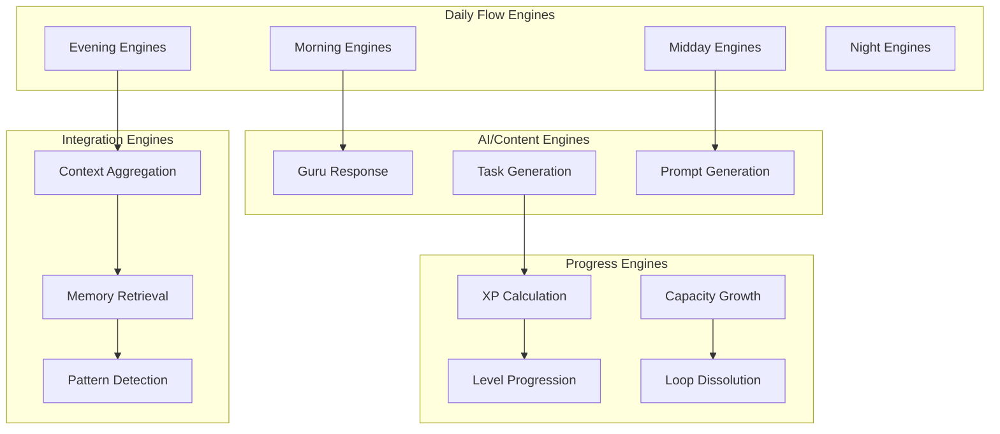

# Engine Documentation

## Overview

This document catalogs all engines that execute during the ConsciousOS daily flow, as observed during the 100-150 day E2E simulation. Engines are computational units that process data, generate content, or perform calculations.

## Engine Categories



## Morning Engines

### 1. morning-context-aggregator

**Location**: `supabase/functions/morning-context/index.ts`

**Purpose**: Aggregates all relevant user context for the morning Guru session.

**Input**:
```typescript
interface MorningContextInput {
  userId: string;
  dayNumber: number;
  currentLevel: number;
  currentLessonId?: string;
}
```

**Processing Steps**:
1. Fetch yesterday's journey data
2. Retrieve active psychological loops
3. Query recent journal entries (last 7 days)
4. Calculate current capacity scores
5. Aggregate pattern insights

**Output**:
```typescript
interface MorningContextOutput {
  yesterday: {
    completed: boolean;
    mood?: string;
    reflection?: string;
  };
  activeLoops: Array<{
    id: string;
    pattern: string;
    intensity: number;
    dissolutionProgress: number;
  }>;
  recentInsights: string[];
  capacitySnapshot: Record<string, number>;
  suggestedFocus: string[];
}
```

**Database Queries**:
```sql
-- Yesterday's data
SELECT * FROM daily_journeys 
WHERE user_id = $1 AND date = CURRENT_DATE - INTERVAL '1 day';

-- Active loops
SELECT * FROM user_loops 
WHERE user_id = $1 AND status = 'active';

-- Recent entries
SELECT * FROM journal_entries 
WHERE user_id = $1 AND created_at > NOW() - INTERVAL '7 days';
```

---

### 2. generate-structured-tasks

**Location**: `supabase/functions/generate-structured-tasks/index.ts`

**Purpose**: Generates level-appropriate daily tasks based on curriculum and user context.

**Input**:
```typescript
interface TaskGenerationInput {
  userId: string;
  level: number;
  currentLessonId: string;
  morningData: {
    mood: string;
    energy: number;
    intention: string;
  };
  activeLoops: string[];
}
```

**Processing Logic**:
```typescript
function getTasksPerDay(level: number): number {
  if (level <= 2) return 3;
  if (level <= 3) return 4;
  if (level <= 6) return 4;
  if (level <= 9) return 5;
  if (level <= 12) return 6;
  if (level <= 15) return 5;
  if (level <= 18) return 4;
  if (level <= 20) return 3;
  return 0; // Level 21 - no structure needed
}

function getDomainsForSegment(segment: TimeSegment): string[] {
  switch(segment) {
    case 'morning':
      return ['Ritual', 'Breath', 'Stillness', 'Values'];
    case 'midday':
      return ['Work', 'Mental Clarity', 'Habit', 'Social'];
    case 'evening':
      return ['Integration', 'Emotional', 'Self-Inquiry', 'Body'];
    case 'night':
      return ['Stillness', 'Gratitude', 'Sleep Prep'];
  }
}
```

**Output**:
```typescript
interface TaskGenerationOutput {
  tasks: Array<{
    id: string;
    title: string;
    description: string;
    domain: string;
    durationMinutes: number;
    xpReward: number;
    timeSegment: TimeSegment;
    lessonAlignment?: string;
  }>;
  theme: string;
  totalXpAvailable: number;
}
```

---

### 3. extract-morning-data

**Location**: `supabase/functions/extract-morning-data/index.ts`

**Purpose**: Parses morning Guru conversation to extract structured data.

**Input**:
```typescript
interface ExtractMorningDataInput {
  conversationId: string;
  messages: ChatMessage[];
}
```

**Processing**:
1. Analyze user messages for mood indicators
2. Extract energy level mentions
3. Identify stated intention
4. Detect concerns or challenges
5. Update daily_journeys with extracted data

**Output**:
```typescript
interface ExtractedMorningData {
  mood: string;
  energy: number; // 1-10
  intention: string;
  concerns: string[];
  confidence: number; // extraction confidence
}
```

---

### 4. morning-practice-recommender

**Purpose**: Recommends appropriate morning practice based on user state.

**Algorithm**:
```typescript
function recommendPractice(mood: string, energy: number, level: number): Practice {
  if (energy < 4) {
    return {
      type: 'restorative',
      duration: 5,
      focus: 'gentle_awakening'
    };
  }
  
  if (mood === 'anxious') {
    return {
      type: 'breathwork',
      duration: 10,
      focus: 'calming'
    };
  }
  
  if (level >= 10) {
    return {
      type: 'meditation',
      duration: 20,
      focus: 'self_inquiry'
    };
  }
  
  return {
    type: 'meditation',
    duration: 10,
    focus: 'presence'
  };
}
```

---

## Midday Engines

### 5. structured-presence-prompts

**Location**: `supabase/functions/structured-presence-prompts/index.ts`

**Purpose**: Generates level-appropriate midday presence prompts.

**Input**:
```typescript
interface PresencePromptInput {
  userId: string;
  level: number;
  currentLessonId: string;
  morningIntention: string;
  tasksCompleted: number;
}
```

**Prompt Type Matrix**:

| Level Range | Prompt Type | Example |
|-------------|-------------|---------|
| 1-6 | Simple observation | "What are you noticing right now?" |
| 7-12 | Pattern recognition | "What pattern is showing up in this moment?" |
| 13-18 | Deep inquiry | "Who is aware of these sensations?" |
| 19-21 | Minimal/Space | "..." [silence invitation] |

**Output**:
```typescript
interface PresencePromptOutput {
  prompts: Array<{
    id: string;
    text: string;
    type: 'observation' | 'inquiry' | 'somatic' | 'gratitude';
    depth: number; // 1-10
  }>;
  defaultPrompt: string;
}
```

---

### 6. loop-inquiry-engine

**Purpose**: Generates personalized loop inquiry questions.

**Input**:
```typescript
interface LoopInquiryInput {
  loopId: string;
  loopPattern: string;
  userLevel: number;
  previousInquiries: string[];
}
```

**Processing**:
1. Retrieve loop pattern definition
2. Analyze previous inquiry responses
3. Determine inquiry depth based on level
4. Generate contextual questions
5. Track dissolution progress

**Output**:
```typescript
interface LoopInquiryOutput {
  questions: string[];
  inquiryDepth: 'surface' | 'cognitive' | 'emotional' | 'somatic';
  suggestedApproach: string;
}
```

---

## Evening Engines

### 7. evening-sandhya-context

**Location**: `supabase/functions/evening-sandhya-context/index.ts`

**Purpose**: Aggregates full day data for evening reflection.

**Input**:
```typescript
interface EveningContextInput {
  userId: string;
  date: string;
  journeyId: string;
}
```

**Aggregation Query**:
```sql
SELECT 
  dj.mood as morning_mood,
  dj.intention,
  dj.analysis,
  COUNT(t.id) FILTER (WHERE t.status = 'completed') as tasks_completed,
  COUNT(t.id) FILTER (WHERE t.status = 'skipped') as tasks_skipped,
  COALESCE(SUM(t.xp_reward) FILTER (WHERE t.status = 'completed'), 0) as xp_earned,
  je.content as journal_entry,
  mp.prompt as midday_presence
FROM daily_journeys dj
LEFT JOIN tasks t ON t.journey_id = dj.id
LEFT JOIN journal_entries je ON je.journey_id = dj.id AND je.entry_type = 'midday_presence'
LEFT JOIN midday_presence mp ON mp.journey_id = dj.id
WHERE dj.id = $1
GROUP BY dj.id, je.id, mp.id;
```

**Output**:
```typescript
interface EveningContextOutput {
  morningData: {
    mood: string;
    intention: string;
  };
  taskSummary: {
    completed: number;
    skipped: number;
    totalXp: number;
  };
  middayPresence?: string;
  journalEntries: string[];
  suggestedReflectionAreas: string[];
}
```

---

### 8. day-review-aggregator

**Purpose**: Creates comprehensive day summary for user review.

**Input**: Raw day data from multiple tables

**Processing**:
1. Calculate completion metrics
2. Identify pattern matches
3. Compare to previous days
4. Generate insights
5. Prepare tomorrow preview

**Output**:
```typescript
interface DayReviewOutput {
  summary: {
    completionRate: number;
    xpEarned: number;
    streakMaintained: boolean;
  };
  highlights: string[];
  challenges: string[];
  patterns: Array<{
    pattern: string;
    frequency: number;
    trend: 'increasing' | 'decreasing' | 'stable';
  }>;
  tomorrowPreview: {
    suggestedTheme: string;
    recommendedFocus: string[];
  };
}
```

---

## Night Engines

### 9. sleep-prep-engine

**Purpose**: Selects appropriate sleep preparation practice.

**Input**:
```typescript
interface SleepPrepInput {
  dayStressLevel: number;
  userLevel: number;
  preferences: {
    audioGuidance: boolean;
    practiceDuration: number;
  };
}
```

**Practice Selection Matrix**:

| Stress Level | Level 1-10 | Level 11-20 | Level 21+ |
|--------------|------------|-------------|-----------|
| Low (1-3) | Gratitude practice | Breath awareness | Open awareness |
| Medium (4-6) | Body scan | Body + breath | Just sitting |
| High (7-10) | 4-7-8 breathing | Extended body scan | Grounding practice |

---

### 10. dream-journal-processor

**Purpose**: Processes dream journal entries for morning context.

**Input**: Dream text content

**Processing**:
1. Extract key themes/symbols
2. Identify emotional tone
3. Link to active loops
4. Summarize for morning Guru context

**Output**:
```typescript
interface DreamProcessingOutput {
  summary: string;
  themes: string[];
  emotionalTone: string;
  linkedLoops: string[];
  morningContextHint: string;
}
```

---

## Progress Engines

### 11. xp-calculation-engine

**Purpose**: Calculates XP awards for user actions.

**Formula**:
```typescript
interface XPCalculation {
  baseXP: number;
  streakMultiplier: number;
  levelMultiplier: number;
  phaseBonus: number;
  totalXP: number;
}

function calculateXP(
  action: UserAction,
  streak: number,
  level: number,
  phase: TimePhase
): XPCalculation {
  const baseXP = action.baseXP;
  
  const streakMultiplier = 
    streak >= 30 ? 1.5 :
    streak >= 14 ? 1.3 :
    streak >= 7 ? 1.2 :
    streak >= 3 ? 1.1 : 1.0;
  
  const levelMultiplier = 1 + (level * 0.02); // 2% per level
  
  const phaseBonus = {
    morning: 10,
    midday: 5,
    evening: 15,
    night: 10
  }[phase];
  
  return {
    baseXP,
    streakMultiplier,
    levelMultiplier,
    phaseBonus,
    totalXP: Math.floor(baseXP * streakMultiplier * levelMultiplier + phaseBonus)
  };
}
```

---

### 12. level-progression-engine

**Purpose**: Determines level progression and unlocks.

**Level Thresholds**:
```typescript
const LEVEL_THRESHOLDS = [
  0,      // Level 1
  500,    // Level 2
  1200,   // Level 3
  2500,   // Level 4
  4000,   // Level 5
  6000,   // Level 6
  8500,   // Level 7
  11500,  // Level 8
  15000,  // Level 9
  20000,  // Level 10
  // Extended to Level 30...
];

function checkLevelProgression(currentXP: number, currentLevel: number): {
  newLevel: number;
  leveledUp: boolean;
  unlocks: string[];
} {
  const newLevel = LEVEL_THRESHOLDS.findIndex(threshold => currentXP < threshold);
  const actualLevel = newLevel === -1 ? LEVEL_THRESHOLDS.length : newLevel;
  
  return {
    newLevel: actualLevel,
    leveledUp: actualLevel > currentLevel,
    unlocks: getUnlocksForLevel(actualLevel)
  };
}
```

---

### 13. capacity-growth-engine

**Purpose**: Tracks and updates H-Level capacities.

**12 Capacities**:
1. Attention
2. Observation
3. Presence
4. Body Awareness
5. Emotional Mastery
6. Pattern Recognition
7. Self Inquiry
8. Disidentification
9. Shadow Integration
10. Equanimity
11. Surrender
12. Unification

**Growth Algorithm**:
```typescript
function calculateCapacityGrowth(
  action: UserAction,
  currentCapacities: Record<string, number>
): Record<string, number> {
  const capacityImpacts = {
    'breathing_practice': { presence: 0.5, body_awareness: 0.3 },
    'meditation': { attention: 0.4, observation: 0.4 },
    'journaling': { self_inquiry: 0.5, pattern_recognition: 0.3 },
    'loop_inquiry': { shadow_integration: 0.6, emotional_mastery: 0.4 }
  };
  
  const impacts = capacityImpacts[action.type] || {};
  const updates = {};
  
  for (const [capacity, increment] of Object.entries(impacts)) {
    updates[capacity] = Math.min(10, currentCapacities[capacity] + increment);
  }
  
  return updates;
}
```

---

### 14. loop-dissolution-tracker

**Purpose**: Tracks progress on psychological loop dissolution.

**Loop Lifecycle**:
```typescript
enum LoopStage {
  DETECTED = 'detected',       // Just identified
  ACTIVE = 'active',           // Currently working on
  RESOLVING = 'resolving',     // Making progress
  DISSOLVED = 'dissolved',     // Pattern released
  INTEGRATED = 'integrated'    // Wisdom extracted
}

interface LoopProgress {
  loopId: string;
  stage: LoopStage;
  dissolutionPercent: number;
  inquiriesCompleted: number;
  insightsGained: string[];
  triggersIdentified: string[];
}
```

**Progress Calculation**:
```typescript
function calculateDissolutionProgress(
  inquiries: Inquiry[],
  insights: Insight[],
  daysActive: number
): number {
  const inquiryProgress = Math.min(40, inquiries.length * 5);
  const insightProgress = Math.min(30, insights.length * 10);
  const timeProgress = Math.min(30, daysActive * 2);
  
  return Math.min(100, inquiryProgress + insightProgress + timeProgress);
}
```

---

## Integration Engines

### 15. context-aggregation-engine

**Purpose**: Aggregates all relevant context for AI prompts.

**Input Sources**:
- User profile
- Recent memories
- Active loops
- Current lesson
- Day progress

**Output Format**:
```typescript
interface AggregatedContext {
  user: {
    level: number;
    dayStreak: number;
    dominantCapacity: string;
  };
  memories: {
    recent: string[];
    relevant: string[];
  };
  loops: {
    active: string[];
    resolving: string[];
  };
  lesson: {
    title: string;
    keyConcepts: string[];
    progress: number;
  };
  today: {
    intention: string;
    tasksCompleted: number;
    mood: string;
  };
}
```

---

### 16. memory-retrieval-engine

**Purpose**: Retrieves and ranks relevant memories.

**Retrieval Algorithm**:
```typescript
async function retrieveRelevantMemories(
  userId: string,
  query: string,
  context: ContextWindow
): Promise<Memory[]> {
  // Semantic search
  const semanticMatches = await vectorSearch(query, userId);
  
  // Temporal relevance
  const recentMemories = await fetchRecent(userId, 7);
  
  // Tag matching
  const tagMatches = await searchByTags(context.tags);
  
  // Combine and rank
  return rankMemories([
    ...semanticMatches,
    ...recentMemories,
    ...tagMatches
  ], query);
}
```

---

### 17. pattern-detection-engine

**Purpose**: Identifies patterns in user behavior and growth.

**Pattern Types**:
- Temporal patterns (time of day tendencies)
- Emotional patterns (mood cycles)
- Behavioral patterns (task completion rates)
- Growth patterns (capacity development)

**Detection Algorithm**:
```typescript
function detectPatterns(userData: UserHistory): Pattern[] {
  const patterns: Pattern[] = [];
  
  // Morning mood pattern
  const morningMoods = userData.dailyJourneys.map(d => d.mood);
  if (isConsistent(morningMoods, 'anxious')) {
    patterns.push({
      type: 'morning_anxiety',
      confidence: calculateConfidence(morningMoods),
      occurrences: morningMoods.filter(m => m === 'anxious').length
    });
  }
  
  // Task completion pattern
  const completionRates = calculateRollingAverage(
    userData.dailyJourneys.map(d => d.completionRate),
    7
  );
  
  if (completionRates[0] < completionRates[6]) {
    patterns.push({
      type: 'declining_engagement',
      confidence: 0.75,
      trend: 'decreasing'
    });
  }
  
  return patterns;
}
```

---

## Engine Execution Summary

| Engine | Phase | Frequency | Duration |
|--------|-------|-----------|----------|
| morning-context-aggregator | Morning | Daily | ~50ms |
| generate-structured-tasks | Morning | Daily | ~2s |
| extract-morning-data | Morning | Daily | ~1s |
| structured-presence-prompts | Midday | Daily | ~200ms |
| loop-inquiry-engine | Midday | As needed | ~500ms |
| evening-sandhya-context | Evening | Daily | ~100ms |
| xp-calculation-engine | All | Per action | ~5ms |
| level-progression-engine | All | Per XP gain | ~5ms |
| capacity-growth-engine | All | Per practice | ~10ms |
| loop-dissolution-tracker | All | Weekly | ~50ms |
