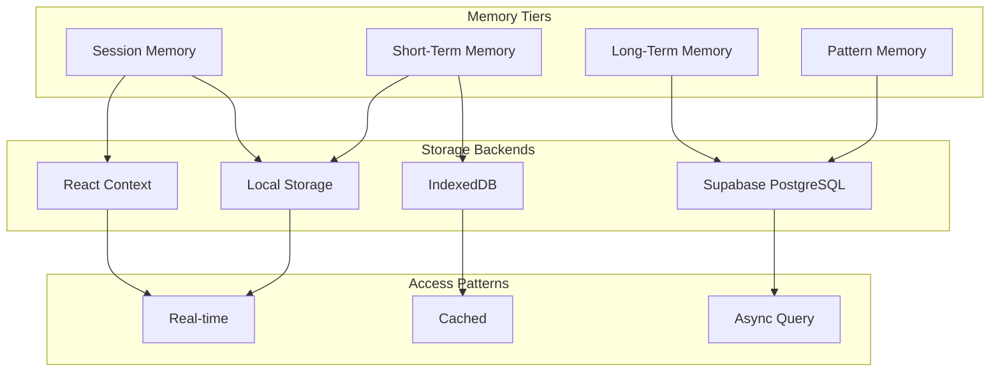
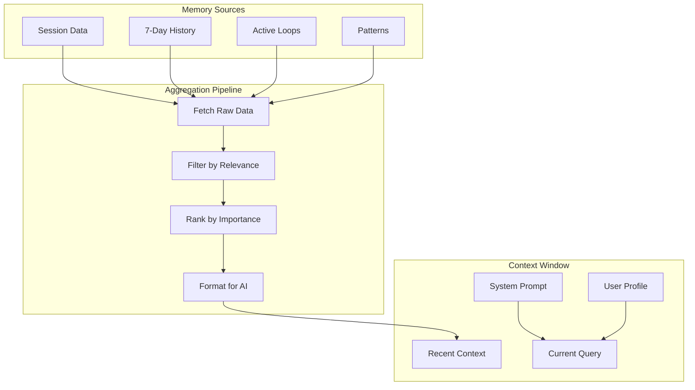
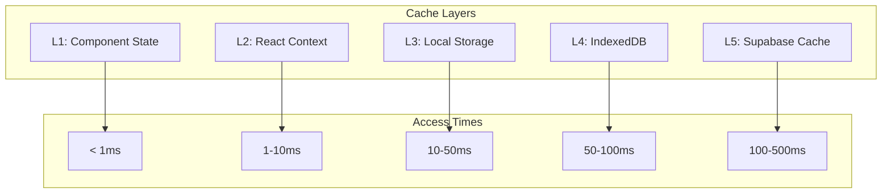

# Memory Layer Documentation

## Overview

The ConsciousOS memory system is a multi-tiered architecture that stores, retrieves, and aggregates user data across different time horizons. This document details the memory layer as observed during the 100-150 day E2E simulation.

## Memory Architecture



## Memory Tiers

### 1. Session Memory

**Purpose**: Stores data for the current active session only. Lost when session ends.

**Storage**: React Context + Component State

**Data Types**:
```typescript
interface SessionMemory {
  // Current conversation
  messages: GuruMessage[];
  pendingMessage: string | null;
  
  // Current UI state
  activeModal: string | null;
  expandedCards: string[];
  scrollPosition: number;
  
  // Session metadata
  sessionId: string;
  startTime: Date;
  currentPhase: TimePhase;
}
```

**Lifecycle**:
```
Session Start → Memory Initialization → Active Use → Session End → Memory Cleared
```

---

### 2. Short-Term Memory

**Purpose**: Recent data (1-7 days) for immediate context and quick retrieval.

**Storage**: localStorage + IndexedDB

**Data Types**:
```typescript
interface ShortTermMemory {
  // Daily journey cache
  currentDay: DailyJourney;
  todaysTasks: Task[];
  
  // Recent conversations
  recentSessions: GuruSession[];
  
  // Quick access patterns
  frequentPractices: Practice[];
  activeLoops: Loop[];
  
  // Temporary aggregations
  todayStats: DayStats;
  streakInfo: StreakInfo;
}
```

**Sync Strategy**:
- Write-through to localStorage on change
- IndexedDB for larger payloads
- TTL: 7 days
- Background sync with Supabase

---

### 3. Long-Term Memory

**Purpose**: Complete historical record of user journey.

**Storage**: Supabase PostgreSQL

**Tables**:
```sql
-- Core memory tables
profiles              -- User profile and progress
daily_journeys        -- Daily journey records
journal_entries       -- All journal entries
chat_messages         -- Guru conversation history
guru_memory           -- AI-processed memories
user_loops            -- Psychological patterns
practice_history      -- Practice completions
```

**Retention**: Permanent (with GDPR compliance for deletion)

---

### 4. Pattern Memory

**Purpose**: Derived insights and recognized patterns from user data.

**Storage**: Supabase PostgreSQL (computed tables)

**Data Types**:
```typescript
interface PatternMemory {
  patternId: string;
  patternType: 'behavioral' | 'emotional' | 'temporal';
  
  // Pattern metadata
  firstObserved: Date;
  lastObserved: Date;
  occurrenceCount: number;
  confidence: number; // 0-1
  
  // Pattern details
  triggers: string[];
  manifestations: string[];
  relatedLoops: string[];
  
  // Growth tracking
  evolution: Array<{
    timestamp: Date;
    status: 'strengthening' | 'weakening' | 'stable';
  }>;
}
```

---

## Memory Operations

### Read Operations

#### 1. Context Retrieval for Guru

```typescript
async function buildGuruContext(
  userId: string,
  sessionType: 'morning' | 'midday' | 'evening'
): Promise<GuruContext> {
  // Tier 1: Session memory (immediate)
  const sessionContext = getSessionMemory();
  
  // Tier 2: Short-term cache (localStorage)
  const recentData = getFromLocalStorage('recent_context');
  
  // Tier 3: Long-term query (Supabase)
  const [memories, loops, patterns] = await Promise.all([
    fetchRecentMemories(userId, 7),
    fetchActiveLoops(userId),
    fetchRelevantPatterns(userId, sessionType)
  ]);
  
  return {
    session: sessionContext,
    recent: recentData,
    memories,
    loops,
    patterns
  };
}
```

**Query Pattern**:
```sql
-- Fetch recent memories for context
SELECT * FROM guru_memory 
WHERE user_id = $1 
  AND created_at > NOW() - INTERVAL '7 days'
ORDER BY importance DESC, created_at DESC
LIMIT 10;

-- Fetch active loops
SELECT * FROM user_loops 
WHERE user_id = $1 AND status = 'active';

-- Fetch patterns relevant to session type
SELECT * FROM user_patterns 
WHERE user_id = $1 
  AND session_types @> ARRAY[$2];
```

#### 2. Memory Search

```typescript
async function searchMemories(
  userId: string,
  query: string,
  options: SearchOptions
): Promise<Memory[]> {
  // Semantic search via embeddings
  const queryEmbedding = await generateEmbedding(query);
  
  return await supabase.rpc('search_memories', {
    p_user_id: userId,
    p_query_embedding: queryEmbedding,
    p_match_threshold: options.threshold || 0.7,
    p_match_count: options.limit || 5
  });
}
```

**Database Function**:
```sql
CREATE OR REPLACE FUNCTION search_memories(
  p_user_id UUID,
  p_query_embedding VECTOR(1536),
  p_match_threshold FLOAT,
  p_match_count INT
)
RETURNS TABLE (
  id UUID,
  content TEXT,
  similarity FLOAT
) AS $$
BEGIN
  RETURN QUERY
  SELECT 
    gm.id,
    gm.content,
    1 - (gm.embedding <=> p_query_embedding) AS similarity
  FROM guru_memory gm
  WHERE gm.user_id = p_user_id
    AND 1 - (gm.embedding <=> p_query_embedding) > p_match_threshold
  ORDER BY similarity DESC
  LIMIT p_match_count;
END;
$$ LANGUAGE plpgsql;
```

---

### Write Operations

#### 1. Store Conversation Memory

```typescript
async function storeConversationMemory(
  userId: string,
  sessionId: string,
  conversation: Conversation
): Promise<void> {
  // Extract key insights
  const insights = await extractInsights(conversation);
  
  // Generate embedding
  const content = formatForEmbedding(insights);
  const embedding = await generateEmbedding(content);
  
  // Store in database
  await supabase.from('guru_memory').insert({
    user_id: userId,
    session_id: sessionId,
    content: insights.summary,
    full_content: conversation,
    embedding,
    tags: insights.tags,
    importance: calculateImportance(insights),
    emotional_tone: insights.tone,
    linked_loops: insights.linkedLoops
  });
  
  // Update short-term cache
  updateLocalCache('recent_sessions', { sessionId, insights });
}
```

#### 2. Update Pattern Memory

```typescript
async function updatePatternMemory(
  userId: string,
  event: UserEvent
): Promise<void> {
  // Check if event matches existing patterns
  const matchedPatterns = await matchEventToPatterns(userId, event);
  
  for (const pattern of matchedPatterns) {
    // Update occurrence count
    await supabase.from('user_patterns').update({
      occurrence_count: pattern.occurrence_count + 1,
      last_observed: new Date(),
      confidence: recalculateConfidence(pattern, event)
    }).eq('id', pattern.id);
    
    // Record evolution
    await supabase.from('pattern_evolution').insert({
      pattern_id: pattern.id,
      timestamp: new Date(),
      event_type: event.type,
      status: determineEvolutionStatus(pattern, event)
    });
  }
  
  // Detect new patterns
  const newPatterns = await detectNewPatterns(userId);
  if (newPatterns.length > 0) {
    await supabase.from('user_patterns').insert(newPatterns);
  }
}
```

---

## Memory Aggregation

### Context Window Building



### Aggregation Algorithm

```typescript
async function aggregateContext(
  userId: string,
  currentIntent: string
): Promise<AggregatedContext> {
  // 1. Fetch from all tiers
  const [
    profile,
    recentMemories,
    activeLoops,
    detectedPatterns,
    todayProgress
  ] = await Promise.all([
    fetchProfile(userId),
    fetchRecentMemories(userId, 7),
    fetchActiveLoops(userId),
    fetchRelevantPatterns(userId, currentIntent),
    fetchTodayProgress(userId)
  ]);
  
  // 2. Filter and rank
  const relevantMemories = rankByRelevance(
    recentMemories,
    currentIntent
  ).slice(0, 5);
  
  // 3. Build context window
  return {
    user: {
      level: profile.level,
      journeyDay: calculateDayNumber(profile.created_at),
      dominantCapacity: findDominantCapacity(profile.capacities),
      currentStreak: profile.streak
    },
    context: {
      activeLoops: activeLoops.map(l => l.pattern_name),
      recentInsights: relevantMemories.map(m => m.content),
      detectedPatterns: detectedPatterns.map(p => p.description),
      todaysIntention: todayProgress.intention,
      tasksCompleted: todayProgress.tasksCompleted
    },
    guidance: {
      suggestedApproach: determineApproach(profile, activeLoops),
      cautionAreas: identifyCautionAreas(activeLoops),
      celebrationPoints: identifyWins(todayProgress)
    }
  };
}
```

---

## Memory Types Detail

### 1. guru_memory Table

**Schema**:
```sql
CREATE TABLE guru_memory (
  id UUID PRIMARY KEY DEFAULT gen_random_uuid(),
  user_id UUID NOT NULL REFERENCES auth.users(id) ON DELETE CASCADE,
  session_id UUID REFERENCES chat_sessions(id),
  
  -- Content
  content TEXT NOT NULL,              -- Summarized content
  full_content TEXT,                  -- Full conversation
  embedding VECTOR(1536),             -- For semantic search
  
  -- Metadata
  tags TEXT[],
  importance INTEGER CHECK (importance BETWEEN 1 AND 10),
  emotional_tone TEXT,
  memory_type TEXT,                   -- 'insight', 'pattern', 'milestone'
  
  -- Relationships
  linked_loops UUID[],
  related_memories UUID[],
  
  -- Timestamps
  created_at TIMESTAMPTZ DEFAULT NOW(),
  accessed_at TIMESTAMPTZ,            -- Last retrieved
  access_count INTEGER DEFAULT 0,     -- Retrieval frequency
  
  -- Constraints
  CONSTRAINT valid_importance CHECK (importance BETWEEN 1 AND 10)
);

-- Indexes
CREATE INDEX idx_guru_memory_user_date ON guru_memory(user_id, created_at DESC);
CREATE INDEX idx_guru_memory_importance ON guru_memory(user_id, importance DESC);
```

**RLS Policy**:
```sql
CREATE POLICY "Users can manage own memories"
  ON guru_memory FOR ALL
  USING (auth.uid() = user_id);
```

---

### 2. user_loops Table

**Schema**:
```sql
CREATE TABLE user_loops (
  id UUID PRIMARY KEY DEFAULT gen_random_uuid(),
  user_id UUID NOT NULL REFERENCES auth.users(id) ON DELETE CASCADE,
  
  -- Loop identification
  pattern_name TEXT NOT NULL,
  pattern_type TEXT,                  -- 'origin', 'worth', 'safety', etc.
  
  -- Status
  status TEXT DEFAULT 'active',       -- 'active', 'resolving', 'dissolved'
  
  -- Progress tracking
  dissolution_progress INTEGER DEFAULT 0 CHECK (dissolution_progress BETWEEN 0 AND 100),
  inquiries_completed INTEGER DEFAULT 0,
  insights_gained TEXT[],
  
  -- Detection
  first_detected_at TIMESTAMPTZ DEFAULT NOW(),
  detection_source TEXT,              -- 'assessment', 'conversation', 'pattern'
  
  -- Evolution
  intensity_history JSONB[],          -- [{date, intensity}, ...]
  
  created_at TIMESTAMPTZ DEFAULT NOW(),
  updated_at TIMESTAMPTZ DEFAULT NOW()
);
```

---

### 3. pattern_evolution Table

**Schema**:
```sql
CREATE TABLE pattern_evolution (
  id UUID PRIMARY KEY DEFAULT gen_random_uuid(),
  pattern_id UUID NOT NULL REFERENCES user_patterns(id) ON DELETE CASCADE,
  
  event_type TEXT NOT NULL,
  event_data JSONB,
  
  status TEXT,                        -- 'strengthening', 'weakening', 'stable'
  confidence FLOAT CHECK (confidence BETWEEN 0 AND 1),
  
  recorded_at TIMESTAMPTZ DEFAULT NOW()
);
```

---

## Memory Performance

### Caching Strategy



### Optimization Techniques

1. **Predictive Loading**: Load likely-needed memories before request
2. **Differential Updates**: Only sync changed data
3. **Embedding Caching**: Cache vector embeddings
4. **Query Pagination**: Limit memory retrieval batches
5. **Garbage Collection**: Remove low-importance old memories

---

## Memory in E2E Testing

During the 100-150 day simulation, the memory layer is validated for:

1. **Data Integrity**: All writes are readable
2. **Consistency**: No orphaned references
3. **Performance**: Queries complete within thresholds
4. **Evolution**: Patterns develop correctly over time
5. **Privacy**: RLS policies enforce user isolation

**Test Queries**:
```sql
-- Verify memory storage
SELECT COUNT(*) FROM guru_memory 
WHERE user_id = 'test-user' AND created_at > NOW() - INTERVAL '1 day';

-- Check pattern detection
SELECT * FROM user_patterns 
WHERE user_id = 'test-user' 
ORDER BY occurrence_count DESC;

-- Validate context retrieval time
EXPLAIN ANALYZE 
SELECT * FROM guru_memory 
WHERE user_id = 'test-user' 
  AND created_at > NOW() - INTERVAL '7 days'
ORDER BY importance DESC 
LIMIT 10;
```
