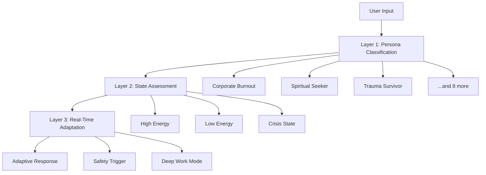

# Deep Analysis: Truly Transformational Daily Flow for Millions of Diverse Users

## Executive Overview

After analyzing all 11 personas and the infrastructure, here's a comprehensive framework for making ConsciousOS truly transformational at scale.

---

## Part 1: The 11 Personas - A Deeper Look

### Persona Matrix at a Glance

| Persona | Primary Need | Time Available | V-Level Range | Key Sensitivity | Preferred Tone |
|---------|--------------|----------------|---------------|-----------------|----------------|
| **Corporate Burnout** | Stress relief, practical tools | 10-15 min/day | V1-V2 | Being told to "just relax" | Direct, no fluff |
| **Spiritual Seeker** | Depth, wisdom integration | 30+ min/day | V2-V3 | Spiritual bypassing | Contemplative |
| **Trauma Survivor** | Safety, gentle pacing | Variable | V1 (with V2 moments) | Re-traumatization | Warm, validating |
| **Curious Skeptic** | Evidence, science | 5-15 min/day | V0-V1 | "Woo-woo" language | Direct, curious |
| **Parent with Kids** | Micro-moments, guilt-free | 1-5 min chunks | V1-V2 | Guilt about self-care | Understanding |
| **Retired Explorer** | Purpose, connection | 15-30 min/day | V2-V3 | Technology frustration | Gentle, unhurried |
| **Creative Blocked Artist** | Unblock, inspiration | Variable | V2 (with V3 moments) | Perfectionism | Encouraging |
| **College Student** | Focus, exam stress | 5-10 min/day | V1-V2 | Overwhelm | Casual, relatable |
| **Chronic Pain Sufferer** | Pain management | Gentle practices | V1 (with V2 moments) | Pushing too hard | Compassionate |
| **Social Justice Activist** | Resilience, hope | Variable | V2-V3 | Hopelessness | Honoring anger/grief |
| **Tech Entrepreneur** | Decision clarity | 5-10 min/day | V1-V2 | Wasting time | Practical, efficient |

---

## Part 2: The Challenge of Millions

### The Paradox of Personalization at Scale

```
┌─────────────────────────────────────────────────────────────────────────────┐
│                     THE MILLION-USER PARADOX                                 │
├─────────────────────────────────────────────────────────────────────────────┤
│                                                                              │
│  EXPECTATION:                                                                │
│  "We need to personalize for EVERY user individually"                       │
│                                                                              │
│  REALITY:                                                                    │
│  ├── Computing power is finite                                               │
│  ├── AI tokens cost money                                                    │
│  └── User attention is limited                                               │
│                                                                              │
│  SOLUTION:                                                                   │
│  ├── Cluster-based personas (macro-level)                                    │
│  ├── Adaptive parameters within clusters (micro-level)                       │
│  ├── User behavioral signals (real-time)                                    │
│  └── Hierarchical personalization                                           │
│                                                                              │
└─────────────────────────────────────────────────────────────────────────────┘
```

### Scalable Architecture: The 3-Layer Model



---

## Part 3: Edge Cases That Break Typical Apps

### Critical Edge Cases

```yaml
EDGE_CASES:
  
  # User states that require special handling
  CRISIS_STATE:
    detection: "Language indicating self-harm, severe depression, panic"
    response: "Immediate safety protocol, crisis resources, human handoff"
    priority: "CRITICAL - overrides all other logic"
    
  SPIRITUAL_EMERGENCY:
    detection: "User reports dissociation,桃花 experiences, ego death without preparation"
    response: "Grounding protocol, normalize experience, recommend professional support"
    priority: "HIGH - can be destabilizing"
    
  LOOP_AMPLIFICATION:
    detection: "User going in circles, same pattern repeated 5+ times"
    response: "Gentle interruption, offer different approach, check safety"
    priority: "MEDIUM - reduces effectiveness"
    
  PLATEAU:
    detection: "No progress in 30+ days, same V-level, low engagement"
    response: "Offer new perspective, challenge gently, check for avoidance"
    priority: "MEDIUM - affects retention"
    
  REGRESSION:
    detection: "User reports increased distress, worse than baseline"
    response: "Check for life events, reduce intensity, offer safety"
    priority: "HIGH - may need professional support"
    
  OVERIDENTIFICATION:
    detection: "User overly attached to spiritual experiences or V-level"
    response: "Point to non-attachment, redirect to presence, catch ego games"
    priority: "MEDIUM - spiritual bypassing"
    
  PHYSICAL_PAIN_SPIKE:
    detection: "Chronic pain user reports sudden increase"
    response: "Offer pain management, check for grounding, reduce physical practices"
    priority: "MEDIUM - comfort issue"
    
  RESISTANCE:
    detection: "Consistent skipping, negative language, avoidance patterns"
    response: "Explore gently, offer different approach, never force"
    priority: "LOW-MEDIUM - natural part of process"
```

### Edge Case Detection Flow

```
┌─────────────────────────────────────────────────────────────────────────────┐
│                     REAL-TIME EDGE CASE DETECTION                            │
├─────────────────────────────────────────────────────────────────────────────┤
│                                                                              │
│   User Input (check-in, journal, chat)                                      │
│              │                                                                │
│              ▼                                                                │
│   ┌─────────────────────────────────────────────────────────────────┐       │
│   │                    AI SENTIMENT ANALYSIS                        │       │
│   ├─────────────────────────────────────────────────────────────────┤       │
│   │                                                                  │       │
│   │  POSITIVE          NEUTRAL           CONCERNING        CRISIS   │       │
│   │     │                 │                   │               │    │       │
│   │     ▼                 ▼                   ▼               ▼    │       │
│   │  Continue        Standard          Edge Case         Safety   │       │
│   │  adaptive        response          protocol         protocol   │       │
│   │                                                                  │       │
│   └─────────────────────────────────────────────────────────────────┘       │
│                                                                              │
│   CONCERNING includes:                                                       │
│   ├── Depression indicators      │   Loop amplification                    │
│   ├── Anxiety spikes             │   Overwhelm signals                     │
│   ├── Pain increases             │   Resistance patterns                   │
│   └── Spiritual crisis           │   Regression signs                      │
│                                                                              │
└─────────────────────────────────────────────────────────────────────────────┘
```

---

## Part 4: Making It Truly Transformational

### The Transformation Framework

```
┌─────────────────────────────────────────────────────────────────────────────┐
│                     THE TRANSFORMATIONAL LOOP                               │
├─────────────────────────────────────────────────────────────────────────────┤
│                                                                              │
│         ┌─────────────────────────────────────────────────────┐              │
│         │                                                     │              │
│         │   AWARENESS → INSIGHT → CHOOSING → ACTING →       │              │
│         │                                 INTEGRATING        │              │
│         │                                                     │              │
│         └─────────────────────────────────────────────────────┘              │
│                                   │                                          │
│                                   ▼                                          │
│   ┌─────────────────────────────────────────────────────────────────┐         │
│   │                    TRANSFORMATION INDICATORS                    │         │
│   ├─────────────────────────────────────────────────────────────────┤         │
│   │                                                                  │         │
│   │  AWARENESS:    "I notice when my loop activates"               │         │
│   │  INSIGHT:      "I understand WHY this pattern exists"            │         │
│   │  CHOOSING:     "I can choose differently in the moment"         │         │
│   │  ACTING:       "I respond instead of react"                     │         │
│   │  INTEGRATING:  "This change STICKS - it's now natural"          │         │
│   │                                                                  │         │
│   └─────────────────────────────────────────────────────────────────┘         │
│                                                                              │
│   THE KEY DIFFERENCE:                                                        │
│   Most apps stop at AWARENESS. ConsciousOS goes all the way to INTEGRATION. │
│                                                                              │
└─────────────────────────────────────────────────────────────────────────────┘
```

### How Each Persona Experiences Transformation

| Persona | Current State | Transformation Goal | Key Shift |
|---------|---------------|---------------------|-----------|
| **Corporate Burnout** | "I am my work" | "I am awareness that experiences work" | Identity shift from doing to being |
| **Spiritual Seeker** | "I need to achieve enlightenment" | "There is no one to achieve anything" | Dropping the spiritual ego |
| **Trauma Survivor** | "I am damaged" | "I am whole, even with wounds" | Safety from within |
| **Curious Skeptic** | "Show me the evidence" | "Experience is its own evidence" | From mind to direct experience |
| **Parent with Kids** | "I have no time for myself" | "Every moment is practice" | Integration of practice and life |
| **Retired Explorer** | "My life had purpose through work" | "My being itself has purpose" | Purpose beyond role |
| **Creative Blocked Artist** | "I'm not creative enough" | "Creativity flows through me" | Trust in the process |
| **College Student** | "My worth is my grades" | "My worth is inherent" | Performance to being |
| **Chronic Pain Sufferer** | "Pain defines my life" | "I am aware of pain, but not limited by it" | Pain as teacher, not enemy |
| **Social Justice Activist** | "I must fix the world" | "I can hold the tension of 'is' and 'could be'" | Sustainable activism |
| **Tech Entrepreneur** | "Success = startup metrics" | "Success = presence and peace" | Metrics to awareness |

---

## Part 5: The Flexible Daily Flow - Persona-Adaptive

### The "Living Schedule" Concept

Instead of rigid time slots, the flow follows the user's life:

```
┌─────────────────────────────────────────────────────────────────────────────┐
│                     THE LIVING SCHEDULE - PERSONA-ADAPTIVE                    │
├─────────────────────────────────────────────────────────────────────────────┤
│                                                                              │
│   ENTRY POINT: User opens app                                                │
│              │                                                               │
│              ▼                                                               │
│   ┌─────────────────────────────────────────────────────────────────┐       │
│   │                    WHAT'S ALIVE FOR YOU?                        │       │
│   ├─────────────────────────────────────────────────────────────────┤       │
│   │                                                                  │       │
│   │   ○ I want a practice                                            │       │
│   │   ○ I want to reflect/inquire                                    │       │
│   │   ○ I want guidance from the Guru                               │       │
│   │   ○ I want to see where I am                                     │       │
│   │   ○ Just check in briefly                                        │       │
│   │   ○ I'm in crisis / overwhelmed                                   │       │
│   │                                                                  │       │
│   └─────────────────────────────────────────────────────────────────┘       │
│              │                                                               │
│              │ AI selects from 11 persona-specific pathways                │
│              ▼                                                               │
│   ┌─────────────────────────────────────────────────────────────────┐       │
│   │              ADAPTIVE PATHWAY BASED ON PERSONA                   │       │
│   ├─────────────────────────────────────────────────────────────────┤       │
│   │                                                                  │       │
│   │  CORPORATE BURNOUT → "Quick reset. What's your top stressor?"   │       │
│   │  SPIRITUAL SEEKER → "What inquiry is alive for you?"           │       │
│   │  TRAUMA SURVIVOR → "How are you feeling? Safe?"                 │       │
│   │  CURIOUS SKEPTIC → "What would evidence look like today?"       │       │
│   │  PARENT WITH KIDS → "Got 2 minutes? Here's a micro-practice."    │       │
│   │  RETIRED EXPLORER → "Take your time. What's on your mind?"      │       │
│   │  CREATIVE ARTIST → "What's wanting to flow through you?"        │       │
│   │  COLLEGE STUDENT → "Focus reset before your next study sesh?"   │       │
│   │  CHRONIC PAIN → "Gentle awareness of body, as you can."         │       │
│   │  ACTIVIST → "Honoring your grief while sustaining hope."        │       │
│   │  TECH ENTREPRENEUR → "Decision clarity or stress reset?"        │       │
│   │                                                                  │       │
│   └─────────────────────────────────────────────────────────────────┘       │
│                                                                              │
└─────────────────────────────────────────────────────────────────────────────┘
```

### Persona-Specific "What's Alive" Questions

| Persona | Entry Question | Deep Follow-up |
|---------|---------------|----------------|
| **Corporate Burnout** | "What's your top stressor right now?" | "Where does this show up in your body?" |
| **Spiritual Seeker** | "What inquiry wants attention?" | "What dissolves when you look directly?" |
| **Trauma Survivor** | "How does your body feel right now?" | "Is there anything that needs extra gentleness today?" |
| **Curious Skeptic** | "What would you like to test/explore today?" | "What evidence would convince you?" |
| **Parent with Kids** | "How's the chaos level?" | "What's one micro-moment you could claim?" |
| **Retired Explorer** | "What brings you joy today?" | "What would make today meaningful?" |
| **Creative Blocked Artist** | "What wants to be created?" | "What block is really about?" |
| **College Student** | "What's your biggest academic pressure?" | "What's one thing you CAN control?" |
| **Chronic Pain Sufferer** | "Gentle check-in: how's your body today?" | "Where can you offer yourself compassion?" |
| **Social Justice Activist** | "What's weighing on you about the world?" | "How can you hold hope and grief together?" |
| **Tech Entrepreneur** | "Decision clarity or stress relief?" | "What's the one decision that matters most?" |

---

## Part 6: Cultural & Accessibility Adaptation

### Cultural Sensitivity Layers

```yaml
CULTURAL_ADAPTATIONS:
  
  LANGUAGE_STYLE:
    western_individualistic:
      - Focus on "I" and personal journey
      - Achievement-oriented language
      - Direct communication
      
    eastern_collectivist:
      - Connection to tradition and lineage
      - Wisdom transmission language
      - Respectful, humble tone
      
    african_community:
      - Community and ancestral connection
      - Oral tradition feel
      - Storytelling approach
      
    latin_emotional:
      - Heart-centered language
      - Passion and feeling focus
      - Warm, expressive tone
      
  SPIRITUAL_TERMINOLOGY:
    buddhist_oriented:
      - Use: awareness, Buddha-nature, mindfulness, śūnyatā
      - Avoid: God, Christian sins, Hindu-specific terms
      
    hindu_oriented:
      - Use: Ātman, dharma, karma, śiva-consciousness
      - Avoid: Christian sins, Buddhist-specific terms
      
    secular_western:
      - Use: awareness, presence, attention, consciousness
      - Avoid: All religious/spiritual terminology
      
    new_age:
      - Use: ascension, light workers, galactic, energy
      - Adapt carefully to avoid appropriation
      
  ACCESSIBILITY:
    visual_impairment:
      - Full screen reader support
      - Audio-first options
      - High contrast mode
      
    hearing_impairment:
      - Transcripts for all audio
      - Visual cues for sounds
      - Haptic feedback
      
    motor_impairment:
      - Voice control
      - Large touch targets
      - Eye tracking support
      
    cognitive:
      - Simple language by default
      - Predictable navigation
      - Reduced sensory input options
```

---

## Part 7: The Transformation Tracking System

### Measuring Real Change (Not Just Engagement)

```yaml
TRANSFORMATION_METRICS:
  
  SHORT_TERM (0-30 days):
    engagement_metrics:
      - Sessions completed
      - Time in app
      - Streak maintenance
      
    immediate_relief:
      - Stress reduction (pre/post)
      - Mood improvement
      - Sleep quality
      
  MEDIUM_TERM (30-180 days):
    capacity_growth:
      - H-Level increases
      - Self-reported presence
      - Observer perspective
      
    pattern_recognition:
      - Loop identification accuracy
      - Moment-of-choice awareness
      - Response vs reaction
      
  LONG_TERM (180+ days):
    life_integration:
      - Domain health improvements
      - Relationship quality
      - Work/life balance
      
    identity_shift:
      - Self-concept changes
      - Values clarification
      - Purpose alignment
      
    integration_indicators:
      - Less reactivity
      - More equanimity
      - Deeper contentment
```

---

## Part 8: The Safety Net - Crisis & Edge Case Handling

### Crisis Protocol Flow

```
┌─────────────────────────────────────────────────────────────────────────────┐
│                     CRISIS PROTOCOL FLOW                                     │
├─────────────────────────────────────────────────────────────────────────────┤
│                                                                              │
│   DETECTION TRIGGERS:                                                        │
│   ├── "I want to hurt myself"                                               │
│   ├── "I can't go on anymore"                                               │
│   ├── Severe dissociation                                                    │
│   ├── Panic attack indicators                                               │
│   └── Trauma flashback signals                                               │
│                                                                              │
│   ┌─────────────────────────────────────────────────────────────────┐       │
│   │                    IMMEDIATE RESPONSE                           │       │
│   ├─────────────────────────────────────────────────────────────────┤       │
│   │                                                                  │       │
│   │  STEP 1: Pause all AI content                                   │       │
│   │  STEP 2: Show crisis resources (988, international options)     │       │
│   │  STEP 3: Offer human connection (crisis counselor callback)     │       │
│   │  STEP 4: Grounding exercise (5-4-3-2-1)                        │       │
│   │  STEP 5: Follow-up check-in (24h, 48h, 1 week)                 │       │
│   │                                                                  │       │
│   └─────────────────────────────────────────────────────────────────┘       │
│                                                                              │
│   ESCALATION PATH:                                                           │
│   AI → Trained counselor (if available) → Professional referral           │
│                                                                              │
└─────────────────────────────────────────────────────────────────────────────┘
```

---

## Summary: The Truly Transformational System

### What Makes This Different from Other Apps

| Feature | Typical Wellness App | ConsciousOS |
|---------|---------------------|-------------|
| Personalization | Demographic-based | Behavior + State + History |
| Progress Tracking | Sessions completed | Capacity growth + Loop integration |
| Crisis Handling | None | Real-time detection + protocol |
| Adaptability | Static personas | Dynamic, learns from behavior |
| Transformation Focus | Symptom relief | Root cause + lasting change |
| Cultural Sensitivity | Western default | Multi-cultural by design |
| Accessibility | Basic | Comprehensive |
| Scalability | Generic content | AI-personalized at scale |

### The Core Promise

> **"ConsciousOS meets you exactly where you are—**
> **with your specific history, needs, and aspirations—**
> **and guides you toward awakening at your own pace,**
> **in your own way,**
> **without pressure, without dogma,**
> **and with complete respect for your journey."**

### Key Implementation Priorities

1. **Persona Detection**: Automatic classification from onboarding + behavior
2. **Edge Case Detection**: Real-time crisis + resistance identification
3. **Flexible Flow**: Activity-based, not time-based
4. **Deep Work Mode**: When something is alive, go deeper
5. **Safety First**: Crisis protocol overrides everything
6. **Cultural Adaptation**: Language + approach changes per user
7. **Transformation Tracking**: Measure what actually matters
8. **Scale Architecture**: Cluster-based personas with individual adaptation