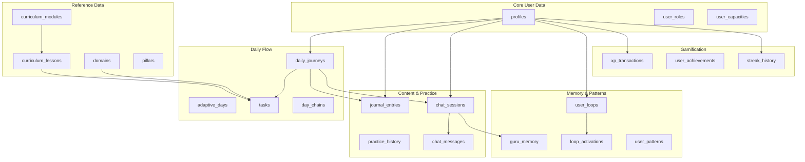

# Supabase Schema Documentation

## Overview

This document details the database schema used by ConsciousOS, including table structures, relationships, indexes, and the operations performed during the 100-150 day E2E simulation.

## Schema Architecture



## Core Tables

### 1. profiles

**Purpose**: Core user profile and progress tracking

**Schema**:
```sql
CREATE TABLE profiles (
  id UUID PRIMARY KEY DEFAULT gen_random_uuid(),
  user_id UUID NOT NULL UNIQUE REFERENCES auth.users(id) ON DELETE CASCADE,
  
  -- Identity
  display_name TEXT,
  avatar_url TEXT,
  
  -- Progress
  xp INTEGER NOT NULL DEFAULT 0,
  level INTEGER NOT NULL DEFAULT 1,
  consciousness_level INTEGER NOT NULL DEFAULT 1,
  v_level INTEGER DEFAULT 1,
  v_level_name TEXT DEFAULT 'Awakening Seeker',
  
  -- Streak
  streak INTEGER NOT NULL DEFAULT 0,
  longest_streak INTEGER DEFAULT 0,
  streak_freezes INTEGER DEFAULT 3,
  
  -- Mode
  journey_path TEXT DEFAULT 'structured',
  curriculum_mode BOOLEAN NOT NULL DEFAULT false,
  adaptive_mode BOOLEAN DEFAULT false,
  
  -- Onboarding
  onboarding_completed BOOLEAN NOT NULL DEFAULT false,
  assessment_answers JSONB,
  
  -- Timestamps
  created_at TIMESTAMPTZ NOT NULL DEFAULT NOW(),
  updated_at TIMESTAMPTZ NOT NULL DEFAULT NOW()
);

-- Indexes
CREATE INDEX idx_profiles_user_id ON profiles(user_id);
CREATE INDEX idx_profiles_level ON profiles(level);
```

**RLS Policies**:
```sql
CREATE POLICY "Users can view own profile"
  ON profiles FOR SELECT USING (auth.uid() = user_id);

CREATE POLICY "Users can update own profile"
  ON profiles FOR UPDATE USING (auth.uid() = user_id);
```

**E2E Queries Observed**:
```sql
-- Fetch user progress
SELECT level, xp, streak, v_level FROM profiles WHERE user_id = $1;

-- Update XP
UPDATE profiles SET xp = xp + $2, updated_at = NOW() WHERE user_id = $1;

-- Level progression
UPDATE profiles 
SET level = $2, updated_at = NOW() 
WHERE user_id = $1 AND level < $2;
```

---

### 2. daily_journeys

**Purpose**: Daily journey record for structured mode

**Schema**:
```sql
CREATE TYPE journey_status AS ENUM (
  'morning_pending',
  'tasks_active', 
  'evening_pending',
  'practice_pending',
  'completed'
);

CREATE TABLE daily_journeys (
  id UUID PRIMARY KEY DEFAULT gen_random_uuid(),
  user_id UUID NOT NULL REFERENCES auth.users(id) ON DELETE CASCADE,
  date DATE NOT NULL DEFAULT CURRENT_DATE,
  
  -- Sessions
  morning_session_id UUID REFERENCES chat_sessions(id),
  evening_session_id UUID REFERENCES chat_sessions(id),
  
  -- Status
  status journey_status NOT NULL DEFAULT 'morning_pending',
  
  -- Morning data
  theme TEXT,
  mood TEXT,
  intention TEXT,
  analysis JSONB,
  
  -- Practice
  practice_type practice_type,
  practice_duration INTEGER,
  practice_completed BOOLEAN DEFAULT false,
  
  -- Timestamps
  created_at TIMESTAMPTZ NOT NULL DEFAULT NOW(),
  updated_at TIMESTAMPTZ NOT NULL DEFAULT NOW(),
  
  -- Constraints
  CONSTRAINT daily_journeys_user_date_unique UNIQUE (user_id, date)
);

-- Indexes
CREATE INDEX idx_daily_journeys_user_date ON daily_journeys(user_id, date);
CREATE INDEX idx_daily_journeys_status ON daily_journeys(status);
```

**RLS Policies**:
```sql
CREATE POLICY "Users can manage own journeys"
  ON daily_journeys FOR ALL
  USING (auth.uid() = user_id);
```

**E2E Queries Observed**:
```sql
-- Create daily journey
INSERT INTO daily_journeys (user_id, date, status)
VALUES ($1, CURRENT_DATE, 'morning_pending')
ON CONFLICT (user_id, date) DO NOTHING;

-- Update morning session
UPDATE daily_journeys 
SET morning_session_id = $2, status = 'tasks_active'
WHERE id = $1;

-- Aggregate day data for evening
SELECT 
  dj.mood, dj.intention, dj.analysis,
  COUNT(t.id) FILTER (WHERE t.status = 'completed') as completed_tasks,
  COUNT(t.id) FILTER (WHERE t.status = 'skipped') as skipped_tasks,
  COALESCE(SUM(t.xp_reward) FILTER (WHERE t.status = 'completed'), 0) as xp_earned
FROM daily_journeys dj
LEFT JOIN tasks t ON t.journey_id = dj.id
WHERE dj.user_id = $1 AND dj.date = CURRENT_DATE
GROUP BY dj.id;
```

---

### 3. tasks

**Purpose**: Daily tasks generated for structured mode

**Schema**:
```sql
CREATE TYPE task_status AS ENUM (
  'pending',
  'in_progress',
  'completed',
  'skipped'
);

CREATE TYPE time_segment AS ENUM (
  'morning',
  'afternoon',
  'evening',
  'night'
);

CREATE TABLE tasks (
  id UUID PRIMARY KEY DEFAULT gen_random_uuid(),
  journey_id UUID NOT NULL REFERENCES daily_journeys(id) ON DELETE CASCADE,
  domain_id UUID NOT NULL REFERENCES domains(id),
  user_id UUID NOT NULL REFERENCES auth.users(id) ON DELETE CASCADE,
  
  -- Curriculum linkage
  lesson_id UUID REFERENCES curriculum_lessons(id),
  pillar_id UUID REFERENCES pillars(id),
  
  -- Content
  title TEXT NOT NULL,
  description TEXT,
  duration_minutes INTEGER NOT NULL DEFAULT 15,
  xp_reward INTEGER NOT NULL DEFAULT 10,
  
  -- Status
  status task_status NOT NULL DEFAULT 'pending',
  time_segment time_segment NOT NULL DEFAULT 'morning',
  sequence_order INTEGER,
  is_current BOOLEAN DEFAULT false,
  
  -- Completion
  ai_response TEXT,
  feedback TEXT,
  reflection TEXT,
  completed_at TIMESTAMPTZ,
  
  -- Timestamps
  created_at TIMESTAMPTZ NOT NULL DEFAULT NOW(),
  updated_at TIMESTAMPTZ NOT NULL DEFAULT NOW()
);

-- Indexes
CREATE INDEX idx_tasks_journey ON tasks(journey_id);
CREATE INDEX idx_tasks_user_status ON tasks(user_id, status);
CREATE INDEX idx_tasks_time_segment ON tasks(time_segment);
```

**E2E Queries Observed**:
```sql
-- Insert generated tasks
INSERT INTO tasks (journey_id, domain_id, user_id, title, description, 
                   duration_minutes, xp_reward, time_segment)
VALUES ($1, $2, $3, $4, $5, $6, $7, $8);

-- Mark task complete
UPDATE tasks 
SET status = 'completed', completed_at = NOW(), reflection = $2
WHERE id = $1;

-- Get today's tasks
SELECT t.*, d.name as domain_name, d.color as domain_color
FROM tasks t
JOIN domains d ON d.id = t.domain_id
WHERE t.journey_id = $1
ORDER BY t.sequence_order;

-- Task completion stats
SELECT 
  time_segment,
  COUNT(*) FILTER (WHERE status = 'completed') as completed,
  COUNT(*) FILTER (WHERE status = 'skipped') as skipped,
  COUNT(*) as total
FROM tasks
WHERE user_id = $1 AND created_at > NOW() - INTERVAL '7 days'
GROUP BY time_segment;
```

---

### 4. journal_entries

**Purpose**: User journal entries

**Schema**:
```sql
CREATE TABLE journal_entries (
  id UUID PRIMARY KEY DEFAULT gen_random_uuid(),
  user_id UUID NOT NULL REFERENCES auth.users(id) ON DELETE CASCADE,
  journey_id UUID REFERENCES daily_journeys(id) ON DELETE SET NULL,
  pillar_id UUID REFERENCES pillars(id),
  
  -- Content
  content TEXT NOT NULL,
  mood TEXT,
  tags JSONB,
  word_count INTEGER,
  
  -- Entry type
  entry_type TEXT DEFAULT 'general', -- 'morning', 'evening', 'midday_presence', 'dream'
  
  -- AI analysis
  ai_insights JSONB,
  extracted_themes TEXT[],
  
  -- Timestamps
  created_at TIMESTAMPTZ NOT NULL DEFAULT NOW(),
  updated_at TIMESTAMPTZ NOT NULL DEFAULT NOW()
);

-- Indexes
CREATE INDEX idx_journal_entries_user_date ON journal_entries(user_id, created_at DESC);
CREATE INDEX idx_journal_entries_journey ON journal_entries(journey_id);
```

---

### 5. chat_sessions

**Purpose**: Guru chat sessions

**Schema**:
```sql
CREATE TABLE chat_sessions (
  id UUID PRIMARY KEY DEFAULT gen_random_uuid(),
  user_id UUID NOT NULL REFERENCES auth.users(id) ON DELETE CASCADE,
  
  -- Session metadata
  session_type TEXT NOT NULL DEFAULT 'general', -- 'morning', 'evening', 'loop_inquiry'
  phase TEXT, -- 'morning', 'midday', 'evening', 'night'
  
  -- Context
  context_data JSONB, -- Aggregated context used
  
  -- Timestamps
  created_at TIMESTAMPTZ NOT NULL DEFAULT NOW(),
  ended_at TIMESTAMPTZ
);

-- Indexes
CREATE INDEX idx_chat_sessions_user ON chat_sessions(user_id, created_at DESC);
```

---

### 6. chat_messages

**Purpose**: Individual messages within chat sessions

**Schema**:
```sql
CREATE TABLE chat_messages (
  id UUID PRIMARY KEY DEFAULT gen_random_uuid(),
  session_id UUID NOT NULL REFERENCES chat_sessions(id) ON DELETE CASCADE,
  user_id UUID NOT NULL REFERENCES auth.users(id) ON DELETE CASCADE,
  
  -- Message content
  role TEXT NOT NULL, -- 'user', 'assistant', 'system'
  content TEXT NOT NULL,
  
  -- Metadata
  tokens_used INTEGER,
  latency_ms INTEGER,
  model TEXT,
  
  -- Timestamps
  created_at TIMESTAMPTZ NOT NULL DEFAULT NOW()
);

-- Indexes
CREATE INDEX idx_chat_messages_session ON chat_messages(session_id, created_at);
```

**E2E Queries Observed**:
```sql
-- Store AI conversation
INSERT INTO chat_sessions (user_id, session_type, phase, context_data)
VALUES ($1, $2, $3, $4)
RETURNING id;

INSERT INTO chat_messages (session_id, user_id, role, content, tokens_used, latency_ms, model)
VALUES ($1, $2, $3, $4, $5, $6, $7);

-- Retrieve conversation history
SELECT * FROM chat_messages 
WHERE session_id = $1 
ORDER BY created_at;
```

---

### 7. guru_memory

**Purpose**: AI-processed memories for context

**Schema**:
```sql
CREATE TABLE guru_memory (
  id UUID PRIMARY KEY DEFAULT gen_random_uuid(),
  user_id UUID NOT NULL REFERENCES auth.users(id) ON DELETE CASCADE,
  session_id UUID REFERENCES chat_sessions(id),
  
  -- Content
  content TEXT NOT NULL,
  full_content TEXT,
  embedding VECTOR(1536),
  
  -- Metadata
  tags TEXT[],
  importance INTEGER CHECK (importance BETWEEN 1 AND 10),
  emotional_tone TEXT,
  memory_type TEXT,
  
  -- Relationships
  linked_loops UUID[],
  related_memories UUID[],
  
  -- Access tracking
  created_at TIMESTAMPTZ DEFAULT NOW(),
  accessed_at TIMESTAMPTZ,
  access_count INTEGER DEFAULT 0
);

-- Indexes
CREATE INDEX idx_guru_memory_user_date ON guru_memory(user_id, created_at DESC);
CREATE INDEX idx_guru_memory_importance ON guru_memory(user_id, importance DESC);
```

---

### 8. user_loops

**Purpose**: User's psychological pattern tracking

**Schema**:
```sql
CREATE TABLE user_loops (
  id UUID PRIMARY KEY DEFAULT gen_random_uuid(),
  user_id UUID NOT NULL REFERENCES auth.users(id) ON DELETE CASCADE,
  
  pattern_name TEXT NOT NULL,
  pattern_type TEXT, -- 'origin', 'worth', 'safety', 'power', 'connection', 'identity', 'shadow'
  
  status TEXT DEFAULT 'active', -- 'active', 'resolving', 'dissolved'
  dissolution_progress INTEGER DEFAULT 0 CHECK (dissolution_progress BETWEEN 0 AND 100),
  
  inquiries_completed INTEGER DEFAULT 0,
  insights_gained TEXT[],
  
  first_detected_at TIMESTAMPTZ DEFAULT NOW(),
  detection_source TEXT,
  
  intensity_history JSONB[],
  
  created_at TIMESTAMPTZ DEFAULT NOW(),
  updated_at TIMESTAMPTZ DEFAULT NOW()
);

-- Indexes
CREATE INDEX idx_user_loops_user_status ON user_loops(user_id, status);
```

---

### 9. xp_transactions

**Purpose**: XP audit trail

**Schema**:
```sql
CREATE TABLE xp_transactions (
  id UUID PRIMARY KEY DEFAULT gen_random_uuid(),
  user_id UUID NOT NULL REFERENCES auth.users(id) ON DELETE CASCADE,
  
  amount INTEGER NOT NULL,
  source TEXT NOT NULL, -- 'task_complete', 'practice_complete', 'journal_entry', etc.
  source_id UUID, -- Reference to triggering entity
  
  balance_after INTEGER NOT NULL,
  
  metadata JSONB,
  
  created_at TIMESTAMPTZ NOT NULL DEFAULT NOW()
);

-- Indexes
CREATE INDEX idx_xp_transactions_user ON xp_transactions(user_id, created_at DESC);
```

---

### 10. practice_history

**Purpose**: Practice completion tracking

**Schema**:
```sql
CREATE TABLE practice_history (
  id UUID PRIMARY KEY DEFAULT gen_random_uuid(),
  user_id UUID NOT NULL REFERENCES auth.users(id) ON DELETE CASCADE,
  
  practice_type practice_type NOT NULL,
  title TEXT,
  duration_seconds INTEGER,
  
  completed_at TIMESTAMPTZ NOT NULL DEFAULT NOW(),
  
  metadata JSONB
);

-- Indexes
CREATE INDEX idx_practice_history_user ON practice_history(user_id, completed_at DESC);
```

---

## Reference Tables

### curriculum_modules

```sql
CREATE TABLE curriculum_modules (
  id UUID PRIMARY KEY DEFAULT gen_random_uuid(),
  name TEXT NOT NULL,
  subtitle TEXT NOT NULL,
  description TEXT NOT NULL,
  icon TEXT NOT NULL,
  color TEXT NOT NULL,
  duration_days INTEGER NOT NULL DEFAULT 14,
  order_index INTEGER NOT NULL,
  created_at TIMESTAMPTZ NOT NULL DEFAULT NOW()
);
```

### curriculum_lessons

```sql
CREATE TABLE curriculum_lessons (
  id UUID PRIMARY KEY DEFAULT gen_random_uuid(),
  module_id UUID NOT NULL REFERENCES curriculum_modules(id),
  pillar_id UUID NOT NULL REFERENCES pillars(id),
  title TEXT NOT NULL,
  teaching_content TEXT NOT NULL,
  practice_instructions JSONB DEFAULT '[]',
  reflection_prompts JSONB DEFAULT '[]',
  tasks JSONB DEFAULT '[]',
  practice_duration_minutes INTEGER NOT NULL DEFAULT 15,
  order_index INTEGER NOT NULL,
  created_at TIMESTAMPTZ NOT NULL DEFAULT NOW()
);
```

### domains

```sql
CREATE TABLE domains (
  id UUID PRIMARY KEY DEFAULT gen_random_uuid(),
  name TEXT NOT NULL UNIQUE,
  icon TEXT NOT NULL,
  color TEXT NOT NULL,
  description TEXT NOT NULL,
  created_at TIMESTAMPTZ NOT NULL DEFAULT NOW()
);
```

### pillars

```sql
CREATE TABLE pillars (
  id UUID PRIMARY KEY DEFAULT gen_random_uuid(),
  name TEXT NOT NULL,
  sanskrit TEXT NOT NULL,
  description TEXT NOT NULL,
  icon TEXT NOT NULL,
  color TEXT NOT NULL,
  order_index INTEGER NOT NULL,
  created_at TIMESTAMPTZ NOT NULL DEFAULT NOW()
);
```

---

## Database Functions

### calculate_level_from_xp

```sql
CREATE OR REPLACE FUNCTION calculate_level_from_xp(xp_amount INTEGER)
RETURNS INTEGER AS $$
BEGIN
  RETURN GREATEST(1, FLOOR(xp_amount / 100)::INTEGER + 1);
END;
$$ LANGUAGE plpgsql;
```

### update_updated_at_column

```sql
CREATE OR REPLACE FUNCTION update_updated_at_column()
RETURNS TRIGGER AS $$
BEGIN
  NEW.updated_at = NOW();
  RETURN NEW;
END;
$$ LANGUAGE plpgsql;
```

---

## Triggers

```sql
-- Auto-update updated_at
CREATE TRIGGER update_profiles_updated_at
  BEFORE UPDATE ON profiles
  FOR EACH ROW EXECUTE FUNCTION update_updated_at_column();

CREATE TRIGGER update_daily_journeys_updated_at
  BEFORE UPDATE ON daily_journeys
  FOR EACH ROW EXECUTE FUNCTION update_updated_at_column();

CREATE TRIGGER update_tasks_updated_at
  BEFORE UPDATE ON tasks
  FOR EACH ROW EXECUTE FUNCTION update_updated_at_column();
```

---

## E2E Test Validation Queries

```sql
-- Verify daily journey creation
SELECT date, status, COUNT(*) 
FROM daily_journeys 
WHERE user_id = 'test-user'
GROUP BY date, status;

-- Check task generation
SELECT time_segment, COUNT(*) as task_count
FROM tasks
WHERE journey_id IN (
  SELECT id FROM daily_journeys WHERE user_id = 'test-user'
)
GROUP BY time_segment;

-- Validate XP transactions
SELECT source, SUM(amount) as total_xp
FROM xp_transactions
WHERE user_id = 'test-user'
GROUP BY source;

-- Check memory storage
SELECT COUNT(*) as memory_count, AVG(importance) as avg_importance
FROM guru_memory
WHERE user_id = 'test-user';

-- Verify loop tracking
SELECT pattern_name, status, dissolution_progress
FROM user_loops
WHERE user_id = 'test-user';
```
